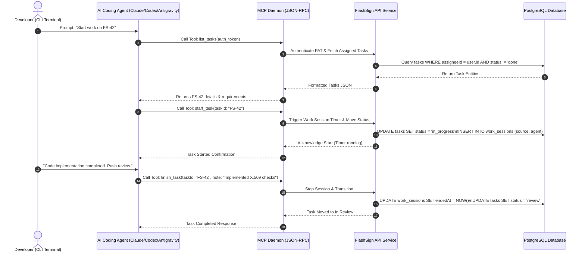
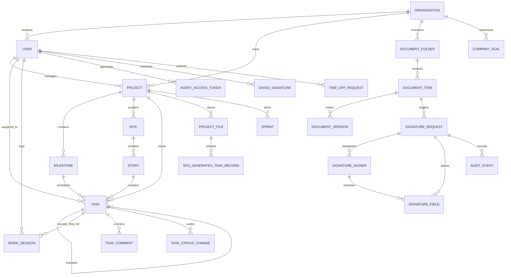

# Software Requirements Specification (SRS)
## FlashSign Unified Platform: Agile Project Management, AI Coding Agent Hub & Electronic Signatures

**Standard Alignment:** ISO/IEC/IEEE 29148:2018 Systems and software engineering — Life cycle processes — Requirements engineering  
**Document Version:** 1.0.0  
**Status:** Baseline Specification (Derived from Codebase Analysis & Working Prototype)  
**Date of Release:** October 2026  
**Target Platform:** Next.js 16 (App Router), React 19, TypeScript, Tailwind CSS v4, Express 5, PostgreSQL (Drizzle ORM), Model Context Protocol (MCP)  
**Security / Confidentiality:** Proprietary / Enterprise Internal

---

## Executive Table of Contents

- [Section 1: Introduction](#section-1-introduction)
  - [1.1 Purpose of the SRS](#11-purpose-of-the-srs)
  - [1.2 Scope of the Software Product](#12-scope-of-the-software-product)
  - [1.3 Product Objectives](#13-product-objectives)
  - [1.4 Intended Audience](#14-intended-audience)
  - [1.5 Definitions, Acronyms, and Abbreviations](#15-definitions-acronyms-and-abbreviations)
  - [1.6 Document Conventions](#16-document-conventions)
  - [1.7 References](#17-references)
  - [1.8 Document Organization](#18-document-organization)
- [Section 2: Overall Description](#section-2-overall-description)
  - [2.1 Product Perspective](#21-product-perspective)
  - [2.2 Product Context and System Boundaries](#22-product-context-and-system-boundaries)
  - [2.3 Product Functions Summary](#23-product-functions-summary)
  - [2.4 User Classes and Characteristics](#24-user-classes-and-characteristics)
  - [2.5 User Roles and Permissions](#25-user-roles-and-permissions)
  - [2.6 Operating Environment](#26-operating-environment)
  - [2.7 Technology Stack](#27-technology-stack)
  - [2.8 Design and Implementation Constraints](#28-design-and-implementation-constraints)
  - [2.9 Assumptions and Dependencies](#29-assumptions-and-dependencies)
  - [2.10 Existing System Limitations](#210-existing-system-limitations)
  - [2.11 Prototype Limitations and Production Gaps](#211-prototype-limitations-and-production-gaps)
- [Section 3: System Architecture and Components](#section-3-system-architecture-and-components)
  - [3.1 High-Level Architecture](#31-high-level-architecture)
  - [3.2 Frontend Architecture](#32-frontend-architecture)
  - [3.3 Backend Architecture and API Contracts](#33-backend-architecture-and-api-contracts)
  - [3.4 Data Storage and Persistence Mechanisms](#34-data-storage-and-persistence-mechanisms)
  - [3.5 External Integrations and Model Context Protocol (MCP)](#35-external-integrations-and-model-context-protocol-mcp)
  - [3.6 Authentication, Session, and Token Architecture](#36-authentication-session-and-token-architecture)
  - [3.7 Entity Relationships and Data Flow](#37-entity-relationships-and-data-flow)
- [Section 4: Functional Requirements](#section-4-functional-requirements)
  - [4.1 Module 1: Authentication & Organization Onboarding](#41-module-1-authentication--organization-onboarding)
  - [4.2 Module 2: Project Management & Workspace Portfolio](#42-module-2-project-management--workspace-portfolio)
  - [4.3 Module 3: Tasks, Kanban & Subtask Execution](#43-module-3-tasks-kanban--subtask-execution)
  - [4.4 Module 4: Dynamic Timeline, Sprints & Planning](#44-module-4-dynamic-timeline-sprints--planning)
  - [4.5 Module 5: SRS Document Analysis & Story Generation](#45-module-5-srs-document-analysis--story-generation)
  - [4.6 Module 6: AI Coding Agent Hub & MCP Integration](#46-module-6-ai-coding-agent-hub--mcp-integration)
  - [4.7 Module 7: Document Repository & Contract Management](#47-module-7-document-repository--contract-management)
  - [4.8 Module 8: Electronic Signature & Agreement Lifecycle](#48-module-8-electronic-signature--agreement-lifecycle)
  - [4.9 Module 9: Team Collaboration & Availability](#49-module-9-team-collaboration--availability)
  - [4.10 Module 10: Reports, Analytics & Auditing](#410-module-10-reports-analytics--auditing)
  - [4.11 Module 11: Settings, Seals & Governance](#411-module-11-settings-seals--governance)
- [Section 5: External Interface Requirements](#section-5-external-interface-requirements)
  - [5.1 User Interface Requirements](#51-user-interface-requirements)
  - [5.2 Hardware Interface Requirements](#52-hardware-interface-requirements)
  - [5.3 Software Interface Requirements](#53-software-interface-requirements)
  - [5.4 Communication Interface Requirements](#54-communication-interface-requirements)
  - [5.5 API Interface Requirements](#55-api-interface-requirements)
  - [5.6 Third-Party Integration Requirements](#56-third-party-integration-requirements)
- [Section 6: Non-Functional Requirements](#section-6-non-functional-requirements)
  - [6.1 Performance Requirements](#61-performance-requirements)
  - [6.2 Security Requirements](#62-security-requirements)
  - [6.3 Usability Requirements](#63-usability-requirements)
  - [6.4 Accessibility Requirements](#64-accessibility-requirements)
  - [6.5 Reliability and Availability Requirements](#65-reliability-and-availability-requirements)
  - [6.6 Maintainability Requirements](#66-maintainability-requirements)
  - [6.7 Compatibility and Portability Requirements](#67-compatibility-and-portability-requirements)
  - [6.8 Scalability Requirements](#68-scalability-requirements)
  - [6.9 Privacy and Data Protection Requirements](#69-privacy-and-data-protection-requirements)
  - [6.10 Data Integrity and Backup Requirements](#610-data-integrity-and-backup-requirements)
  - [6.11 Observability and Auditability Requirements](#611-observability-and-auditability-requirements)
- [Section 7: Data Requirements](#section-7-data-requirements)
  - [7.1 Data Entities and Attributes (Data Dictionary)](#71-data-entities-and-attributes-data-dictionary)
  - [7.2 Data Integrity and Validation Rules](#72-data-integrity-and-validation-rules)
  - [7.3 Persistence and Mock Data Mapping](#73-persistence-and-mock-data-mapping)
- [Section 8: User Workflows and Use Cases](#section-8-user-workflows-and-use-cases)
  - [8.1 UC-01: Organization Setup & Multi-Role Member Invitation](#81-uc-01-organization-setup--multi-role-member-invitation)
  - [8.2 UC-02: SRS Document Ingestion & AI Task Synthesis](#82-uc-02-srs-document-ingestion--ai-task-synthesis)
  - [8.3 UC-03: Multi-Board Kanban Task Execution & Guarded Transitions](#83-uc-03-multi-board-kanban-task-execution--guarded-transitions)
  - [8.4 UC-04: AI Coding Agent Work Session via MCP](#84-uc-04-ai-coding-agent-work-session-via-mcp)
  - [8.5 UC-05: Multi-Party Sequential Document Signing & Company Seal Application](#85-uc-05-multi-party-sequential-document-signing--company-seal-application)
- [Section 9: Business Rules and Constraints](#section-9-business-rules-and-constraints)
  - [9.1 Core Domain Business Rules (Confirmed from Code)](#91-core-domain-business-rules-confirmed-from-code)
  - [9.2 Architectural and Operational Constraints](#92-architectural-and-operational-constraints)
- [Section 10: Acceptance and Verification](#section-10-acceptance-and-verification)
  - [10.1 Verification Methods](#101-verification-methods)
  - [10.2 Requirements Traceability Matrix (RTM)](#102-requirements-traceability-matrix-rtm)
- [Section 11: Limitations, Gaps, and Recommendations](#section-11-limitations-gaps-and-recommendations)
  - [11.1 Prototype Gaps Catalog](#111-prototype-gaps-catalog)
  - [11.2 Production Roadmap Recommendations](#112-production-roadmap-recommendations)
- [Section 12: Appendices](#section-12-appendices)
  - [12.1 Requirement ID Index](#121-requirement-id-index)
  - [12.2 Route & Screen Inventory](#122-route--screen-inventory)
  - [12.3 Glossary](#123-glossary)
  - [12.4 Open Questions for Stakeholders](#124-open-questions-for-stakeholders)
  - [12.5 Codebase Inventory Reviewed](#125-codebase-inventory-reviewed)

---

# Section 1: Introduction

### 1.1 Purpose of the SRS
This Software Requirements Specification (SRS) establishes the formal, normative functional and non-functional requirements for the **FlashSign Unified Platform**. The document captures the complete architectural, algorithmic, behavioral, and data specifications derived through static code inspection of the working prototype (`flash-sign-proto`) and the underlying e-signature domain reference (`FLASH_SIGN_FEATURES.md` and `PROJECT_MANAGEMENT_REQUIREMENTS.docx`). It serves as the definitive baseline for engineering teams, quality assurance testers, systems architects, and project stakeholders for transitioning the prototype into a hardened production enterprise system.

### 1.2 Scope of the Software Product
The FlashSign Unified Platform bridges agile software project management and legally binding electronic document execution. The product integrates:
1. **Agile Project & Work Item Delivery:** Multi-project portfolio structures, multi-board Kanban views (`@dnd-kit`), hierarchical work breakdowns (Phases/Milestones $\rightarrow$ Epics $\rightarrow$ Stories $\rightarrow$ Tasks $\rightarrow$ Subtasks), sprint planning, dynamic timeline calculations with baseline history tracking, and effort forecasting.
2. **AI Coding Agent Hub (Model Context Protocol):** A centralized integration layer allowing local and remote AI coding agents (Anthropic Claude Code, OpenAI Codex, Google Gemini CLI, Google Antigravity) to authenticate via Personal Access Tokens (PAT), query assigned tasks, record progress notes, trigger automatic work session timers, and transition board states through an MCP JSON-RPC protocol.
3. **AI Requirements Synthesis Engine (SRS Parser):** Automated extraction of functional requirements, user stories, acceptance criteria, story points, and priority classifications from uploaded SRS specification files (`.pdf`, `.doc`, `.docx`), supported by an interactive human-in-the-loop review and audit modal.
4. **Electronic Signatures & Document Lifecycle:** Comprehensive envelope creation, field placement (signature, initials, date, name, text, checkbox), multi-party sequential/parallel routing, token-gated public signing, saved signature management, authorized company seal stamping, PDF flattening (`pdf-lib`), and immutable audit logging.
5. **Team Collaboration & Governance:** Team directory management, member capacity allocation, leave/time-off requests, shared calendar planning, announcements, and granular 12-role Role-Based Access Control (RBAC).

### 1.3 Product Objectives
- **Unify Development and Legal Approvals:** Eliminate disjointed workflows between task completion and contract/SOW sign-offs by embedding e-signature envelopes directly into project milestones and deliverables.
- **Trace Autonomous Agent Contributions:** Provide transparent, audit-ready accountability for AI agent code contributions, capturing precise active session durations, status transitions, and notes.
- **Automate Delivery Scheduling:** Ensure realistic delivery projections using dynamic schedule recalculations that distinguish estimated workdays from calendar spans while preventing subtask double-counting.
- **Guarantee Compliance and Auditability:** Maintain non-repudiable audit logs across document signatures, contract reviews, and task lifecycle changes.

### 1.4 Intended Audience
- **Software Engineers & Architects:** Implementation details, API specifications, component boundaries, and database schemas.
- **Quality Assurance Engineers:** Acceptance criteria, verification methods, guarded move edge cases, and test scenarios.
- **Project & Product Managers:** Feature scope, workflow lifecycles, role permissions, and delivery roadmap.
- **Executive Leadership & Legal Auditors:** Compliance frameworks, security boundaries, and e-signature integrity.

### 1.5 Definitions, Acronyms, and Abbreviations
| Term / Acronym | Definition |
| :--- | :--- |
| **ACL** | Access Control List |
| **Active Signer** | A recipient in an envelope currently assigned status `needs_to_sign` whose turn it is to sign. |
| **Baseline** | An approved historical snapshot of project schedule start/end dates used to measure project timeline drift. |
| **Company Seal** | An authorized corporate stamp/seal image applied to agreements by designated executive roles. |
| **DTO** | Data Transfer Object |
| **Envelope** | A distinct electronic signature transaction encapsulating documents, recipient roles, placed fields, and status. |
| **Flattening** | The server-side process (`pdf-lib`) of burning field values and signatures into PDF pages to yield an immutable document. |
| **Guarded Move** | An interactive validation gate prompting the user when a parent task is moved to `Done` while subtasks remain open. |
| **JWT** | JSON Web Token |
| **MCP** | Model Context Protocol — An open JSON-RPC specification standardizing AI agent access to developmental tools and context. |
| **OTP** | One-Time Password (6-digit verification code). |
| **PAT** | Personal Access Token (Bearer authentication token generated for AI agents). |
| **RBAC** | Role-Based Access Control |
| **Routing Order** | An integer sequence determining multi-party signing order when sequential signing is enabled. |
| **SOW** | Statement of Work |
| **SRS** | Software Requirements Specification |
| **Tamper-Evident** | Cryptographic verification guaranteeing that any modification to a document post-signature is detected. |

### 1.6 Document Conventions
- Requirements are written in accordance with **RFC 2119** and **ISO/IEC/IEEE 29148:2018**.
- **Normative Verbal Forms:**
  - **\"SHALL\"**: Mandatory requirement (equivalent to MUST).
  - **\"SHOULD\"**: High-priority recommendation (equivalent to SHOULD).
  - **\"MAY\"**: Permissible or optional behavior.
- **Requirement Identifier Scheme:** `[Requirement Category]-[Module Code]-[3-Digit Sequence Number]`, e.g., `FR-AUTH-001`, `NFR-SEC-001`.
- **Implementation Status Tags:**
  - `[Implemented]`: Fully functional in code.
  - `[Partially Implemented]`: Partially realized or missing persistence/edge-case handling.
  - `[Mocked]`: Simulated using local mock datasets or browser `localStorage`.
  - `[UI Only]`: Rendered visually with no backing behavior.

### 1.7 References
1. **IEEE 29148:2018:** Systems and software engineering — Life cycle processes — Requirements engineering.
2. **FlashSign Codebase Repository:** `flash-sign-proto/` Next.js 16.4.2 application source code.
3. **FlashSign Features Inventory:** `FLASH_SIGN_FEATURES.md` (Domain inventory as of 2026-10-22).
4. **Project Management Requirements Specification:** `PROJECT_MANAGEMENT_REQUIREMENTS.docx` (Version 1.0, 13 October 2026).
5. **Model Context Protocol (MCP) Specification:** Anthropic / Open Protocol Specification for AI Tool Calling.

### 1.8 Document Organization
This specification is organized into 12 primary sections compliant with ISO/IEC/IEEE 29148. Section 2 describes user roles and constraints; Section 3 details architecture with Mermaid diagrams; Section 4 specifies 80+ functional requirements; Section 5 defines external interfaces; Section 6 defines non-functional requirements; Section 7 outlines data requirements; Section 8 documents use cases; Section 9 details business rules; Section 10 provides the verification matrix; Section 11 analyzes technical gaps; and Section 12 provides appendices.

---

# Section 2: Overall Description

### 2.1 Product Perspective
The FlashSign Unified Platform represents the evolution of a standalone electronic signature utility into an integrated enterprise delivery suite. Historically, agile management platforms (e.g., Jira, Linear) operate independently of legal document execution engines (e.g., DocuSign, Adobe Sign), forcing development organizations to duplicate authorizations across external communication channels. FlashSign unifies these disciplines into a common workspace where task progress, AI coding agent telemetry, and contractual milestone sign-offs coexist under a centralized security and data model.

### 2.2 Product Context and System Boundaries
The platform operates as a secure multi-tenant cloud application. System boundaries encompass:
- Web browsers executing the Next.js 16 App Router interface.
- REST/JSON API services handling business logic, document persistence, and signature validation.
- Model Context Protocol (MCP) daemon handling JSON-RPC tool invocations from developer CLI terminals.
- Outbound SMTP mail delivery services issuing OTP codes, member invitations, and signed document attachments.
- Cloud object storage managing immutable PDF binaries, user avatars, and company seals.

### 2.3 Product Functions Summary
- **Organization & Multi-Tenancy Management:** Self-service registration, 4-step organization onboarding, workspace slug generation, and secure team invitation links.
- **Project Portfolio Governance:** Creation and configuration of projects with auto-computed or manual project health, custom Kanban columns, extra project boards (e.g., Testing Board), and archive capabilities.
- **Hierarchical Work Item Execution:** Complete lifecycle of tasks, subtasks, user stories, and epics with estimate unit switching (`days`, `weeks`, `months`), effort logging, overrun detection, and guarded completion moves.
- **Dynamic Timeline & Baseline Engine:** Forward schedule forecasting, start/due date adjustments based on subtask spans, calendar-day variance tracking, and historical baseline change records with justification notes.
- **Automated SRS Story Synthesis:** Parsing of uploaded specification files to automatically propose user stories, acceptance criteria, story points, and priority classifications with audit logging for accepted, edited, and rejected items.
- **AI Coding Agent Integration:** Centralized MCP server hub providing PAT generation with granular expiry, active work session timers that auto-start on task pickup, auto-pause on task switch, idle timeout enforcement, daily cutoffs, and agent command-line configuration guides.
- **Document Management & Templates:** File repository with folder trees, document versioning, placeholder-driven contract templates (`{{client_name}}`, `{{effective_date}}`), and review comment threads.
- **Electronic Agreement Execution:** DocuSign-style envelope builder with drag-and-drop field coordinates, tokenized recipient access gating, mobile-responsive signing pads (Type, Draw, Upload), role-based company seal stamping, and PDF flattening.
- **Team Resource & Capacity Planning:** Team rosters, individual weekly capacity hours, leave request management, meeting scheduling, and shared calendar visualization.
- **Portfolio Analytics & Reporting:** Interactive velocity charts, task time breakdown by worker and AI provider, project health distribution, and agreement completion metrics.

### 2.4 User Classes and Characteristics
1. **Executive / CEO:** High-level strategic stakeholders requiring portfolio health overviews, executive sign-off authority, company seal application, and contract approval capabilities.
2. **Project Manager:** Operational leaders responsible for project baselining, sprint planning, task assignments, workload balancing, and milestone tracking.
3. **Product Owner:** Requirements managers focused on backlog refinement, user story authoring, SRS file analysis, and acceptance criteria verification.
4. **Engineering Lead / Developer:** Technical implementers executing tasks, logging work sessions, interacting with boards, and configuring AI coding agents.
5. **QA Tester:** Quality specialists verifying deliverables, tracking defect queues, executing test checklists, and rejecting non-conforming items.
6. **Document Manager / Legal Counsel:** Contract administrators overseeing agreement creation, template standardization, counterparty negotiations, and signature compliance.
7. **External Client / Recipient:** Guest or registered signers accessing agreements via tokenized links to review and execute legally binding contracts.
8. **Compliance Auditor:** Read-only observers inspecting immutable audit trails, signature timestamps, and AI agent attribution logs.
9. **Organization Administrator:** System managers administering user rosters, invitation links, billing, security policies, and workspace preferences.
10. **Automated AI Coding Agent:** Autonomous CLI programs (Claude Code, Codex, Gemini CLI, Antigravity) executing tool commands on behalf of an authenticated human developer.

### 2.5 User Roles and Permissions
The platform defines 12 distinct persona roles (`DemoRole`). The access control matrix implemented in `flash-sign-proto/src/lib/permissions.ts` and `src/types/index.ts` governs navigation visibility and resource action capabilities:

| Role Identifier (`DemoRole`) | Display Title | Theme Accent | Default Landing Route | Accessible Navigation Groups (`permissions.ts`) |
| :--- | :--- | :--- | :--- | :--- |
| `ceo` | CEO / Executive | `#009882` | `/dashboard` | `dashboard`, `projects`, `approvals`, `documents`, `reports` |
| `project_manager` | Project Manager | `#5c6bc0` | `/dashboard` | `dashboard`, `projects`, `my-tasks`, `planner`, `teams`, `approvals`, `reports` |
| `product_owner` | Product Owner | `#e57373` | `/dashboard` | `dashboard`, `projects`, `my-tasks`, `planner`, `ai-agents` |
| `engineering_lead`| Engineering Lead| `#26a69a` | `/dashboard` | `dashboard`, `projects`, `my-tasks`, `teams`, `ai-agents`, `reports` |
| `developer` | Developer | `#ab47bc` | `/my-tasks` | `dashboard`, `my-tasks`, `projects`, `ai-agents` |
| `qa_tester` | QA Tester | `#66bb6a` | `/my-tasks` | `dashboard`, `my-tasks`, `projects`, `ai-agents` |
| `org_admin` | Org Administrator| `#42a5f5` | `/settings/users` | `dashboard`, `teams`, `activity`, `settings` |
| `document_manager`| Document Manager| `#ffa726` | `/agreements` | `dashboard`, `documents`, `approvals`, `reports` |
| `client` | Client (External) | `#8d6e63` | `/agreements` | `documents` |
| `auditor` | Compliance Auditor| `#78909c` | `/reports` | `dashboard`, `activity`, `reports` |
| `platform_admin` | Platform Admin | `#2e7d32` | `/dashboard` | *All navigation groups enabled* |
| `integration_service`| Service Worker| `#546e7a`| `/dashboard` | `projects`, `ai-agents` |

### 2.6 Operating Environment
- **Client Tier:** Modern web browsers supporting ECMAScript 2022, HTML5 Canvas, Web Storage, and CSS Flexbox/Grid:
  - Google Chrome (latest 2 versions)
  - Mozilla Firefox (latest 2 versions)
  - Apple Safari (macOS / iOS latest 2 versions)
  - Microsoft Edge (Chromium-based, latest 2 versions)
- **Application Server Tier:** Node.js runtime environment version 20.x or 24.x LTS on Linux (Debian/Ubuntu, RHEL) or Windows Server.
- **Database Engine Tier:** PostgreSQL version 15+ (e.g., Neon serverless PostgreSQL) with SSL enabled (`ssl: "require"`).

### 2.7 Technology Stack
- **Frontend Framework:** Next.js **16.4.2** (App Router architecture, React Server Components and Client Components).
- **UI Library & Runtime:** React **19.3.0** with TypeScript **5.x**.
- **Styling & Design Tokens:** Tailwind CSS **v4** with custom design tokens (`ink`, `flash`, `paper`, `mist`, `waiting`, `danger`).
- **Drag-and-Drop Interaction:** `@dnd-kit/core` (v6.3.1), `@dnd-kit/sortable` (v10.0.0), and `@dnd-kit/utilities` (v3.2.2).
- **Form Management & Validation:** `react-hook-form` (v7.90.0) with `@hookform/resolvers` and `zod` (v4.6.7).
- **Data Visualization:** `recharts` (v3.10.1) for velocity, health, and workload rendering.
- **Icons & Typography:** `lucide-react` (v1.60.0), Google Fonts (Geist, Bricolage Grotesque, Manrope, Dancing Script, Caveat, Great Vibes, Playfair Display).
- **PDF Manipulation & Canvas Rendering:** `pdfjs-dist` (legacy worker locked at `/public/pdf.worker.min.mjs`) and `pdf-lib` (v1.17.9).
- **Target Backend API & ORM:** Express **5.x**, `tsx`, and Drizzle ORM (`postgres-js` driver).

### 2.8 Design and Implementation Constraints
1. **Next.js 16 Architectural Conventions:** Next.js 16 renames and restructures edge middleware to `proxy`. Routing guards must account for this boundary without introducing double-redirection bugs.
2. **Cross-Origin Cookie Constraints:** Cross-origin API calls require explicit `credentials: "include"`, `SameSite=Lax`, and consistent domain/port handling between client (`localhost:3000`) and API (`localhost:4000`).
3. **pdf.js Worker Synchronization:** The PDF worker script in `public/pdf.worker.min.mjs` must remain version-locked with `pdfjs-dist` to prevent canvas initialization crashes.
4. **Bcrypt 72-Byte Boundary:** Password hashing via bcrypt strictly rejects strings exceeding 72 bytes (`src/lib/limits.ts`).

### 2.9 Assumptions and Dependencies
- **Single Active Work Session:** It is assumed that an individual human developer only actively works on one task timer at any given moment; picking up a new task automatically pauses or switches preceding open sessions.
- **Email Delivery:** In non-production prototype environments, mail transport defaults to console logging when `SMTP_HOST` is unconfigured.
- **Token Validity:** Personal access tokens for AI coding agents rely on high-entropy random generation and assume client-side secure environment variable storage (`PM_TOKEN`).

### 2.10 Existing System Limitations
- **PDF Page Manipulation:** The current prototype field editor and flattener strictly process the **first document** (`documents[0]`) in multi-document envelopes.
- **Dropdown & Radio Customization:** Placed dropdown and radio fields lack an options configuration editor in the UI, defaulting to text input fallback during execution.
- **Font Embedding in PDF Flattening:** Typed signatures rendered with Google Fonts in the browser default to Helvetica Oblique when burned into the PDF with `pdf-lib`.

### 2.11 Prototype Limitations and Production Gaps
- **Client-Side State Storage:** The prototype stores all state across projects, boards, and envelopes in browser `localStorage` (`STORAGE_KEY = 'flashsign-proto-state-v4'`), subjecting data to browser quota limits (~5-10 MB).
- **Simulated AI Story Generation:** The SRS analysis engine simulates requirement parsing via deterministic timeouts and heuristic dictionaries (`src/lib/srs-analysis.ts`) rather than real-time LLM inference.
- **Mocked MCP Server Daemon:** The AI Agent Hub demonstrates configuration guides and simulated tool executions; a live JSON-RPC daemon listening on SSE/Stdio is not yet bound to a production database.
- **Zero Automated Tests:** The repository contains no unit, integration, or end-to-end test suites (`npm test` is unconfigured).

---

# Section 3: System Architecture and Components

### 3.1 High-Level Architecture
The FlashSign Unified Platform architecture unifies frontend presentation, operational workflow automation, AI agent orchestration, and document security. The target production architecture separates concerns into a modular multi-tier topology:

```mermaid
graph TD
    subgraph ClientTier ["Client Presentation Tier (Next.js 16)"]
        UI["Web UI Components\n(Dashboard, Multi-Board, Planner, Agreements)"]
        ROUTER["App Router & Layout Shell\n(WorkspaceLayout, AppHeader, AppSidebar)"]
        STATE["Client State Contexts\n(AppContext, DemoAuthContext)"]
        DND_CORE["Drag & Drop Engine\n(@dnd-kit/core, @dnd-kit/sortable)"]
        CANVAS_ENG["Client PDF Canvas\n(pdfjs-dist legacy worker)"]
    end

    subgraph APITier ["Backend & Integration Tier"]
        EXPRESS["Application API (Express 5 / Route Handlers)\n(Auth, Projects, Tasks, Envelopes)"]
        MCP_SERVER["Model Context Protocol (MCP) Server\n(JSON-RPC via SSE / Stdio Transport)"]
        PDF_FLATTEN["PDF Engine (pdf-lib)\n(Flattening, Coordinate Mapping)"]
        SCHEDULER["Background Scheduler\n(Reminders, Sweeps, Auto-Stops)"]
    end

    subgraph DataTier ["Persistence & Object Storage"]
        PG_DB[("PostgreSQL Database\n(Drizzle ORM Engine)")]
        OBJ_STORE["Cloud Object Storage (S3 / GCS)\n(PDF Documents, Proof Seals, Signatures)"]
    end

    subgraph AgentClients ["Autonomous AI Coding Agents"]
        CLAUDE["Anthropic Claude Code"]
        CODEX["OpenAI Codex"]
        GEMINI["Google Gemini CLI"]
        ANTIGRAV["Google Antigravity"]
    end

    UI --> STATE
    STATE --> DND_CORE
    STATE --> CANVAS_ENG
    ROUTER --> UI
    UI -.->|REST / JSON Calls| EXPRESS
    AGENT_CLIENTS -->|Bearer Token (PAT)| MCP_SERVER
    MCP_SERVER --> EXPRESS
    EXPRESS --> PG_DB
    EXPRESS --> OBJ_STORE
    EXPRESS --> PDF_FLATTEN
    SCHEDULER --> PG_DB
```

### 3.2 Frontend Architecture
The frontend is constructed using the Next.js 16 App Router. It employs a nested layout architecture:
1. **Root Layout (`src/app/layout.tsx`):** Injects Google fonts (Geist, Bricolage Grotesque, Manrope), loads global styles (`src/app/globals.css`), and wraps the application tree in `DemoAuthProvider` and `AppProvider`.
2. **Workspace Shell (`src/app/(workspace)/layout.tsx`):** Enforces user session hydration and authentication gates. Renders the collapsible `AppSidebar` (`src/components/layout/app-sidebar.tsx`), the top navigation `AppHeader` (`src/components/layout/app-header.tsx`), the global `TaskDetailDrawer`, and the application `Toaster`.
3. **State Management Topologies:**
   - **`AppContext` (`src/context/app-context.tsx`):** A monolithic React Context (~2,583 lines) governing application entities (projects, tasks, sprints, epics, stories, work sessions, signature requests, templates, collaboration items). It exposes atomic mutation functions (`addTask`, `updateTask`, `moveTask`, `agentStartTask`, `saveSignature`) and synchronizes state to `localStorage`.
   - **`DemoAuthContext` (`src/context/demo-auth-context.tsx`):** Manages user session lifecycle, organizational signup/onboarding steps, workspace selection, preference persistence, and tokenized invitations.

### 3.3 Backend Architecture and API Contracts
The backend services are architected around domain-driven service boundaries. In the target production architecture, these are mounted as an Express 5 API or Next.js API Route Handlers:
- **Authentication Service (`server/routes/auth.ts`):** Handles bcrypt credential hashing, 6-digit email OTP dispatching, session row creation, and httpOnly cookie issuance (`flash_sign_token`).
- **Project & Task Delivery Service (`server/routes/projects.ts`):** Provides endpoints for project CRUD, custom column updates, task reordering, and subtask parent-child linking.
- **AI Agent Hub & MCP Daemon (`server/mcp/index.ts`):** Implements the Model Context Protocol JSON-RPC specification over Server-Sent Events (SSE) or Stdio. Exposes tools (`list_tasks`, `start_task`, `finish_task`, `add_note`) gated by personal access tokens.
- **Electronic Signature & Envelope Service (`server/routes/envelopes.ts`, `server/routes/sign.ts`):** Manages multi-party envelope configurations, field placement coordinate transforms, recipient status routing, and PDF flattening via `pdf-lib`.

### 3.4 Data Storage and Persistence Mechanisms
- **Prototype Persistence:** The current prototype operates entirely client-side. The state is serialized via JSON and saved to browser `localStorage` under `flashsign-proto-state-v4` (`src/context/app-context.tsx`). Auxiliary demo auth state is stored under keys defined in `src/lib/storage.ts` (`flashsign_demo_user`, `flashsign_demo_workspaces`, etc.).
- **Production Persistence Model:** PostgreSQL served via Drizzle ORM. Enforces foreign key constraints, cascading deletions (e.g., removing a draft envelope cascades to its documents, recipients, and fields), and transaction fencing.
- **Binary Document Storage:** In the production system, documents and signature PNG vectors must be decoupled from the relational database and stored in private cloud object storage buckets (Amazon S3 / Google Cloud Storage), accessible only via time-limited presigned URLs.

### 3.5 External Integrations and Model Context Protocol (MCP)
The platform establishes an external integration boundary for AI coding agents based on the **Model Context Protocol (MCP)**:
- Developers generate a Personal Access Token (`pmat_...`) within the UI (`src/components/agents/create-token-dialog.tsx`).
- The developer configures their local agent CLI (`~/.claude/config.json`, `~/.codex/config.json`, or Antigravity settings) specifying the MCP server endpoint (`https://pm.example.com/mcp`) and bearer token.
- Agents query the MCP server to receive tasks, claim work, log active sessions, and report status transitions without requiring direct UI interaction.



### 3.6 Authentication, Session, and Token Architecture
The platform implements a multi-tiered token and identity architecture:
1. **Interactive Human User Sessions:**
   - Authenticated via bcrypt password verification or 6-digit email OTP (`email_otps` table).
   - Issues a database-backed session row (`sessions` table) and sets an `httpOnly`, `SameSite=Lax`, `Secure` cookie named `flash_sign_token` containing a signed JWT (`{ sub: userId, sid: sessionId }`).
2. **AI Agent Bearer Tokens (PAT):**
   - High-entropy cryptographic bearer tokens prefixed with `pmat_` stored in `agent_access_tokens`.
   - The plain token is revealed only once at creation; only the last four characters (`lastFour`) and SHA-256 hash are persisted.
   - Associated with an explicit expiration lifespan (30, 90, or 365 days) and revocable at any time.
3. **Public Recipient Signing Tokens:**
   - Stateless JWTs containing `{ eid: envelopeId, rid: recipientId, purpose: "sign" }` with a 30-day cryptographic validity signed by `JWT_SECRET`.
   - Grants token-gated access to public signing endpoints (`/sign/[token]`) without requiring account registration, while enforcing authentication checks if the recipient email matches an existing organization account.

### 3.7 Entity Relationships and Data Flow
The logical entity relationships governing the project delivery and document execution domains are represented below:



---

# Section 4: Functional Requirements

## 4.1 Module 1: Authentication & Organization Onboarding

### FR-AUTH-001: User Registration & Account Creation
- **Requirement ID:** FR-AUTH-001  
- **Requirement Name:** Self-Service User Sign-up  
- **Description:** The system shall allow new users to register an account by providing their full name, work email address, and a secure password.  
- **Actor/Role:** Unauthenticated Visitor  
- **Preconditions:** The visitor does not hold an active authenticated session.  
- **Trigger:** Submission of the registration form at `/signup` or `/register`.  
- **Main Flow:**
  1. The user navigates to `/register` or `/signup`.
  2. The user inputs Full Name, Email, Password, and optional Job Title.
  3. The system validates input formats (email regex, password length $\ge 8$ chars, password bytes $\le 72$).
  4. The system creates an unverified account record and dispatches a 6-digit email OTP verification code.
  5. The system transitions the browser to the verification view (`/verify-email`).
- **Alternative/Error Flow:**
  - *Invalid Input:* If email is malformed or password is $<8$ characters, highlight invalid fields with inline error messages.
  - *Existing Email:* If email is already registered and verified, return HTTP 409 Conflict with \"Account already exists. Please log in.\"
  - *Prototype State:* In the current prototype (`src/app/(auth)/signup/page.tsx`), self-signup creates a pending user in `localStorage` and routes immediately to `/onboarding/create-organization`.
- **Postconditions:** A new user record is created in pending verification status.
- **Priority:** Must Have  
- **Source Evidence:** `flash-sign-proto/src/app/(auth)/register/page.tsx`, `flash-sign-proto/src/context/demo-auth-context.tsx:51-56`, `server/routes/auth.ts:signup`.  
- **Implementation Status:** Partially Implemented (Frontend complete with localStorage; backend exists in Express).  
- **Acceptance Criteria:** The system successfully creates the account, enforces password constraints, and halts progression until verification or onboarding is complete.

### FR-AUTH-002: Email OTP Verification
- **Requirement ID:** FR-AUTH-002  
- **Requirement Name:** One-Time Password Verification  
- **Description:** The system shall verify the ownership of the user's email address using a 6-digit bcrypt-hashed OTP valid for 10 minutes.  
- **Actor/Role:** Unverified User  
- **Preconditions:** An unverified user record exists with an active OTP dispatch.  
- **Trigger:** User submits the 6-digit code on `/verify-email`.  
- **Main Flow:**
  1. User enters the 6-digit OTP code received via email.
  2. The system verifies the code hash against `email_otps` table.
  3. Upon match, the system marks `email_verified = true`, consumes the OTP, issues a 30-day session cookie, and routes to `/home` or `/onboarding`.
- **Alternative/Error Flow:**
  - *Expired Code:* Return error \"Verification code has expired. Request a new code.\"
  - *Rate Limiting / Attempts Exceeded:* After 5 consecutive failed attempts, invalidate the code and return HTTP 429.
  - *Resend Cooldown:* Resending OTP is throttled by a 60-second cooldown interval.
- **Postconditions:** The user account status transitions to verified.
- **Priority:** Must Have  
- **Source Evidence:** `server/lib/otp.ts`, `server/routes/auth.ts:verify-email`, `FLASH_SIGN_FEATURES.md §5.1`.  
- **Implementation Status:** Implemented in Express backend; simulated in prototype auth context.  
- **Acceptance Criteria:** Incorrect codes are rejected, maximum 5 attempts are enforced, and successful verification authenticates the session.

### FR-AUTH-003: Multi-Step Organization Onboarding
- **Requirement ID:** FR-AUTH-003  
- **Requirement Name:** Organization Workspace Creation Wizard  
- **Description:** The system shall guide a newly registered user through a 4-step onboarding wizard to establish their primary organization workspace.  
- **Actor/Role:** Registered User (Organization Owner)  
- **Preconditions:** User is authenticated but `organizationSetupCompleted` is false.  
- **Trigger:** Landing on `/onboarding` post-registration.  
- **Main Flow:**
  1. **Step 1 (Organization Info):** User enters Organization Name, Industry, Company Size, Website, and URL Slug.
  2. **Step 2 (Preferences):** User selects Theme (Light/Dark), notification toggles (in-app, email, assignment alerts, deadline reminders), and Timezone.
  3. **Step 3 (Profile):** User inputs Job Title, Department, Phone, Address, and selects an Avatar Color or Photo.
  4. **Step 4 (Completion):** System presents a confirmation summary and initializes default workspace entities.
  5. The system sets `organizationSetupCompleted = true` and redirects to `/dashboard` or `/projects/home`.
- **Alternative/Error Flow:**
  - *Missing Required Fields:* Disallow \"Continue\" progression until Organization Name and Slug are populated.
- **Postconditions:** Organization workspace record is initialized and user is assigned the `ceo` / owner role.
- **Priority:** Must Have  
- **Source Evidence:** `flash-sign-proto/src/app/onboarding/page.tsx`, `flash-sign-proto/src/app/onboarding/create-organization/page.tsx`, `flash-sign-proto/src/context/demo-auth-context.tsx:58-65`.  
- **Implementation Status:** Implemented (Client-side interactive wizard persisted to localStorage).  
- **Acceptance Criteria:** Wizard state persists across step navigation and accurately populates `currentOrganization` upon completion.

### FR-AUTH-004: Tokenized Team Member Invitations
- **Requirement ID:** FR-AUTH-004  
- **Requirement Name:** Email Invitation Dispatch & Tokenized Acceptance  
- **Description:** The system shall allow Organization Administrators and Owners to invite team members via email with pre-assigned roles, allowing invitees to join via a secure token link without creating an organization.  
- **Actor/Role:** Org Admin / CEO (Sender); Invited User (Recipient)  
- **Preconditions:** Inviting user possesses administrative permissions.  
- **Trigger:** Submission of the \"Invite Member\" modal in `/teams/members`.  
- **Main Flow:**
  1. Admin inputs invitee Email, Full Name, assigned `DemoRole`, Job Title, Department, and optional custom message.
  2. The system generates a cryptographic token, sets status to `pending`, and calculates an expiration timestamp (default 7 days).
  3. The system generates an acceptance link (`/invite/[token]`) and dispatches an invitation email.
  4. The invitee accesses `/invite/[token]`, sets their password and name, and confirms acceptance.
  5. The system creates the user account directly within the organization, bypassing the organization creation wizard.
- **Alternative/Error Flow:**
  - *Expired Token:* If current date exceeds `expiresAt`, show error banner: \"This invitation has expired. Contact your administrator.\"
  - *Revoked Token:* If admin clicked \"Revoke\", show error: \"This invitation is no longer valid.\"
- **Postconditions:** Invitee account is created with pre-assigned role linked to the inviter's organization.
- **Priority:** Must Have  
- **Source Evidence:** `flash-sign-proto/src/app/(auth)/invite/[token]/page.tsx`, `flash-sign-proto/src/lib/invitations.ts`, `flash-sign-proto/src/context/demo-auth-context.tsx:77-90`.  
- **Implementation Status:** Implemented (Full UI and validation flow present in prototype).  
- **Acceptance Criteria:** Accepted invitations join the correct organization and revoke further use of the token.

### FR-AUTH-005: User Login & Session Issuance
- **Requirement ID:** FR-AUTH-005  
- **Requirement Name:** Secure User Authentication & Remember-Me  
- **Description:** The system shall authenticate existing users using email and password, issuing a secure session cookie.  
- **Actor/Role:** Registered User  
- **Preconditions:** User has a registered, verified account.  
- **Trigger:** Submission of credentials at `/login`.  
- **Main Flow:**
  1. User enters Email and Password and toggles optional \"Remember Me\".
  2. System validates credentials against database password hash (bcrypt).
  3. Upon success, system creates a `sessions` table row, generates an `httpOnly` JWT cookie (`flash_sign_token`), and redirects to `/dashboard` (or `?next=` destination).
  4. If \"Remember Me\" is selected, session cookie lifespan is 30 days; otherwise, session terminates on browser close.
- **Alternative/Error Flow:**
  - *Invalid Credentials:* Return HTTP 401: \"Invalid email or password.\"
  - *Unverified Account:* Return HTTP 403: Redirect user to `/verify-email` with fresh OTP.
- **Postconditions:** Authenticated session cookie established; user redirected to authorized dashboard.
- **Priority:** Must Have  
- **Source Evidence:** `flash-sign-proto/src/app/(auth)/login/page.tsx`, `server/routes/auth.ts:login`, `server/lib/auth.ts`.  
- **Implementation Status:** Implemented in Express; simulated in prototype auth context.  
- **Acceptance Criteria:** Valid credentials establish session; invalid credentials display generic error preventing user enumeration.

### FR-AUTH-006: Password Recovery Workflow
- **Requirement ID:** FR-AUTH-006  
- **Requirement Name:** Self-Service Password Reset via OTP  
- **Description:** The system shall allow users to reset forgotten passwords by verifying a 6-digit reset code delivered via email.  
- **Actor/Role:** Registered User  
- **Preconditions:** User account exists.  
- **Trigger:** User submits password reset request at `/forgot-password`.  
- **Main Flow:**
  1. User enters email at `/forgot-password`.
  2. System checks user existence and dispatches a password reset OTP code.
  3. User enters OTP code at `/reset-password?email=...`.
  4. System validates code and prompts for a new password.
  5. System updates password hash, marks code as consumed, revokes all active user sessions across all devices, and redirects to `/login?reset=1`.
- **Alternative/Error Flow:**
  - *Non-Existent Email:* To prevent user enumeration, return identical success acknowledgment without sending mail.
- **Postconditions:** User password hash is updated; previous sessions terminated.
- **Priority:** Should Have  
- **Source Evidence:** `flash-sign-proto/src/app/(auth)/forgot-password/page.tsx`, `flash-sign-proto/src/app/(auth)/reset-password/page.tsx`, `server/routes/auth.ts:forgot-password`.  
- **Implementation Status:** Implemented (UI present in prototype; backend in Express).  
- **Acceptance Criteria:** Password reset terminates existing device sessions and enforces minimum 8-character password security.

### FR-AUTH-007: Role-Based Navigation & Page Access Control
- **Requirement ID:** FR-AUTH-007  
- **Requirement Name:** RBAC Navigation Gating  
- **Description:** The system shall filter sidebar navigation items, action buttons, and route destinations based on the user's assigned role configuration.  
- **Actor/Role:** Authenticated User (Any of 12 Demo Roles)  
- **Preconditions:** User holds an active session with an assigned `role`.  
- **Trigger:** Navigation rendering in `AppSidebar` and route access in `WorkspaceLayout`.  
- **Main Flow:**
  1. The system inspects `currentUser.role` against `ROLE_CONFIGS` in `src/lib/permissions.ts`.
  2. The sidebar renders only the allowed navigation groups (`dashboard`, `projects`, `my-tasks`, `planner`, `teams`, `ai-agents`, `documents`, `approvals`, `reports`, `settings`).
  3. Direct URL access to unauthorized pages displays an access denied barrier or redirects to the role's `defaultPath`.
- **Alternative/Error Flow:**
  - *Unauthorized Access Attempt:* If a `client` attempts accessing `/teams` or `/settings`, redirect to `/agreements`.
- **Postconditions:** User interface strictly reflects the functional authority of the authenticated persona.
- **Priority:** Must Have  
- **Source Evidence:** `flash-sign-proto/src/lib/permissions.ts`, `flash-sign-proto/src/components/layout/app-sidebar.tsx:61-156`.  
- **Implementation Status:** Implemented (Strict navigation filtering active in prototype).  
- **Acceptance Criteria:** Each role accesses only designated views; unauthorized navigation links are hidden from DOM.

### FR-AUTH-008: Demo Persona Switcher
- **Requirement ID:** FR-AUTH-008  
- **Requirement Name:** Interactive Role Persona Switching  
- **Description:** When enabled via configuration, the system shall provide an interactive role switcher in the sidebar allowing demonstration users to toggle between all 12 system personas without re-authenticating.  
- **Actor/Role:** Demonstration Evaluator / Administrator  
- **Preconditions:** Feature switch `FEATURES.roleSwitcher` is set to `true`.  
- **Trigger:** User selects an alternate persona from the role switcher popover.  
- **Main Flow:**
  1. User clicks the Role Badge in the sidebar footer.
  2. Popover displays all 12 personas with titles, colors, and descriptions.
  3. User selects a persona (e.g., \"QA Tester\").
  4. The system updates `demoRole`, switches the active user context to the preset persona user (`DEMO_ROLE_USERS`), updates sidebar navigation, and routes to the role's default landing path.
- **Alternative/Error Flow:**
  - *Feature Disabled:* When `FEATURES.roleSwitcher = false`, the popover is suppressed and the app operates strictly as `FIXED_DEMO_ROLE` (`ceo`).
- **Postconditions:** Active persona and accessible feature set immediately update in application state.
- **Priority:** Could Have (Prototype/Demo capability)  
- **Source Evidence:** `flash-sign-proto/src/lib/features.ts`, `flash-sign-proto/src/components/layout/app-sidebar.tsx:35-39`, `flash-sign-proto/src/context/app-context.tsx:setDemoRole`.  
- **Implementation Status:** Implemented (Gated behind feature flag `FEATURES.roleSwitcher`).  
- **Acceptance Criteria:** Toggling persona updates `currentUserId`, navigation permissions, and header badges without page reload.

---

## 4.2 Module 2: Project Management & Workspace Portfolio

### FR-PROJ-001: Project Creation & Initialization
- **Requirement ID:** FR-PROJ-001  
- **Requirement Name:** New Project Provisioning  
- **Description:** The system shall allow authorized users to create a new project workspace with a unique project key, name, owner, dates, tags, and priority.  
- **Actor/Role:** Project Manager, Product Owner, CEO, Org Admin  
- **Preconditions:** User belongs to the active organization and possesses project creation permissions.  
- **Trigger:** Submission of the \"New Project\" modal at `/projects` or `/workspace/new`.  
- **Main Flow:**
  1. User invokes \"New Project\" dialog.
  2. User inputs Project Name, Project Key (e.g., \"FS\"), Description, Start Date, Target Due Date, Priority (`low`, `medium`, `high`, `critical`), and Duration Unit (`days`, `weeks`, `months`).
  3. System validates that the Project Key is unique within the organization (2-10 uppercase alphanumeric chars).
  4. System assigns creator as `ownerId`, initializes default Kanban columns (To Do, In Progress, In Review, Done, Blocked), and saves record.
  5. The system navigates to the project overview page (`/projects/[projectId]`).
- **Alternative/Error Flow:**
  - *Duplicate Key:* If Project Key already exists, flag error: \"Project key is already in use within this workspace.\"
- **Postconditions:** Project record created with default boards and columns.
- **Priority:** Must Have  
- **Source Evidence:** `flash-sign-proto/src/components/projects/new-project-dialog.tsx`, `flash-sign-proto/src/context/app-context.tsx:addProject`.  
- **Implementation Status:** Implemented (State persisted in localStorage).  
- **Acceptance Criteria:** New project appears in project portfolio listing and can receive tasks immediately.

### FR-PROJ-002: Project Overview & Metric Aggregation
- **Requirement ID:** FR-PROJ-002  
- **Requirement Name:** Project Overview Dashboard  
- **Description:** The system shall render a comprehensive project dashboard displaying health status, sprint counts, task completion percentages, member avatars, urgent issues, and recent audit activity.  
- **Actor/Role:** Authenticated User with Project Access  
- **Preconditions:** Project ID exists.  
- **Trigger:** Navigation to `/projects/[projectId]`.  
- **Main Flow:**
  1. System queries project metadata, associated tasks, sprints, milestones, and audit activities.
  2. System computes:
     - Completed tasks count and total subtask count.
     - Work done percentage based on estimated days (`progressOfTasks`).
     - In Progress, Blocked, and Overdue task counts.
  3. System renders StatCards, ProjectTimelineSummary, Urgent Tasks table, and recent activity feed.
- **Alternative/Error Flow:**
  - *Non-Existent Project:* If project ID does not resolve, return Next.js `notFound()`.
- **Postconditions:** Project metrics visual display rendered accurately.
- **Priority:** Must Have  
- **Source Evidence:** `flash-sign-proto/src/app/(workspace)/projects/[projectId]/page.tsx:31-150`.  
- **Implementation Status:** Implemented (Fully functional with reactive metric recalculations).  
- **Acceptance Criteria:** Metric cards accurately reflect the sum of underlying task statuses and estimated work effort.

### FR-PROJ-003: Dynamic Project Health Determination
- **Requirement ID:** FR-PROJ-003  
- **Requirement Name:** Automated & Manual Project Health Tracking  
- **Description:** The system shall calculate project health (`on_track`, `at_risk`, `off_track`, `delayed`) automatically based on schedule variance and overdue tasks, while permitting manual manager override.  
- **Actor/Role:** System (Automated); Project Manager (Manual Override)  
- **Preconditions:** Project exists.  
- **Trigger:** Task schedule changes or manual setting in Project Settings.  
- **Main Flow:**
  1. When `healthMode = 'auto'`, the system evaluates timeline difference (`timelineDifference` in days) and overdue task counts:
     - If variance $\le 0$ days and overdue $= 0$: Health is `on_track`.
     - If variance $>0$ and $\le 5$ days or overdue $>0$: Health is `at_risk`.
     - If variance $>5$ days: Health is `off_track` or `delayed`.
  2. If `healthMode = 'manual'`, the system preserves the explicit health value chosen by the Project Manager.
- **Alternative/Error Flow:**
  - None; fallback defaults to `on_track`.
- **Postconditions:** `project.health` reflects calculated or overridden state.
- **Priority:** Should Have  
- **Source Evidence:** `flash-sign-proto/src/lib/timeline-calculator.ts`, `flash-sign-proto/src/lib/project-health.ts`.  
- **Implementation Status:** Implemented (Algorithmic calculator active).  
- **Acceptance Criteria:** Moving task due dates beyond project target automatically updates health badge from `on_track` to `at_risk` or `off_track` in auto mode.

### FR-PROJ-004: Custom Kanban Board Column Configuration
- **Requirement ID:** FR-PROJ-004  
- **Requirement Name:** Project-Specific Board Column Customization  
- **Description:** The system shall allow teams to rename, reorder, add, and recolor Kanban columns while mapping every column to one of five fixed task stages (`todo`, `in_progress`, `review`, `done`, `blocked`).  
- **Actor/Role:** Project Manager, Engineering Lead  
- **Preconditions:** User possesses project management authority.  
- **Trigger:** Editing columns in Project Settings $\rightarrow$ Board.  
- **Main Flow:**
  1. Manager views project's board column list.
  2. Manager adds a new column (e.g., \"QA Testing\"), assigns a display color, and maps its status stage to `in_progress`.
  3. Manager reorders columns via drag-and-drop.
  4. The system validates that all four required stages (`todo`, `in_progress`, `review`, `done`) have at least one assigned column (`missingStages` check).
  5. The system saves the column array to `project.boardColumns`.
- **Alternative/Error Flow:**
  - *Missing Required Stage:* Disallow saving if columns omit a mapping for `todo`, `in_progress`, `review`, or `done`.
- **Postconditions:** Project board renders custom columns; timing and AI agent logic continue functioning via the mapped stage status.
- **Priority:** Should Have  
- **Source Evidence:** `flash-sign-proto/src/lib/board-columns.ts:8-55`, `flash-sign-proto/src/app/(workspace)/projects/[projectId]/settings/page.tsx`.  
- **Implementation Status:** Implemented.  
- **Acceptance Criteria:** Custom column names appear on the Kanban board; cards dropped in custom columns adopt the underlying stage status.

### FR-PROJ-005: Multi-Board Project Management
- **Requirement ID:** FR-PROJ-005  
- **Requirement Name:** Extra Project Boards Provisioning  
- **Description:** The system shall allow a project to maintain secondary boards (e.g., \"Testing Board\", \"Deployment Board\") where cards move between boards while retaining unified history and comments.  
- **Actor/Role:** Project Manager, Engineering Lead  
- **Preconditions:** Project exists.  
- **Trigger:** Adding an extra board in Project Settings.  
- **Main Flow:**
  1. User specifies a board name (e.g., \"QA & Testing\").
  2. System creates `extraBoards` entry with unique `id`.
  3. Cards can be assigned to the board via task placement or drag-and-drop.
  4. When a card moves across boards, the system records a `TaskStatusChange` event with `fromBoardId` and `toBoardId`.
  5. Moving a card to another board stops previous work session timers and starts a new timer scoped to the destination board.
- **Alternative/Error Flow:**
  - *Deleting Board with Active Tasks:* Prompt user to reassign active tasks to Main Board before board deletion.
- **Postconditions:** Secondary board available on Kanban view; time tracking splits accurately by board.
- **Priority:** Should Have  
- **Source Evidence:** `flash-sign-proto/src/lib/board-columns.ts:57-104`, `flash-sign-proto/src/lib/task-journey.ts`.  
- **Implementation Status:** Implemented.  
- **Acceptance Criteria:** Moving a task to a secondary board creates a board transition record and isolates board-level stage durations.

### FR-PROJ-006: Project Archival & Restoration
- **Requirement ID:** FR-PROJ-006  
- **Requirement Name:** Project Archival & Soft Deletion  
- **Description:** The system shall permit project managers to archive completed or inactive projects, hiding them from active portfolio views while preserving complete audit history.  
- **Actor/Role:** Project Manager, Org Admin, CEO  
- **Preconditions:** Project exists.  
- **Trigger:** User selects \"Archive Project\" from project menu.  
- **Main Flow:**
  1. User triggers \"Archive Project\" and confirms dialog.
  2. System sets `project.isArchived = true` and `status = 'archived'`.
  3. Project is removed from active portfolio navigation and sidebar shortcuts.
  4. Archived project remains accessible via `/projects?filter=archived` in read-only mode, with an option to \"Restore\".
- **Alternative/Error Flow:**
  - *Permanent Deletion:* Deleting an archived project requires entering the project name as a confirmation safeguard and cascades deletion to all contained tasks and files.
- **Postconditions:** Project is hidden from active operational views.
- **Priority:** Should Have  
- **Source Evidence:** `flash-sign-proto/src/context/app-context.tsx:archiveProject`, `flash-sign-proto/src/app/(workspace)/projects/[projectId]/page.tsx:42`.  
- **Implementation Status:** Implemented.  
- **Acceptance Criteria:** Archived projects do not appear in active task pickers, search dropdowns, or active workload aggregations.

### FR-PROJ-007: Project Hierarchical Structure (Phase $\rightarrow$ Epic $\rightarrow$ Story)
- **Requirement ID:** FR-PROJ-007  
- **Requirement Name:** Multi-Tier Work Breakdown Structure  
- **Description:** The system shall support a 4-tier hierarchical plan structure: Phases (Milestones) $\rightarrow$ Epics $\rightarrow$ Stories $\rightarrow$ Tasks, allowing tasks to optionally nest under stories, epics, or phases.  
- **Actor/Role:** Product Owner, Project Manager  
- **Preconditions:** Project exists.  
- **Trigger:** Navigating to `/projects/[projectId]/plan` or assigning parent entities in task drawer.  
- **Main Flow:**
  1. User creates an Epic under a Project (or Phase) specifying name, description, and color.
  2. User creates a Story under the Epic specifying user story format and acceptance criteria.
  3. User links Tasks to Stories via `task.storyId` or Epics via `task.epicId`.
  4. The system visualizes the complete tree in the Plan view, aggregating estimated effort and completion percentages up through the hierarchy.
- **Alternative/Error Flow:**
  - *Orphaned Tasks:* Tasks not linked to epics or stories remain valid and attach directly to the root project level.
- **Postconditions:** Plan hierarchy established; tree navigation reflects parent-child links.
- **Priority:** Should Have  
- **Source Evidence:** `flash-sign-proto/src/types/index.ts:308-343`, `flash-sign-proto/src/lib/plan.ts`, `flash-sign-proto/src/app/(workspace)/projects/[projectId]/plan/page.tsx`.  
- **Implementation Status:** Implemented.  
- **Acceptance Criteria:** Effort and completion progress aggregate up from tasks to stories, epics, and milestones.

### FR-PROJ-008: Recent Projects Navigation History
- **Requirement ID:** FR-PROJ-008  
- **Requirement Name:** Recent Project Access Tracking  
- **Description:** The system shall maintain an ordered list of recently visited projects per user to facilitate rapid workspace switching.  
- **Actor/Role:** Authenticated User  
- **Preconditions:** User visits project routes.  
- **Trigger:** Landing on `/projects/[projectId]`.  
- **Main Flow:**
  1. Component triggers `addRecentProject(projectId)`.
  2. The system unshifts the project ID to `recentProjectIds`, removing duplicates and limiting storage to the 5 most recent IDs.
  3. AppHeader and Sidebar quick-switchers render recent projects at the top of selection menus.
- **Alternative/Error Flow:**
  - None.
- **Postconditions:** Recent project ID stack updated in state and localStorage.
- **Priority:** Could Have  
- **Source Evidence:** `flash-sign-proto/src/context/app-context.tsx:addRecentProject`, `flash-sign-proto/src/components/layout/app-header.tsx`.  
- **Implementation Status:** Implemented.  
- **Acceptance Criteria:** Visiting a project immediately places it at the top of recent project shortcuts.

### FR-PROJ-009: Project Portfolio Search & Filtering
- **Requirement ID:** FR-PROJ-009  
- **Requirement Name:** Portfolio-Wide Project Search and Filter  
- **Description:** The system shall provide real-time debounced search, status filtering, category grouping, and sorting across the organization's project portfolio.  
- **Actor/Role:** Authenticated User  
- **Preconditions:** Navigation to `/projects`.  
- **Trigger:** Entering search keywords or selecting filter chips.  
- **Main Flow:**
  1. User enters text in search input.
  2. The system filters projects across `name`, `key`, `description`, and `tags`.
  3. User selects filter chips: `Active`, `Planning`, `Completed`, `Archived`, or `Favorites`.
  4. The system sorts projects by name, target due date, or creation date.
- **Alternative/Error Flow:**
  - *No Matches:* Render empty state illustration with \"No projects match your filter criteria.\"
- **Postconditions:** Project cards update instantaneously to reflect active filter parameters.
- **Priority:** Should Have  
- **Source Evidence:** `flash-sign-proto/src/app/(workspace)/projects/page.tsx`.  
- **Implementation Status:** Implemented.  
- **Acceptance Criteria:** Search query matches both project keys and titles with debounced responsive rendering.

---

## 4.3 Module 3: Tasks, Kanban & Subtask Execution

### FR-TASK-001: Task Creation & Key Generation
- **Requirement ID:** FR-TASK-001  
- **Requirement Name:** Task Authoring with Auto-Generated Key  
- **Description:** The system shall create tasks with auto-incremented project-prefixed keys (e.g., \"FS-101\"), assigning priority, type, estimated duration, unit, dates, and reporter.  
- **Actor/Role:** Any authenticated team member  
- **Preconditions:** Active project exists.  
- **Trigger:** Submission of `CreateTaskModal` or Quick Create button.  
- **Main Flow:**
  1. User triggers task creation.
  2. User inputs Title, Description, Type (`story`, `bug`, `task`, `epic`), Priority (`low`, `medium`, `high`, `critical`), Assignee, Milestone, Estimated Duration, and Duration Unit (`days`, `weeks`, `months`).
  3. System determines project key, finds highest current numeric key suffix, and assigns `key = "${projectKey}-${nextSeq}"`.
  4. System assigns `reporterId = currentUser.id`, `status = 'todo'`, and sets creation timestamps.
  5. Task is prepended to the task collection and appears on the project board.
- **Alternative/Error Flow:**
  - *Empty Title:* Disallow submission; highlight Title input with error: \"Title is required.\"
- **Postconditions:** Task record created with unique key and default To Do status.
- **Priority:** Must Have  
- **Source Evidence:** `flash-sign-proto/src/components/tasks/create-task-modal.tsx`, `flash-sign-proto/src/context/app-context.tsx:addTask`.  
- **Implementation Status:** Implemented.  
- **Acceptance Criteria:** Task keys are sequential, unique per project, and persist across board views.

### FR-TASK-002: Interactive Kanban Drag-and-Drop Board
- **Requirement ID:** FR-TASK-002  
- **Requirement Name:** Kanban Board Drag-and-Drop Task Transitions  
- **Description:** The system shall allow users to transition tasks between board columns using accessible drag-and-drop powered by `@dnd-kit`, instantly updating status and triggering work session timers.  
- **Actor/Role:** Developer, QA Tester, Project Manager  
- **Preconditions:** Tasks exist in project.  
- **Trigger:** Dragging a card and dropping it into a target column on `/projects/[projectId]/board`.  
- **Main Flow:**
  1. User drags task card from source column to target column.
  2. `@dnd-kit` calculates collisions and renders optimistic drop placeholder.
  3. Upon drop, system identifies target column's mapped status.
  4. System executes `moveTask(taskId, targetColumnId, targetStatus)`.
  5. The system invokes `trackStatusMove` to update work sessions and write a `TaskStatusChange` audit record.
- **Alternative/Error Flow:**
  - *Guarded Move Triggered:* If task has uncompleted subtasks and is dropped onto `Done`, pause transition and trigger Guarded Move dialog (see FR-TASK-005).
- **Postconditions:** Task column and status updated; timer behavior adjusted.
- **Priority:** Must Have  
- **Source Evidence:** `flash-sign-proto/src/components/projects/project-board.tsx`, `flash-sign-proto/src/context/app-context.tsx:moveTask`, `flash-sign-proto/src/lib/task-time.ts`.  
- **Implementation Status:** Implemented.  
- **Acceptance Criteria:** Dragging a card across columns updates status in state, records audit timestamp, and starts/stops timers accurately.

### FR-TASK-003: Subtask Hierarchy & Non-Double-Counting Schedule Rule
- **Requirement ID:** FR-TASK-003  
- **Requirement Name:** Subtask Management & Schedule Derivation  
- **Description:** The system shall support creating subtasks linked via `parentId`, calculating parent duration and dates strictly from the subtasks to avoid double-counting work effort.  
- **Actor/Role:** Developer, Project Manager  
- **Preconditions:** Parent task exists.  
- **Trigger:** Adding a subtask from the Task Detail Drawer or tasks list.  
- **Main Flow:**
  1. User opens task drawer and selects Subtasks tab or quick-add input.
  2. User inputs subtask title, assignee, and estimated duration.
  3. System creates subtask with `parentId = parentTask.id`.
  4. When calculating schedule (`calculateTaskEffectiveSchedule`):
     - If a task has no subtasks, its own `estimatedDuration` is used.
     - If a task has subtasks, its effective duration is calculated as the sum of its subtask durations, and its start/due dates expand to cover the earliest subtask start and latest subtask due date.
     - The parent's own estimate is retained for historical comparison but excluded from overall project workdays sum.
- **Alternative/Error Flow:**
  - None.
- **Postconditions:** Subtasks linked to parent; project schedule recalculates without double-counting.
- **Priority:** Must Have  
- **Source Evidence:** `flash-sign-proto/src/lib/timeline-calculator.ts:53-120`, `flash-sign-proto/src/lib/subtasks.ts`, `flash-sign-proto/src/components/tasks/card-subtasks.tsx`.  
- **Implementation Status:** Implemented.  
- **Acceptance Criteria:** Adding subtasks to a 5-day parent task causes project total workdays to reflect subtask durations rather than adding parent plus subtasks.

### FR-TASK-004: Container Task Timer Suppression Rule
- **Requirement ID:** FR-TASK-004  
- **Requirement Name:** Timer Suppression on Container Tasks  
- **Description:** The system shall treat a task with subtasks as a organizational container, disallowing active timers on the parent task and requiring timers to run on individual subtasks.  
- **Actor/Role:** System / Developer  
- **Preconditions:** Task possesses one or more subtasks (`hasSubtasks = true`).  
- **Trigger:** Task is transitioned into `in_progress`.  
- **Main Flow:**
  1. User moves parent task to `in_progress`.
  2. System checks `hasSubtasks(task.id, tasks)`.
  3. Since task is a container, system marks status as `in_progress` but **does not create a `WorkSession` timer** for the parent.
  4. When a developer moves an individual subtask to `in_progress`, the system launches the work session timer on that specific subtask.
- **Alternative/Error Flow:**
  - None.
- **Postconditions:** Work time is recorded precisely against atomic subtask units without duplicate parent time tracking.
- **Priority:** Must Have  
- **Source Evidence:** `flash-sign-proto/src/context/app-context.tsx:152-160`, `flash-sign-proto/src/lib/subtasks.ts`.  
- **Implementation Status:** Implemented.  
- **Acceptance Criteria:** Moving a container task to In Progress starts 0 timers; moving its subtask to In Progress starts an active timer.

### FR-TASK-005: Guarded Move Dialog on Premature Completion
- **Requirement ID:** FR-TASK-005  
- **Requirement Name:** Guarded Move Validation on Open Subtasks  
- **Description:** When a user attempts to transition a parent task to `Done` while one or more of its subtasks remain open, the system shall intercept the action and display a confirmation barrier.  
- **Actor/Role:** Developer, QA Tester, Project Manager  
- **Preconditions:** Parent task has open subtasks (`status !== 'done'`).  
- **Trigger:** Dragging or setting parent task to `done`.  
- **Main Flow:**
  1. User moves parent task to `done`.
  2. `useGuardedMove` hook detects open subtasks and halts the status mutation.
  3. System renders the Guarded Move modal listing all uncompleted subtasks by key and title.
  4. Modal presents two options:
     - **\"Complete All Subtasks & Move\":** Transitions all remaining subtasks to `done`, stops their open timers, and moves parent to `done`.
     - **\"Keep Subtasks Open & Move Parent\":** Moves parent to `done` while leaving subtasks in their current state.
  5. User selects an option; system applies atomic mutation.
- **Alternative/Error Flow:**
  - *User Cancels:* Clicking \"Cancel\" or backdrop aborts the move, returning parent card to its original column.
- **Postconditions:** Tasks transition according to selected guarded move policy.
- **Priority:** Must Have  
- **Source Evidence:** `flash-sign-proto/src/components/tasks/use-guarded-move.tsx`, `flash-sign-proto/src/app/(workspace)/projects/[projectId]/tasks/page.tsx:68-70`.  
- **Implementation Status:** Implemented.  
- **Acceptance Criteria:** Attempting to complete a task with open subtasks presents dialog; cancelling leaves card in original status.

### FR-TASK-006: Task Detail Drawer & Comprehensive Attribute Editing
- **Requirement ID:** FR-TASK-006  
- **Requirement Name:** Slide-Over Task Inspection & Modification Drawer  
- **Description:** The system shall provide a slide-over drawer displaying tabs for Details, Checklist, Progress, Comments, Attachments, and Journey, allowing modification of all task attributes.  
- **Actor/Role:** Authenticated User  
- **Preconditions:** Task exists.  
- **Trigger:** Clicking a task card or row.  
- **Main Flow:**
  1. System opens `TaskDetailDrawer` slide-over with active task data.
  2. **Details Tab:** Edit title, description, priority, assignee, reporter, milestone, sprint, epic, story, board placement, and due dates.
  3. **Checklist Tab:** Add and toggle checkbox items with completion progress bar.
  4. **Progress & Time Tab:** View logged time vs estimate, overrun indicators, and manual time entry form.
  5. **Comments Tab:** Post timestamped markdown comments.
  6. **Journey Tab:** View visual board-to-board progression history and stay durations.
  7. Edits auto-save to application state with immediate UI reflection.
- **Alternative/Error Flow:**
  - *Delete Task:* Clicking trash icon prompts `ConfirmDeleteModal` before removing task from state.
- **Postconditions:** Task record updated; drawer closes on backdrop click or close button.
- **Priority:** Must Have  
- **Source Evidence:** `flash-sign-proto/src/components/tasks/task-detail-drawer.tsx:34-220`.  
- **Implementation Status:** Implemented.  
- **Acceptance Criteria:** Modifying attributes in drawer updates board card display and triggers activity audit logs.

### FR-TASK-007: Schedule Overrun Indicator
- **Requirement ID:** FR-TASK-007  
- **Requirement Name:** Task Schedule Overrun Flagging  
- **Description:** The system shall dynamically compute whether an In Progress task has exceeded its estimated duration, displaying visible overrun badges and elapsed time warnings.  
- **Actor/Role:** System  
- **Preconditions:** Task is in `in_progress` status and possesses an `estimatedDuration`.  
- **Trigger:** Elapsed active work session time exceeds estimate.  
- **Main Flow:**
  1. System evaluates total logged minutes + active running session minutes for the task.
  2. System converts `estimatedDuration` to equivalent working minutes.
  3. If total logged minutes > estimated minutes, flag `isOverrun = true`.
  4. System renders amber/red overrun warning badge (`Clock` icon with \"+N hours/days over estimate\") on card and in task drawer.
  5. In task list view, user can toggle `overrunOnly` filter to isolate all overrun tasks.
- **Alternative/Error Flow:**
  - None.
- **Postconditions:** Overrun status visible across boards, task lists, and reports.
- **Priority:** Should Have  
- **Source Evidence:** `flash-sign-proto/src/lib/subtasks.ts:inProgressSince`, `flash-sign-proto/src/app/(workspace)/projects/[projectId]/tasks/page.tsx:76-77`.  
- **Implementation Status:** Implemented.  
- **Acceptance Criteria:** Tasks whose active time exceeds estimate display overrun indicators and appear in overrun-only filter views.

### FR-TASK-008: Multi-Board Task Journey Tracking
- **Requirement ID:** FR-TASK-008  
- **Requirement Name:** Task Board-to-Board Journey Audit  
- **Description:** The system shall record each movement of a task across project boards, detailing entry time, exit time, actor, source (web or AI agent), comments posted during the stage, and time logged on each board.  
- **Actor/Role:** Developer, QA Tester, Project Manager  
- **Preconditions:** Project has more than one board configured (`boards.length > 1`).  
- **Trigger:** Task card moved to another board.  
- **Main Flow:**
  1. System listens to board placement changes.
  2. `taskJourney` utility calculates journey stages:
     - Board ID and display name.
     - Entry timestamp (`from`) and exit timestamp (`to`).
     - Moving user and channel (`web` vs AI agent client).
     - Worker minutes breakdown per contributor.
     - Count of comments posted while residing on that board.
  3. TaskDetailDrawer renders visual Journey pipeline in Journey tab.
- **Alternative/Error Flow:**
  - Single-Board Projects: Journey tab is hidden when project has only the Main Board.
- **Postconditions:** Cross-board movements preserved as verifiable development audit trail.
- **Priority:** Should Have  
- **Source Evidence:** `flash-sign-proto/src/lib/task-journey.ts:28-60`, `flash-sign-proto/src/components/tasks/task-journey.tsx`.  
- **Implementation Status:** Implemented.  
- **Acceptance Criteria:** A card moved from Development Board to Testing Board displays distinct time logged in Dev vs Testing.

### FR-TASK-009: Task Checklist Management
- **Requirement ID:** FR-TASK-009  
- **Requirement Name:** Task Checklist Item CRUD  
- **Description:** The system shall allow users to attach structured checklist items to tasks, toggling completion status and rendering progress indicators on board cards.  
- **Actor/Role:** Authenticated User  
- **Preconditions:** Task drawer is open.  
- **Trigger:** Adding or checking checklist items in Checklist tab.  
- **Main Flow:**
  1. User enters text for a new checklist item.
  2. System appends `{ id, text, completed: false }` to `task.checklist`.
  3. Clicking a checkbox toggles `completed = !completed`.
  4. Task card renders compact checklist ratio badge (e.g., \"3/5\").
- **Alternative/Error Flow:**
  - Empty text input is ignored.
- **Postconditions:** Checklist item saved; completion ratio updated.
- **Priority:** Should Have  
- **Source Evidence:** `flash-sign-proto/src/components/tasks/task-detail-drawer.tsx:ChecklistTab`.  
- **Implementation Status:** Implemented.  
- **Acceptance Criteria:** Checking all checklist items marks checklist progress at 100% on card.

### FR-TASK-010: Task Comment Threading
- **Requirement ID:** FR-TASK-010  
- **Requirement Name:** Timestamped Task Discussion Comments  
- **Description:** The system shall allow team members to post timestamped comments on tasks, attributing authorship to the authenticated user.  
- **Actor/Role:** Authenticated User  
- **Preconditions:** Task drawer is open.  
- **Trigger:** Submitting comment in Comments tab.  
- **Main Flow:**
  1. User enters text in comment textarea.
  2. System appends `{ id, authorId: currentUser.id, body, createdAt: new Date().toISOString() }` to `task.comments`.
  3. Comment appears chronologically in comment stream with author avatar and relative timestamp.
  4. System creates an activity audit record (`task.comment.added`).
- **Alternative/Error Flow:**
  - Empty submission is prevented.
- **Postconditions:** Comment persisted; card displays updated comment count badge.
- **Priority:** Should Have  
- **Source Evidence:** `flash-sign-proto/src/components/tasks/task-detail-drawer.tsx:CommentsTab`.  
- **Implementation Status:** Implemented.  
- **Acceptance Criteria:** Posted comments display author name, formatted relative time, and persist across drawer sessions.

### FR-TASK-011: Task List Multi-Filter & Search
- **Requirement ID:** FR-TASK-011  
- **Requirement Name:** Task List Multi-Dimension Filtering  
- **Description:** The system shall provide search and filtering across tasks by keyword, status, priority, milestone, epic, assignee, and overrun state.  
- **Actor/Role:** Authenticated User  
- **Preconditions:** Navigation to `/projects/[projectId]/tasks`.  
- **Trigger:** User changes filter dropdowns or enters search text.  
- **Main Flow:**
  1. User inputs text matching task title, key, or description.
  2. User selects filter dropdowns: Status, Priority, Milestone, Epic, Assignee, or toggles \"Overrun Only\".
  3. Table filters matching rows, supporting hierarchical expansion/collapse of subtasks beneath their parent tasks.
- **Alternative/Error Flow:**
  - Zero matches display empty state with reset filters button.
- **Postconditions:** Table displays filtered subset of tasks.
- **Priority:** Should Have  
- **Source Evidence:** `flash-sign-proto/src/app/(workspace)/projects/[projectId]/tasks/page.tsx:71-120`.  
- **Implementation Status:** Implemented.  
- **Acceptance Criteria:** Filtering by an assignee shows only tasks assigned to that individual while preserving parent-subtask relationships.

### FR-TASK-012: Personal Task Aggregation (\"My Tasks\")
- **Requirement ID:** FR-TASK-012  
- **Requirement Name:** Personal Cross-Project Task Queue  
- **Description:** The system shall aggregate all tasks assigned to the authenticated user across all organization projects into a centralized personal workspace view.  
- **Actor/Role:** Authenticated User (Developer, QA Tester, Lead)  
- **Preconditions:** User has assigned tasks across one or more projects.  
- **Trigger:** Navigation to `/my-tasks` or `/projects/my-tasks`.  
- **Main Flow:**
  1. System queries all tasks where `assigneeId === currentUser.id`.
  2. View organizes tasks into sections: In Progress (with active running timer controls), Up Next (To Do), and Completed.
  3. User can start/pause work timers directly from the personal queue.
- **Alternative/Error Flow:**
  - If user has 0 assigned tasks, render \"You have no assigned tasks. Take work from project backlogs.\"
- **Postconditions:** Personal task queue rendered with live timer state.
- **Priority:** Must Have  
- **Source Evidence:** `flash-sign-proto/src/app/(workspace)/my-tasks/page.tsx`, `flash-sign-proto/src/components/agents/my-work-card.tsx`.  
- **Implementation Status:** Implemented.  
- **Acceptance Criteria:** Personal view aggregates tasks across multiple distinct projects accurately reflecting live timer state.

---

## 4.4 Module 4: Dynamic Timeline, Sprints & Planning

### FR-PLAN-001: Forward Schedule Calculation Engine
- **Requirement ID:** FR-PLAN-001  
- **Requirement Name:** Automated Dynamic Timeline Forecasting  
- **Description:** The system shall dynamically compute project completion dates, total workdays, and schedule variances by evaluating task estimates, subtask spans, and dependencies without double-counting effort.  
- **Actor/Role:** System  
- **Preconditions:** Project tasks possess estimated durations and start dates.  
- **Trigger:** Creation, update, or duration change of any task or milestone.  
- **Main Flow:**
  1. System invokes `calculateProjectTimeline(project, tasks, milestones)`.
  2. For each task, `calculateTaskEffectiveSchedule` derives start and due dates.
  3. System identifies earliest task start date (`calculatedStartDate`) and latest task completion date (`calculatedEndDate`).
  4. System computes total work days (sum of atomic estimated days) and calendar span (calendar days between start and end).
  5. System calculates timeline difference against original baseline: `diffCalendarDays(originalEndDate, calculatedEndDate)`.
  6. If diff $>0$, set `timelineStatus = 'extended'`; if diff $<0$, set `timelineStatus = 'shortened'`; if diff $=0$, set `timelineStatus = 'on_schedule'`.
  7. Results are saved into project entity and updated on Project Timeline Summary widget.
- **Alternative/Error Flow:**
  - Tasks missing start dates default to project start date.
- **Postconditions:** Project calculated timeline and variance metrics updated.
- **Priority:** Must Have  
- **Source Evidence:** `flash-sign-proto/src/lib/timeline-calculator.ts:160-240`, `flash-sign-proto/src/lib/schedule.ts`.  
- **Implementation Status:** Implemented (Comprehensive algorithmic engine active).  
- **Acceptance Criteria:** Increasing a task estimate expands calculated project end date and increments calendar variance days.

### FR-PLAN-002: Project Baseline Versioning & History Tracking
- **Requirement ID:** FR-PLAN-002  
- **Requirement Name:** Baseline Re-baselining & Change Audit Log  
- **Description:** The system shall allow project managers to re-baseline the project schedule, archiving the previous start/end dates with a mandatory justification reason in a historical audit log.  
- **Actor/Role:** Project Manager, CEO  
- **Preconditions:** Project possesses an existing baseline.  
- **Trigger:** Clicking \"Re-baseline Project Schedule\" on `/projects/[projectId]/timeline`.  
- **Main Flow:**
  1. Manager initiates re-baselining modal.
  2. Manager enters justification reason (e.g., \"Client scope change approved in CR-04\").
  3. System creates a `BaselineChange` record: `{ at: now, byUserId: currentUser.id, reason, startDate: project.originalStartDate, endDate: project.originalEndDate }`.
  4. System appends record to `project.baselineHistory`.
  5. System updates `originalStartDate = currentStartDate` and `originalEndDate = currentEndDate`, resetting variance diff to 0.
- **Alternative/Error Flow:**
  - Empty reason string disallows confirmation.
- **Postconditions:** Historical baseline archived; project timeline status resets to `on_schedule`.
- **Priority:** Should Have  
- **Source Evidence:** `flash-sign-proto/src/types/index.ts:108-119`, `flash-sign-proto/src/components/projects/project-timeline-summary.tsx`.  
- **Implementation Status:** Implemented.  
- **Acceptance Criteria:** Baseline history modal displays chronological log of all re-baselining events with user attribution and reason.

### FR-PLAN-003: Sprint Creation & Capacity Planning
- **Requirement ID:** FR-PLAN-003  
- **Requirement Name:** Sprint Lifecycle Management  
- **Description:** The system shall support sprint creation, goal definition, date range allocation, capacity setting, and lifecycle transitions (`planned`, `active`, `completed`).  
- **Actor/Role:** Product Owner, Project Manager  
- **Preconditions:** Project exists.  
- **Trigger:** Creating or starting a sprint on `/projects/[projectId]/sprints`.  
- **Main Flow:**
  1. User creates sprint specifying Name, Goal, Start Date, End Date, and Story Point / Hours Capacity.
  2. System initializes sprint in `planned` status.
  3. User moves tasks from backlog into sprint.
  4. User clicks \"Start Sprint\": system transitions sprint to `active`. Only one sprint per project may be active concurrently.
  5. User clicks \"Complete Sprint\": system prompts to move incomplete tasks to Backlog or Next Sprint, marking sprint `completed`.
- **Alternative/Error Flow:**
  - *Multiple Active Sprints:* Disallow starting a sprint if another sprint in the same project is currently `active`.
- **Postconditions:** Sprint status transitioned; associated task assignments updated.
- **Priority:** Should Have  
- **Source Evidence:** `flash-sign-proto/src/types/index.ts:273-288`, `flash-sign-proto/src/app/(workspace)/projects/[projectId]/sprints/page.tsx`.  
- **Implementation Status:** Implemented.  
- **Acceptance Criteria:** Incomplete tasks from completed sprints automatically roll over to backlog or designated next sprint.

### FR-PLAN-004: Interactive Calendar & Event Visualization
- **Requirement ID:** FR-PLAN-004  
- **Requirement Name:** Unified Planning Calendar  
- **Description:** The system shall provide an interactive calendar aggregating task deadlines, milestone due dates, team meetings, time-off periods, and planning reminders.  
- **Actor/Role:** Authenticated User  
- **Preconditions:** Calendar events or dated tasks exist.  
- **Trigger:** Navigation to `/planner/calendar`.  
- **Main Flow:**
  1. System fetches all dated entities (tasks with due dates, milestones, meetings, leaves).
  2. System maps entities into categorized calendar items with distinctive color badges:
     - `task_deadline`: Task Key + Title
     - `milestone`: Target Flag
     - `meeting`: Meeting Title + Time
     - `time_off`: Member Name + Leave Type
  3. User can switch views: Month, Week, or Day.
  4. Clicking any item opens its inspection modal.
- **Alternative/Error Flow:**
  - None.
- **Postconditions:** Unified schedule view rendered.
- **Priority:** Should Have  
- **Source Evidence:** `flash-sign-proto/src/app/(workspace)/planner/page.tsx`, `flash-sign-proto/src/types/collaboration.ts:24-49`.  
- **Implementation Status:** Implemented.  
- **Acceptance Criteria:** Dates updated on tasks immediately reflect on the planning calendar without manual refresh.

### FR-PLAN-005: Milestone Tracking & Phase Definition
- **Requirement ID:** FR-PLAN-005  
- **Requirement Name:** Project Milestones & Progress Rollup  
- **Description:** The system shall support defining project milestones (phases) with target dates, computing milestone progress automatically based on linked task completion.  
- **Actor/Role:** Project Manager, Product Owner  
- **Preconditions:** Project exists.  
- **Trigger:** Navigation to `/projects/[projectId]/milestones`.  
- **Main Flow:**
  1. User adds a milestone (e.g., \"Phase 1: Architecture Baseline\") with due date and description.
  2. Tasks are linked to milestone via `task.milestoneId`.
  3. System calculates `milestone.progress` as the percentage of linked task estimated effort completed.
  4. Status transitions automatically:
     - If all tasks done: `completed`.
     - If due date is past and tasks remain open: `missed` or `at_risk`.
     - Otherwise: `upcoming`.
- **Alternative/Error Flow:**
  - None.
- **Postconditions:** Milestone status and progress bar updated.
- **Priority:** Should Have  
- **Source Evidence:** `flash-sign-proto/src/types/index.ts:291-306`, `flash-sign-proto/src/app/(workspace)/projects/[projectId]/milestones/page.tsx`.  
- **Implementation Status:** Implemented.  
- **Acceptance Criteria:** Completing tasks linked to a milestone advances the milestone progress percentage proportionally.

### FR-PLAN-006: Duration Unit Switching & Normalization
- **Requirement ID:** FR-PLAN-006  
- **Requirement Name:** Duration Unit Conversion (`days`, `weeks`, `months`)  
- **Description:** The system shall allow users to input estimates in days, weeks, or months while normalizing all internal schedule calculations into standard working days (1 week = 5 workdays, 1 month = 20 workdays).  
- **Actor/Role:** Authenticated User  
- **Preconditions:** Task or project estimate input.  
- **Trigger:** User toggles unit select in `EstimateField` or `DurationField`.  
- **Main Flow:**
  1. User enters numeric value `V` and selects unit `U` (`days`, `weeks`, `months`).
  2. System stores `durationUnit = U` for presentation formatting.
  3. For schedule calculations, system normalizes:
     - `days`: $V$
     - `weeks`: $V \times 5$
     - `months`: $V \times 20$
  4. UI renders the localized string (e.g., \"2 weeks\") while calendar engines operate on normalized days.
- **Alternative/Error Flow:**
  - Non-numeric or negative inputs are rejected.
- **Postconditions:** Normalized days used in calculations; preferred unit preserved in UI.
- **Priority:** Should Have  
- **Source Evidence:** `flash-sign-proto/src/lib/durations.ts`, `flash-sign-proto/src/components/shared/duration-fields.tsx`.  
- **Implementation Status:** Implemented.  
- **Acceptance Criteria:** Entering \"2 weeks\" stores 10 workdays in calculator and displays \"2 weeks\" in task details.

### FR-PLAN-007: Timeline Variance Reporting & Export
- **Requirement ID:** FR-PLAN-007  
- **Requirement Name:** Schedule Variance Analysis & Visual Gantt  
- **Description:** The system shall render a comparative Gantt chart illustrating the original baseline bar versus the current calculated schedule bar, highlighting drift.  
- **Actor/Role:** Project Manager, Executive  
- **Preconditions:** Project timeline calculated.  
- **Trigger:** Viewing `/projects/[projectId]/timeline`.  
- **Main Flow:**
  1. System renders horizontal timeline visualization.
  2. Baseline bar (gray) renders from `originalStartDate` to `originalEndDate`.
  3. Current bar (teal/amber) renders from `currentStartDate` to `currentEndDate`.
  4. Variance badge indicates exact day delta (e.g., \"+14 days extended\").
- **Alternative/Error Flow:**
  - None.
- **Postconditions:** Schedule variance visually verifiable.
- **Priority:** Should Have  
- **Source Evidence:** `flash-sign-proto/src/components/reports/timeline-report.tsx`, `flash-sign-proto/src/lib/timeline-report.ts`.  
- **Implementation Status:** Implemented.  
- **Acceptance Criteria:** Chart accurately displays the visual difference between original baseline dates and calculated forecast dates.

---

## 4.5 Module 5: SRS Document Analysis & Story Generation

### FR-SRS-001: Project File Upload & SRS Categorization
- **Requirement ID:** FR-SRS-001  
- **Requirement Name:** Project File Upload and Category Assignment  
- **Description:** The system shall allow users to upload specification and project documents (`.pdf`, `.doc`, `.docx`, `.figma`, `.archive`, `.image`), tagging their category as `srs`, `test_report`, `doc`, or `other`.  
- **Actor/Role:** Product Owner, Project Manager, Developer  
- **Preconditions:** Active project exists.  
- **Trigger:** Dropping or selecting files on `/projects/[projectId]/files`.  
- **Main Flow:**
  1. User drops file into upload zone or clicks browse.
  2. System reads file metadata: Name, Size, and MIME type.
  3. System prompts user to assign category (`srs`, `test_report`, `doc`, `other`).
  4. If categorized as `srs`, system initializes `analysisStatus = 'not_analyzed'` and renders a visible \"Analyze SRS\" action button.
  5. File record is created in `projectFiles`.
- **Alternative/Error Flow:**
  - *Oversized File:* Reject uploads exceeding configured max size (5 MB in prototype).
- **Postconditions:** File uploaded and displayed in project files repository.
- **Priority:** Must Have  
- **Source Evidence:** `flash-sign-proto/src/types/index.ts:223-239`, `flash-sign-proto/src/app/(workspace)/projects/[projectId]/files/page.tsx`.  
- **Implementation Status:** Implemented.  
- **Acceptance Criteria:** Uploaded files tagged with category `srs` expose the AI analysis action trigger.

### FR-SRS-002: Multi-Stage SRS Analysis Simulation
- **Requirement ID:** FR-SRS-002  
- **Requirement Name:** Multi-Step Automated SRS Extraction Workflow  
- **Description:** The system shall execute a multi-stage analysis pipeline across uploaded SRS files, synthesizing suggested user stories, acceptance criteria, story points, and priority classifications.  
- **Actor/Role:** Product Owner, Project Manager  
- **Preconditions:** Project file categorized as `srs` exists with `analysisStatus !== 'tasks_created'`.  
- **Trigger:** Clicking \"Analyze with AI\" in `SrsActionModal`.  
- **Main Flow:**
  1. User triggers SRS analysis on file.
  2. System initiates multi-stage progress indicator:
     - Step 1: Parsing SRS document structure & sections.
     - Step 2: Extracting functional requirements & user stories.
     - Step 3: Synthesizing acceptance criteria & priority tags.
     - Step 4: Preparing suggested tasks for review.
  3. System generates an array of candidate user stories mapped to document section citations (`sourceSection`).
  4. System transitions file `analysisStatus = 'analyzed'`, records `analyzedAt`, and automatically opens the Review Modal.
- **Alternative/Error Flow:**
  - *Analysis Failure:* If parsing fails, display error modal with \"Document structure unreadable. Ensure text-based PDF/DOCX format.\"
- **Postconditions:** Candidate requirements stored in review buffer ready for human inspection.
- **Priority:** Must Have  
- **Source Evidence:** `flash-sign-proto/src/components/projects/srs-action-modal.tsx:30-56`, `flash-sign-proto/src/lib/srs-analysis.ts:28-138`.  
- **Implementation Status:** Partially Implemented (Frontend parsing pipeline and heuristic generation fully functional; LLM API integration planned).  
- **Acceptance Criteria:** Analysis modal shows animated 4-step progress and transitions candidate tasks to the review stage.

### FR-SRS-003: Human-in-the-Loop SRS Task Review Modal
- **Requirement ID:** FR-SRS-003  
- **Requirement Name:** Candidate Task Review & Audit Interface  
- **Description:** The system shall present an interactive review modal displaying all AI-extracted candidate requirements, enabling filtering by Accepted, Edited, and Rejected states with live metric tallies.  
- **Actor/Role:** Product Owner, Project Manager, Lead Developer  
- **Preconditions:** SRS file has completed analysis.  
- **Trigger:** Opening `SrsGeneratedTasksModal`.  
- **Main Flow:**
  1. System displays modal with summary counts: Total Extracted, Accepted, Edited, and Rejected.
  2. Tab navigation allows filtering by All, Accepted, Edited, or Rejected.
  3. Each task card displays Title, Type badge, Priority badge, Story Points, Source Section tag, Acceptance Criteria, and Action buttons (Accept, Edit, Reject).
  4. Search input provides real-time filtering across titles, descriptions, and source sections.
- **Alternative/Error Flow:**
  - None.
- **Postconditions:** Review interface rendered accurately reflecting candidate tasks.
- **Priority:** Must Have  
- **Source Evidence:** `flash-sign-proto/src/components/projects/srs-generated-tasks-modal.tsx:39-110`.  
- **Implementation Status:** Implemented.  
- **Acceptance Criteria:** Status tab switches accurately isolate accepted, edited, and rejected task subsets.

### FR-SRS-004: In-Modal Task Attribute Refinement
- **Requirement ID:** FR-SRS-004  
- **Requirement Name:** In-Review Candidate Task Modification  
- **Description:** The system shall allow reviewers to inline-edit candidate task titles, descriptions, acceptance criteria, story points, priority, and type before ingestion, recording an `isEdited = true` audit flag.  
- **Actor/Role:** Product Owner, Engineering Lead  
- **Preconditions:** Candidate task displayed in Review Modal.  
- **Trigger:** Clicking \"Edit\" on a candidate task card.  
- **Main Flow:**
  1. Reviewer clicks \"Edit\" button on candidate card.
  2. Card transitions to inline editable form inputs.
  3. Reviewer modifies Title, Description, Acceptance Criteria, Priority, or Points.
  4. Reviewer clicks \"Save Changes\": system sets `isEdited = true`, records original values in `originalTitle`, `originalDescription`, etc., and updates display badge to \"Edited\".
- **Alternative/Error Flow:**
  - *Discard Edits:* Clicking \"Cancel\" restores original candidate attributes.
- **Postconditions:** Modified candidate task marked as edited with preserved audit history.
- **Priority:** Should Have  
- **Source Evidence:** `flash-sign-proto/src/components/projects/srs-generated-tasks-modal.tsx:180-260`, `flash-sign-proto/src/types/index.ts:243-270`.  
- **Implementation Status:** Implemented.  
- **Acceptance Criteria:** Edited tasks display \"Edited\" badge and preserve both original AI text and human-modified text.

### FR-SRS-005: Candidate Task Rejection with Justification
- **Requirement ID:** FR-SRS-005  
- **Requirement Name:** Task Rejection & Reason Capture  
- **Description:** The system shall permit reviewers to reject candidate tasks extracted from an SRS, capturing an optional rejection justification and excluding the item from project board ingestion.  
- **Actor/Role:** Product Owner, Project Manager  
- **Preconditions:** Candidate task displayed in Review Modal.  
- **Trigger:** Clicking \"Reject\" on a candidate task card.  
- **Main Flow:**
  1. Reviewer clicks \"Reject\" on a candidate task.
  2. System prompts for optional Rejection Reason (e.g., \"Duplicate of existing architectural item\", \"Out of scope for Phase 1\").
  3. System sets `outcome = 'rejected'` and stores `rejectionReason`.
  4. Card moves to Rejected tab with red styling; rejected tasks are excluded from final project task generation.
- **Alternative/Error Flow:**
  - *Re-accept:* Reviewer can click \"Re-accept\" on a rejected task to restore it to Accepted status.
- **Postconditions:** Task flagged as rejected and archived in review history.
- **Priority:** Should Have  
- **Source Evidence:** `flash-sign-proto/src/components/projects/srs-generated-tasks-modal.tsx:280-340`.  
- **Implementation Status:** Implemented.  
- **Acceptance Criteria:** Rejected items do not generate board tasks upon batch confirmation.

### FR-SRS-006: Direct Task Ingestion & Traceability Linking
- **Requirement ID:** FR-SRS-006  
- **Requirement Name:** Batch Creation of Approved SRS Tasks  
- **Description:** The system shall batch-convert all accepted and edited candidate tasks into permanent project tasks, creating bidirectional traceability links between the project task and the source SRS document section.  
- **Actor/Role:** Product Owner, Project Manager  
- **Preconditions:** At least one candidate task has `outcome = 'accepted'`.  
- **Trigger:** Clicking \"Generate Tasks (N)\" in Review Modal footer.  
- **Main Flow:**
  1. Reviewer clicks \"Generate Tasks\".
  2. For each accepted candidate task, system invokes `addTask`:
     - Creates task with unique key (e.g., \"FS-105\").
     - Sets `isSrsGenerated = true`.
     - Sets `sourceDocumentId = file.id` and `sourceDocumentName = file.name`.
     - Sets `sourceSection = candidate.sourceSection`.
     - Injects `acceptanceCriteria` into task record.
  3. System records historical link in `srsTaskHistories`.
  4. System updates file `analysisStatus = 'tasks_created'` and `tasksGeneratedCount`.
  5. Modal closes and board updates with newly generated tasks tagged with \"SRS Generated\" badges.
- **Alternative/Error Flow:**
  - None.
- **Postconditions:** Permanent project tasks created; bidirectional traceability maintained.
- **Priority:** Must Have  
- **Source Evidence:** `flash-sign-proto/src/components/projects/srs-generated-tasks-modal.tsx:120-170`, `flash-sign-proto/src/context/app-context.tsx:saveSrsTaskReview`.  
- **Implementation Status:** Implemented.  
- **Acceptance Criteria:** Generated tasks appear on Kanban board with a link back to the specific source document and section.

---

## 4.6 Module 6: AI Coding Agent Hub & MCP Integration

### FR-AGENT-001: Multi-Agent Provider Configuration
- **Requirement ID:** FR-AGENT-001  
- **Requirement Name:** Supported AI Coding Agent Hub Profiles  
- **Description:** The system shall maintain configuration profiles and connection guides for four primary AI coding agent clients: Anthropic Claude Code, OpenAI Codex, Google Gemini CLI, and Google Antigravity.  
- **Actor/Role:** Developer, Engineering Lead  
- **Preconditions:** Navigation to `/ai-agents/connect`.  
- **Trigger:** Selecting an AI agent product card.  
- **Main Flow:**
  1. User accesses AI Agent Hub $\rightarrow$ Connect.
  2. Cards display agent vendor, mark, theme accent, and application coverage (e.g., Claude Code: \"Terminal, VS Code, JetBrains\").
  3. Selecting an agent expands command-line setup snippets with prefilled MCP server URLs and environment variable references.
- **Alternative/Error Flow:**
  - None.
- **Postconditions:** Developer receives exact client-side setup instructions for their selected agent.
- **Priority:** Must Have  
- **Source Evidence:** `flash-sign-proto/src/lib/agent-connection.ts:21-65`, `flash-sign-proto/src/app/(workspace)/ai-agents/connect/page.tsx`.  
- **Implementation Status:** Implemented.  
- **Acceptance Criteria:** Setup instructions reflect the exact JSON configuration required by each vendor's MCP client.

### FR-AGENT-002: Personal Access Token (PAT) Generation
- **Requirement ID:** FR-AGENT-002  
- **Requirement Name:** Cryptographic AI Agent Token Provisioning  
- **Description:** The system shall allow developers to generate Personal Access Tokens (`pmat_...`) with user-defined names and expiration periods (30, 90, or 365 days), revealing the full plaintext token only once at creation.  
- **Actor/Role:** Authenticated Developer / Engineer  
- **Preconditions:** User holds developer permissions.  
- **Trigger:** Submitting \"Create Token\" dialog in `/ai-agents/tokens`.  
- **Main Flow:**
  1. Developer clicks \"Create Token\".
  2. Developer enters Token Name (e.g., \"MacBook Pro Claude CLI\") and selects Expiry Lifespan (30 days, 90 days, or 365 days).
  3. System generates random token: `pmat_${crypto.randomUUID()}`.
  4. System extracts `lastFour` characters, stores token metadata in `agent_access_tokens` table, and sets `expiresAt = now + expiryDays`.
  5. System presents full token in a modal with \"Copy to Clipboard\" button and security notice: \"This token will never be shown again.\"
- **Alternative/Error Flow:**
  - *Empty Name:* Disallow creation until name is provided.
- **Postconditions:** Token record created; full plaintext token displayed exactly once.
- **Priority:** Must Have  
- **Source Evidence:** `flash-sign-proto/src/components/agents/create-token-dialog.tsx`, `flash-sign-proto/src/context/app-context.tsx:createAgentToken`.  
- **Implementation Status:** Implemented.  
- **Acceptance Criteria:** Full token is accessible only during the creation modal; subsequent table views display masked `pmat_••••••••1234`.

### FR-AGENT-003: AI Agent Token Revocation
- **Requirement ID:** FR-AGENT-003  
- **Requirement Name:** Instantaneous Token Revocation  
- **Description:** The system shall permit users to revoke any active personal access token, immediately rejecting subsequent tool calls from connected AI agents.  
- **Actor/Role:** Authenticated User, Org Admin  
- **Preconditions:** Token exists in `active` state.  
- **Trigger:** Clicking \"Revoke\" in `/ai-agents/tokens`.  
- **Main Flow:**
  1. User clicks \"Revoke\" next to token row.
  2. System prompts confirmation: \"Revoke token? Connected AI agents will stop working immediately.\"
  3. User confirms; system sets `revokedAt = new Date().toISOString()`.
  4. Token status updates to `revoked` with muted badge.
  5. Any subsequent MCP tool call using the token receives HTTP 401 Unauthorized (`token_revoked`).
- **Alternative/Error Flow:**
  - User cancels confirmation: token remains active.
- **Postconditions:** Token invalidated; agent tool access severed.
- **Priority:** Must Have  
- **Source Evidence:** `flash-sign-proto/src/app/(workspace)/ai-agents/tokens/page.tsx:34-37`, `flash-sign-proto/src/context/app-context.tsx:revokeAgentToken`.  
- **Implementation Status:** Implemented.  
- **Acceptance Criteria:** Revoked token immediately halts further MCP actions in API middleware.

### FR-AGENT-004: Live Work Session Timer Automation
- **Requirement ID:** FR-AGENT-004  
- **Requirement Name:** Automated Work Session Timer Lifecycle  
- **Description:** The system shall automatically start a work session timer when a task is moved to `in_progress` (by human or AI agent), pause any preceding running timers for that user, and stop the timer when moved to `review` or `done`.  
- **Actor/Role:** System / AI Agent / Developer  
- **Preconditions:** Task is a leaf task (`hasSubtasks = false`).  
- **Trigger:** Task status transitions into or out of `in_progress`.  
- **Main Flow:**
  1. System intercepts status transition in `trackStatusMove`.
  2. If entering `in_progress`:
     - System inspects existing open sessions for the worker (`w.endedAt === null`).
     - Any running session is stopped with `endReason = 'switched_task'` and `endedAt = now`.
     - System creates a new `WorkSession` record: `{ id, userId, taskId, startedAt: now, source: agent | 'web', lastActivityAt: now }`.
  3. If leaving `in_progress` (to `review`, `done`, or `todo`):
     - Active session is ended with `endedAt = now`.
     - If destination is `review` or `done`, set `endReason = 'finished'`; otherwise set `endReason = 'paused'`.
- **Alternative/Error Flow:**
  - Container tasks suppress timer creation (see FR-TASK-004).
- **Postconditions:** Accurate work session durations recorded without manual punch-clock overhead.
- **Priority:** Must Have  
- **Source Evidence:** `flash-sign-proto/src/context/app-context.tsx:139-160`, `flash-sign-proto/src/lib/task-time.ts`.  
- **Implementation Status:** Implemented.  
- **Acceptance Criteria:** Moving task A to In Progress starts timer A; moving task B to In Progress automatically stops timer A with `switched_task` and starts timer B.

### FR-AGENT-005: Idle Timeout & Daily Cutoff Auto-Stops
- **Requirement ID:** FR-AGENT-005  
- **Requirement Name:** Unattended Session Auto-Stopping Engine  
- **Description:** The system shall enforce automatic timer shutdowns when an active session exceeds the organization idle timeout or crosses the daily cutoff threshold (e.g., 20:00), flagging the session with `needsReview = true`.  
- **Actor/Role:** System (Scheduler / State Evaluator)  
- **Preconditions:** Open work session exists.  
- **Trigger:** Time elapses past `idleTimeoutMinutes` without agent activity, or current time exceeds `dayCutoff`.  
- **Main Flow:**
  1. Background evaluator (`applyAutoStops`) inspects active sessions.
  2. If `now - session.lastActivityAt > agentSettings.idleTimeoutMinutes * 60000`:
     - Session is stopped with `endedAt = session.lastActivityAt + idleMinutes`.
     - Sets `endReason = 'idle_timeout'` and `needsReview = true`.
  3. If `now` crosses `agentSettings.dayCutoff` (e.g., 20:00):
     - Session is stopped with `endReason = 'day_cutoff'` and `needsReview = true`.
  4. An `AgentEvent` record is logged (`auto_stopped`).
  5. UI displays a yellow warning pill on the developer's timesheet alerting them to review and confirm auto-stopped hours.
- **Alternative/Error Flow:**
  - Developer adjusts auto-stopped session hours manually in timesheet.
- **Postconditions:** Runaway timers prevented; inflated timesheet records avoided.
- **Priority:** Must Have  
- **Source Evidence:** `flash-sign-proto/src/lib/task-time.ts:applyAutoStops`, `flash-sign-proto/src/context/app-context.tsx:422-424`.  
- **Implementation Status:** Implemented.  
- **Acceptance Criteria:** Abandoned timers shut down automatically and display `needsReview` banners on the timesheet view.

### FR-AGENT-006: MCP Tool Contract Execution
- **Requirement ID:** FR-AGENT-006  
- **Requirement Name:** Model Context Protocol (MCP) Tool Endpoints  
- **Description:** The system shall expose a formalized tool contract over MCP allowing AI agents to list assigned tasks, start work sessions, record progress notes, continue sessions, and mark tasks for review.  
- **Actor/Role:** AI Coding Agent Client  
- **Preconditions:** Valid PAT provided in MCP session initialization.  
- **Trigger:** JSON-RPC tool invocation from agent.  
- **Main Flow:**
  1. **`list_tasks`:** Agent queries tasks; system returns JSON list of incomplete tasks assigned to the token's owner with keys, titles, priorities, and acceptance criteria.
  2. **`start_task(taskId)`:** System moves task to `in_progress`, starts `WorkSession` with `source = agent`, and logs `started` agent event.
  3. **`add_note(taskId, note)`:** System appends progress note to task comments and agent activity log.
  4. **`continue_task(taskId)`:** Updates `lastActivityAt` on open session to prevent idle timeout.
  5. **`finish_task(taskId, note)`:** Stops work session timer, moves task to `review`, logs `finished` agent event, and adds closing comment.
- **Alternative/Error Flow:**
  - *Unauthorized Task Access:* If agent attempts starting a task in a project listed in `blockedProjectIds`, return error: \"Access denied: Project is restricted from AI processing.\"
- **Postconditions:** Database state synchronizes with AI agent command execution.
- **Priority:** Must Have  
- **Source Evidence:** `flash-sign-proto/src/app/(workspace)/ai-agents/how-it-works/page.tsx:68-150`, `PROJECT_MANAGEMENT_REQUIREMENTS.docx §10`.  
- **Implementation Status:** Implemented (Simulated via React state in prototype; JSON-RPC protocol specified for production daemon).  
- **Acceptance Criteria:** Agent tool calls execute exact state transitions identical to web UI button clicks.

### FR-AGENT-007: AI Agent Telemetry & Activity Auditing
- **Requirement ID:** FR-AGENT-007  
- **Requirement Name:** Granular Agent Activity Feed  
- **Description:** The system shall record and display an immutable activity feed of all actions performed by AI agents (`listed_tasks`, `started`, `continued`, `paused`, `note`, `finished`, `time_logged`, `auto_stopped`).  
- **Actor/Role:** Developer, Engineering Lead, Auditor  
- **Preconditions:** Agent tool executions occur.  
- **Trigger:** System receives agent tool call.  
- **Main Flow:**
  1. System writes `AgentEvent` record: `{ id, userId, taskId, agent, action, detail, at }`.
  2. `/ai-agents/activity` displays chronological feed with agent badges (Claude, Codex, Gemini, Antigravity), task keys, and action summaries.
  3. Clicking a task key opens the task drawer to inspect agent notes.
- **Alternative/Error Flow:**
  - None.
- **Postconditions:** Agent actions fully audited and attributable to the sponsoring developer.
- **Priority:** Should Have  
- **Source Evidence:** `flash-sign-proto/src/types/index.ts:546-566`, `flash-sign-proto/src/app/(workspace)/ai-agents/activity/page.tsx`.  
- **Implementation Status:** Implemented.  
- **Acceptance Criteria:** Agent activity feed accurately distinguishes between human web actions and agent CLI actions.

### FR-AGENT-008: Organization AI Privacy & Blocked Projects Policy
- **Requirement ID:** FR-AGENT-008  
- **Requirement Name:** Confidential Project Exclusion Policy  
- **Description:** The system shall allow organization administrators to establish global AI policies, including a blacklist of `blockedProjectIds` whose tasks and data may never be accessed by or transmitted to AI coding agents.  
- **Actor/Role:** Org Admin, CEO  
- **Preconditions:** Admin access to Organization settings.  
- **Trigger:** Updating AI policies in `/ai-agents/organisation`.  
- **Main Flow:**
  1. Admin toggles global AI integration switch.
  2. Admin configures allowed agents: Claude Code (yes/no), Codex (yes/no), Gemini CLI (yes/no), Antigravity (yes/no).
  3. Admin selects projects to place on the AI Blocklist (`blockedProjectIds`).
  4. System updates `agentSettings`.
  5. The MCP server automatically filters out blocked project tasks from `list_tasks` and rejects tool execution attempts on blocked task IDs.
- **Alternative/Error Flow:**
  - *Blocked Project Tool Attempt:* Return error: \"Policy Violation: Project data is restricted from AI consumption by organization administrator.\"
- **Postconditions:** Confidential source data isolated from AI agent exposure.
- **Priority:** Must Have  
- **Source Evidence:** `flash-sign-proto/src/types/index.ts:567-576`, `flash-sign-proto/src/app/(workspace)/ai-agents/organisation/page.tsx`.  
- **Implementation Status:** Implemented.  
- **Acceptance Criteria:** Tasks belonging to blocked projects never appear in agent `list_tasks` output.

### FR-AGENT-009: Agent Work Timesheet Reporting
- **Requirement ID:** FR-AGENT-009  
- **Requirement Name:** AI vs Human Work Effort Timesheet  
- **Description:** The system shall aggregate work sessions into a timesheet view distinguishing hours logged via web UI, manual entry, Claude Code, Codex, Gemini CLI, and Antigravity.  
- **Actor/Role:** Developer, Engineering Lead, Project Manager  
- **Preconditions:** Work sessions exist.  
- **Trigger:** Navigating to `/ai-agents/timesheet` or `/teams/timesheet`.  
- **Main Flow:**
  1. System queries `workSessions` for selected date range.
  2. System groups minutes by worker and by `source` (`web`, `claude_code`, `codex`, `gemini_cli`, `antigravity`, `manual`).
  3. System renders breakdown bar chart and itemized tabular log showing task key, start time, end time, duration, and end reason.
- **Alternative/Error Flow:**
  - None.
- **Postconditions:** Transparent timesheet available for productivity and billing analysis.
- **Priority:** Should Have  
- **Source Evidence:** `flash-sign-proto/src/app/(workspace)/ai-agents/timesheet/page.tsx`, `flash-sign-proto/src/components/analytics/time-tracking-chart.tsx`.  
- **Implementation Status:** Implemented.  
- **Acceptance Criteria:** Timesheet renders distinct color-coded columns for human time vs AI agent time.

---

## 4.7 Module 7: Document Repository & Contract Management

### FR-DOC-001: Hierarchical Document Folder Repository
- **Requirement ID:** FR-DOC-001  
- **Requirement Name:** Multi-Tier Folder Document Storage  
- **Description:** The system shall provide a hierarchical document storage repository with nested folders, document counts, and breadcrumb navigation.  
- **Actor/Role:** Document Manager, Project Manager, Org Admin  
- **Preconditions:** Authenticated user with document access.  
- **Trigger:** Navigation to `/documents` or `/documents/folders`.  
- **Main Flow:**
  1. User creates a folder by providing a name and optional parent folder ID.
  2. System stores folder in `documentFolders`.
  3. User can drag or move document items into folders.
  4. System updates `documentCount` and renders folder hierarchy in document views.
- **Alternative/Error Flow:**
  - *Cyclic Nesting:* Disallow selecting a folder as its own parent.
- **Postconditions:** Document folder tree maintained in workspace.
- **Priority:** Should Have  
- **Source Evidence:** `flash-sign-proto/src/types/documents.ts:25-33`, `flash-sign-proto/src/app/(workspace)/documents/folders/page.tsx`.  
- **Implementation Status:** Implemented.  
- **Acceptance Criteria:** Documents inside folders filter correctly when navigating into subfolders.

### FR-DOC-002: Document Versioning & Change Tracking
- **Requirement ID:** FR-DOC-002  
- **Requirement Name:** Document Version History & Content Snapshot  
- **Description:** The system shall maintain an incremental version history for editable documents, tracking version number, author, modified date, change summary, and full content snapshot.  
- **Actor/Role:** Document Manager, Product Owner  
- **Preconditions:** Document exists in editable mode.  
- **Trigger:** Saving modifications in `/documents/[docId]/edit`.  
- **Main Flow:**
  1. User edits document markdown/rich text.
  2. User inputs \"Change Summary\" (e.g., \"Updated SLA penalty clauses\").
  3. User clicks \"Save Version\".
  4. System appends previous content to `doc.versions` array with incremented `versionNumber`.
  5. System updates `doc.currentVersion`, sets `updatedAt = now`, and saves new content.
- **Alternative/Error Flow:**
  - Empty change summary defaults to \"Updated content (vN)\".
- **Postconditions:** New document version preserved; previous versions inspectable in read-only mode.
- **Priority:** Should Have  
- **Source Evidence:** `flash-sign-proto/src/types/documents.ts:35-42`, `flash-sign-proto/src/app/(workspace)/documents/[docId]/edit/page.tsx`.  
- **Implementation Status:** Implemented.  
- **Acceptance Criteria:** Version history drawer displays all historical snapshots with timestamps and change summaries.

### FR-DOC-003: Document Templates with Parameterized Placeholders
- **Requirement ID:** FR-DOC-003  
- **Requirement Name:** Reusable Template Library & Variable Substitution  
- **Description:** The system shall maintain standardized document templates across legal, sales, HR, and PM categories with dynamic placeholder tags (e.g., `{{client_name}}`, `{{effective_date}}`).  
- **Actor/Role:** Document Manager, Project Manager  
- **Preconditions:** Navigation to `/documents/templates`.  
- **Trigger:** Creating a document from a template.  
- **Main Flow:**
  1. User browses template catalog (NDA, SOW, Software License, MSA).
  2. User clicks \"Use Template\".
  3. System parses template content, extracts all `{{placeholder}}` variables, and prompts user in a form.
  4. User fills variable values.
  5. System replaces placeholders with user input and instantiates a new draft document.
- **Alternative/Error Flow:**
  - Unfilled placeholders remain as highlighted tags in the draft.
- **Postconditions:** New document instantiated from standardized template.
- **Priority:** Should Have  
- **Source Evidence:** `flash-sign-proto/src/types/documents.ts:81-100`, `flash-sign-proto/src/components/documents/template-preview-modal.tsx`.  
- **Implementation Status:** Implemented.  
- **Acceptance Criteria:** Template placeholders are dynamically converted into form fields and substituted into the resulting document.

### FR-DOC-004: Contract Lifecycle & Counterparty Management
- **Requirement ID:** FR-DOC-004  
- **Requirement Name:** Contract Portfolio Lifecycle Management  
- **Description:** The system shall manage contracts through an explicit lifecycle (`draft`, `pending_review`, `awaiting_signature`, `active`, `expiring`, `completed`, `expired`, `archived`), capturing counterparties, values, and dates.  
- **Actor/Role:** Document Manager, Executive / CEO  
- **Preconditions:** User possesses contract management access.  
- **Trigger:** Creating or updating a contract in `/contracts`.  
- **Main Flow:**
  1. User inputs Contract Title, Type (`msa`, `sow`, `nda`, `software_license`), Counterparty Name, Contract Value (USD), Effective Date, and Expiration Date.
  2. User selects Renewal Type (`auto`, `manual`, `none`, `one_time`).
  3. System creates contract in `draft` status.
  4. When sent for review, status transitions to `pending_review`.
  5. When linked to an envelope, status transitions to `awaiting_signature`.
  6. Upon completion of all signatures, status transitions to `active`.
- **Alternative/Error Flow:**
  - If expiration date is within 30 days of current date, system flags status as `expiring`.
- **Postconditions:** Contract lifecycle state updated; contract linked to counterparty record.
- **Priority:** Should Have  
- **Source Evidence:** `flash-sign-proto/src/types/documents.ts:105-175`, `flash-sign-proto/src/app/(workspace)/contracts/page.tsx`.  
- **Implementation Status:** Implemented.  
- **Acceptance Criteria:** Contract status chip accurately updates across review, signing, and active execution stages.

### FR-DOC-005: Contract Review Comments & Change Requests
- **Requirement ID:** FR-DOC-005  
- **Requirement Name:** Collaborative Contract Review Threads  
- **Description:** The system shall allow reviewers to leave comments on contracts requesting changes or signifying preliminary approval before signing.  
- **Actor/Role:** Reviewer, Document Manager, Legal Counsel  
- **Preconditions:** Contract is in `pending_review` status.  
- **Trigger:** Submitting a review comment on `/contracts/[contractId]`.  
- **Main Flow:**
  1. Reviewer inspects contract terms.
  2. Reviewer enters comment text and selects action: `changes` (\"Request Changes\") or `approved` (\"Approve Terms\").
  3. System creates a `ContractReviewComment` record.
  4. If changes are requested, notification is dispatched to the contract owner.
- **Alternative/Error Flow:**
  - None.
- **Postconditions:** Review comment appended to contract audit trail.
- **Priority:** Should Have  
- **Source Evidence:** `flash-sign-proto/src/types/documents.ts:132-140`, `flash-sign-proto/src/app/(workspace)/contracts/review/page.tsx`.  
- **Implementation Status:** Implemented.  
- **Acceptance Criteria:** Review comments display author, timestamp, and requested action badges.

### FR-DOC-006: Document-to-Project Cross-Linking
- **Requirement ID:** FR-DOC-006  
- **Requirement Name:** Project Deliverable Document Association  
- **Description:** The system shall support associating documents and contracts to specific project records (`relatedProjectId`), linking project milestone deliverables to binding agreements.  
- **Actor/Role:** Project Manager, Document Manager  
- **Preconditions:** Project and Document exist.  
- **Trigger:** Selecting a project in document or contract settings.  
- **Main Flow:**
  1. User sets `relatedProjectId = projectId` on document item or contract.
  2. Document appears in project overview under \"Linked Documents\".
  3. Project details appear as a breadcrumb chip inside the document viewer.
- **Alternative/Error Flow:**
  - None.
- **Postconditions:** Bidirectional association established.
- **Priority:** Should Have  
- **Source Evidence:** `flash-sign-proto/src/types/documents.ts:62`, `flash-sign-proto/src/app/(workspace)/documents/[docId]/page.tsx`.  
- **Implementation Status:** Implemented.  
- **Acceptance Criteria:** Project overview renders all linked contracts and documents in its resources tab.

### FR-DOC-007: Document Favorite & Filter Shortcuts
- **Requirement ID:** FR-DOC-007  
- **Requirement Name:** Document Favoriting and Scoped Views  
- **Description:** The system shall allow users to mark documents as favorites and filter repository lists by Favorites, Shared With Me, Recent, and Created by Me.  
- **Actor/Role:** Authenticated User  
- **Preconditions:** Navigation to `/documents`.  
- **Trigger:** Clicking the star icon on a document row or card.  
- **Main Flow:**
  1. User clicks Star icon next to document title.
  2. System toggles `doc.isFavorite = !doc.isFavorite`.
  3. Document immediately reflects in `/documents/favorites`.
- **Alternative/Error Flow:**
  - None.
- **Postconditions:** Favorite status updated.
- **Priority:** Could Have  
- **Source Evidence:** `flash-sign-proto/src/app/(workspace)/documents/favorites/page.tsx`, `flash-sign-proto/src/types/documents.ts:67`.  
- **Implementation Status:** Implemented.  
- **Acceptance Criteria:** Starred documents appear instantly in the Favorites folder view.

### FR-DOC-008: Document PDF Export & Download
- **Requirement ID:** FR-DOC-008  
- **Requirement Name:** Document PDF Rendering and Download  
- **Description:** The system shall allow users to download stored documents and contracts as rendered PDF files.  
- **Actor/Role:** Authenticated User  
- **Preconditions:** Document exists.  
- **Trigger:** Clicking \"Download PDF\" in document toolbar.  
- **Main Flow:**
  1. User clicks \"Download PDF\".
  2. System fetches document binary from file route or renders stored content.
  3. System initiates client browser download with filename `"${doc.title}.pdf"`.
- **Alternative/Error Flow:**
  - If binary is unavailable, display error toast: \"Unable to generate PDF. Contact administrator.\"
- **Postconditions:** Document binary downloaded to client workstation.
- **Priority:** Should Have  
- **Source Evidence:** `flash-sign-proto/src/app/(workspace)/documents/[docId]/page.tsx`.  
- **Implementation Status:** Implemented.  
- **Acceptance Criteria:** Clicking download retrieves valid PDF byte stream.

---

## 4.8 Module 8: Electronic Signature & Agreement Lifecycle

### FR-SIGN-001: Signature Request (Envelope) Creation & Setup
- **Requirement ID:** FR-SIGN-001  
- **Requirement Name:** Multi-Party Envelope Builder Wizard  
- **Description:** The system shall provide an envelope creation wizard allowing users to upload documents, add recipients with specific roles, define email messages, and configure reminder frequencies.  
- **Actor/Role:** Document Manager, Project Manager, CEO  
- **Preconditions:** User possesses agreement creation permissions.  
- **Trigger:** Navigation to `/signatures/new` or `/envelopes/get-signatures`.  
- **Main Flow:**
  1. User uploads one or more PDF documents (checked for `%PDF-` magic bytes and $\le 5$ MB).
  2. User adds recipient rows with Name, Email, and Role (`needs_to_sign`, `receives_copy`, `in_person_signer`, `needs_to_view`).
  3. User toggles Signing Order (Sequential vs Parallel).
  4. User sets Subject, Message, and Reminder Frequency (`daily`, `every_2_days`, `every_3_days`, `weekly`, `never`).
  5. User advances to Step 2: Field Placement.
- **Alternative/Error Flow:**
  - *No Document:* Disallow \"Next: Add Fields\" until at least 1 valid document is uploaded.
  - *Missing Recipient Email:* Disallow advancing until all recipient emails are valid.
- **Postconditions:** Draft envelope record created with uploaded documents and recipients.
- **Priority:** Must Have  
- **Source Evidence:** `flash-sign-proto/src/app/(workspace)/signatures/new/page.tsx`, `server/lib/draft-setup.ts`, `FLASH_SIGN_FEATURES.md §5.9`.  
- **Implementation Status:** Implemented (Client UI in prototype; backend in Express).  
- **Acceptance Criteria:** Wizard validates document MIME types and creates draft with assigned recipient IDs.

### FR-SIGN-002: Field Palette & Drag-and-Drop Placement
- **Requirement ID:** FR-SIGN-002  
- **Requirement Name:** Coordinate-Based Field Placement Editor  
- **Description:** The system shall render an interactive PDF canvas allowing senders to drag and drop signature, initials, date, name, text, and checkbox fields onto specific pages for designated recipients.  
- **Actor/Role:** Document Manager, Project Manager  
- **Preconditions:** Draft envelope has at least 1 document and 1 signer.  
- **Trigger:** Navigating to Step 2: Add Fields (`/envelopes/get-signatures/add-fields`).  
- **Main Flow:**
  1. System renders PDF pages via HTML5 `<canvas>` using `pdfjs-dist`.
  2. User selects active recipient from recipient dropdown (each recipient assigned a distinct accent color).
  3. User drags a field from the palette (Signature, Initial, Date Signed, Name, Text, Checkbox) and drops it on a page.
  4. System captures position coordinates and normalizes them to page fractions ($x, y, w, h \in [0, 1]$ with $y$ measured from top).
  5. User can resize, duplicate, or delete placed fields.
  6. Placed fields auto-save to draft state via debounced mutation.
- **Alternative/Error Flow:**
  - *Boundary Collision:* System clamps coordinates so placed fields cannot exceed page margins.
- **Postconditions:** Field coordinate records saved with page number and recipient linkage.
- **Priority:** Must Have  
- **Source Evidence:** `flash-sign-proto/src/components/signature/signature-field-editor.tsx`, `server/lib/draft-fields.ts`, `FLASH_SIGN_FEATURES.md §5.11`.  
- **Implementation Status:** Implemented (Canvas rendering and field editor fully functional).  
- **Acceptance Criteria:** Placed fields maintain consistent relative positions across various screen zooms (50% to 400%).

### FR-SIGN-003: Envelope Send Validation & Sequential Routing Activation
- **Requirement ID:** FR-SIGN-003  
- **Requirement Name:** Envelope Validation Gate and Dispatch  
- **Description:** Before sending, the system shall validate that every recipient assigned to sign has at least one signature/initial field placed, activating recipients according to routing order.  
- **Actor/Role:** Sender (Document Manager / Project Manager)  
- **Preconditions:** Envelope is in `draft` status.  
- **Trigger:** Clicking \"Send Envelope\".  
- **Main Flow:**
  1. System validates:
     - Document count $\ge 1$.
     - Recipient count $\ge 1$.
     - **Every signer has $\ge 1$ placed field.**
  2. If sequential routing is enabled, system activates only the lowest `routing_order` group (setting status to `needs_to_sign`). Higher order signers remain in `waiting` status.
  3. If parallel routing is enabled, all signers activate simultaneously.
  4. System sets envelope status to `waiting_for_others`, sets `sent_at = now`, and dispatches invitation emails with secure tokenized signing URLs.
  5. System records `sent` activity in audit trail.
- **Alternative/Error Flow:**
  - *Missing Fields:* If a signer has no placed fields, halt send and display \"Almost there\" modal listing specific validation errors.
- **Postconditions:** Envelope sent; signing invitations dispatched to active routing group.
- **Priority:** Must Have  
- **Source Evidence:** `server/lib/send-envelope.ts:315-329`, `flash-sign-proto/src/app/(workspace)/signatures/new/page.tsx`.  
- **Implementation Status:** Implemented.  
- **Acceptance Criteria:** Unassigned signers prevent envelope sending; sequential routing emails only group 1 signers upon initial send.

### FR-SIGN-004: Token-Gated Public Signing Access
- **Requirement ID:** FR-SIGN-004  
- **Requirement Name:** Tokenized Recipient Signing Gate  
- **Description:** The system shall allow recipients to open and execute agreements via stateless JWT tokens (`/sign/[token]`) without requiring account registration, while enforcing a login gate if the recipient's email belongs to an existing organization account.  
- **Actor/Role:** Recipient (Signer)  
- **Preconditions:** Active envelope exists with valid signing token.  
- **Trigger:** Recipient accesses `/sign/[token]`.  
- **Main Flow:**
  1. System verifies JWT token signature and expiration (30 days).
  2. System resolves envelope and recipient state:
     - If envelope is completed or voided, render status screen with download button.
     - If recipient is not active (`waiting_turn`), render \"Waiting for earlier signers to complete\".
     - If recipient email matches a registered user account, verify active session:
       - If not logged in, render \"Sign in to continue\" directing to `/login?next=/sign/[token]`.
       - If logged in as wrong account, prompt \"Switch account to sign\".
     - If recipient email is unregistered, grant immediate signing access.
  3. System records `viewed` activity event upon initial access.
- **Alternative/Error Flow:**
  - *Invalid / Tampered Token:* Return HTTP 401: \"Invalid or expired signing link.\"
- **Postconditions:** Signer verified; signing interface initialized with designated fields.
- **Priority:** Must Have  
- **Source Evidence:** `server/lib/signing.ts:350-370`, `flash-sign-proto/src/app/(workspace)/signatures/sign/[requestId]/page.tsx:48-75`.  
- **Implementation Status:** Implemented.  
- **Acceptance Criteria:** Registered recipients cannot sign without authenticating; unregistered recipients execute via token.

### FR-SIGN-005: Responsive Signing Pad (Type, Draw, Upload)
- **Requirement ID:** FR-SIGN-005  
- **Requirement Name:** Multi-Modal Signature & Initials Capture  
- **Description:** The system shall provide an accessible modal allowing signers to adopt a signature and initials by typing in decorative script fonts, drawing on a canvas, or uploading an image.  
- **Actor/Role:** Signer  
- **Preconditions:** Signing interface is active.  
- **Trigger:** Clicking a signature or initials field.  
- **Main Flow:**
  1. Signer clicks field; system opens `SignatureEditor` modal.
  2. **Type Tab:** Signer inputs name and initials; chooses from 4 Google Fonts (`formal` = Playfair Display, `script` = Dancing Script, `bold` = Caveat, `elegant` = Great Vibes).
  3. **Draw Tab:** Signer draws signature and initials on separate HTML5 canvases via mouse or stylus pointer events; system exports smoothed PNG data URLs.
  4. **Upload Tab:** Signer uploads image files ($\le 200$ KB, PNG/JPEG).
  5. Signer clicks \"Adopt & Sign\": system applies signature to clicked field and automatically pre-populates all remaining empty signature fields for that signer.
- **Alternative/Error Flow:**
  - Incomplete name or blank draw canvas disallows adoption.
- **Postconditions:** Signature draft adopted and bound to recipient's placed fields.
- **Priority:** Must Have  
- **Source Evidence:** `flash-sign-proto/src/components/signature/signature-editor.tsx`, `flash-sign-proto/src/components/signature/signature-pad.tsx`, `FLASH_SIGN_FEATURES.md §5.6`.  
- **Implementation Status:** Implemented.  
- **Acceptance Criteria:** Adopting a signature fills all matching fields across the document in one action.

### FR-SIGN-006: Company Seal Application & Role Authorization Gate
- **Requirement ID:** FR-SIGN-006  
- **Requirement Name:** Authorized Corporate Seal Stamping  
- **Description:** The system shall allow authorized executive roles (e.g., `ceo`, `org_admin`) to stamp official corporate seals on agreements, strictly verifying role permissions before applying the seal image.  
- **Actor/Role:** CEO / Executive, Authorized Officer  
- **Preconditions:** Company seals exist in workspace with configured `allowedRoles`.  
- **Trigger:** Applying seal in signing interface.  
- **Main Flow:**
  1. Signer accesses signing screen for an agreement.
  2. System evaluates `seal.allowedRoles.includes(currentUser.role)`.
  3. If authorized, system renders \"Apply Official Seal\" option displaying active company seal stamps.
  4. Signer selects seal; system stamps high-resolution seal graphic onto agreement footer/signature block.
  5. Seal usage is logged with timestamp, user attribution, and incremented `usageCount`.
- **Alternative/Error Flow:**
  - *Unauthorized Role Attempt:* If a developer or external client attempts selecting a seal, suppress the UI element and reject API submission with HTTP 403.
- **Postconditions:** Corporate seal applied to document; audit record logged.
- **Priority:** Should Have  
- **Source Evidence:** `flash-sign-proto/src/components/agreements/company-seals-modal.tsx`, `flash-sign-proto/src/app/(workspace)/signatures/sign/[requestId]/page.tsx:74-76`, `flash-sign-proto/src/types/documents.ts:304-318`.  
- **Implementation Status:** Implemented.  
- **Acceptance Criteria:** Only users holding designated roles can view and apply company seals.

### FR-SIGN-007: Sequential Signing Progression & Completion
- **Requirement ID:** FR-SIGN-007  
- **Requirement Name:** Sequential Signer Handoff and Document Completion  
- **Description:** When an active signer completes submission, the system shall record field values, advance status to signed, activate the next routing order group, or mark the envelope completed when all signers have finished.  
- **Actor/Role:** Signer  
- **Preconditions:** All required fields for the signer are populated.  
- **Trigger:** Clicking \"Finish Signing\".  
- **Main Flow:**
  1. System validates that all `required` fields hold values.
  2. System writes field values and sets `completed_at = now`.
  3. System transitions active signer status to `signed`.
  4. If sequential routing is active and higher order signers exist:
     - System activates the next routing group, setting their status to `needs_to_sign`.
     - System automatically emails \"Review & Sign\" invites to the newly activated signers.
  5. If all signers have completed:
     - System transitions envelope status to `completed` and progress to 100%.
     - System invokes the PDF flattening engine (`flattenEnvelopePdf`).
     - System emails the flattened signed PDF to **all** recipients and the sender.
     - System writes a `completed` audit event.
- **Alternative/Error Flow:**
  - *Missing Required Fields:* Disallow finish; highlight incomplete fields with \"N required fields left\".
- **Postconditions:** Document progresses to next signer or finalizes as completed.
- **Priority:** Must Have  
- **Source Evidence:** `server/lib/signing.ts:submitSigning`, `FLASH_SIGN_FEATURES.md §5.16`.  
- **Implementation Status:** Implemented.  
- **Acceptance Criteria:** Completing signer 1 automatically triggers invite email to signer 2; completing final signer flattens PDF and sends completion emails.

### FR-SIGN-008: Recipient Decline Workflow
- **Requirement ID:** FR-SIGN-008  
- **Requirement Name:** Envelope Decline and Voiding  
- **Description:** The system shall allow signers to decline executing an agreement, capturing a mandatory decline reason, marking the recipient as `declined`, and immediately voiding the envelope.  
- **Actor/Role:** Signer  
- **Preconditions:** Recipient status is `needs_to_sign`.  
- **Trigger:** Clicking \"Decline\" in signing interface.  
- **Main Flow:**
  1. Signer clicks \"Decline to Sign\".
  2. System displays modal requesting a decline reason.
  3. Signer submits reason.
  4. System sets recipient status to `declined` with `decline_reason`.
  5. System transitions envelope status to `voided`.
  6. System dispatches a \"Declined\" email to the envelope sender detailing the reason and actor.
  7. System records `declined` audit event.
- **Alternative/Error Flow:**
  - None; decline is terminal and halts further signing actions.
- **Postconditions:** Envelope voided; subsequent signing links deactivated.
- **Priority:** Must Have  
- **Source Evidence:** `server/lib/signing.ts:declineSigning`, `FLASH_SIGN_FEATURES.md §5.17`.  
- **Implementation Status:** Implemented.  
- **Acceptance Criteria:** Declining an envelope prevents any subsequent signers from executing and sends notification to sender.

### FR-SIGN-009: Saved User Signature Profile
- **Requirement ID:** FR-SIGN-009  
- **Requirement Name:** One-Signature-Per-User Profile Management  
- **Description:** The system shall maintain exactly one saved signature and initials per registered user profile, pre-filling fields automatically during self-signing and agreement signing.  
- **Actor/Role:** Authenticated User  
- **Preconditions:** Navigation to Settings $\rightarrow$ Signature.  
- **Trigger:** Saving a signature in `/settings/signature` or profile.  
- **Main Flow:**
  1. User creates or edits signature (Type, Draw, Upload).
  2. System enforces **one-per-user rule**: overwrites previous signature record for that `userId`.
  3. System stores signature image, initials image, or font style.
  4. When the user subsequently enters any signing flow, the system auto-populates their saved signature into placed fields.
- **Alternative/Error Flow:**
  - None.
- **Postconditions:** User profile updated with default signature assets.
- **Priority:** Should Have  
- **Source Evidence:** `flash-sign-proto/src/components/settings/signature-settings-tab.tsx`, `server/lib/profile.ts`, `FLASH_SIGN_FEATURES.md §5.6`.  
- **Implementation Status:** Implemented.  
- **Acceptance Criteria:** Updating signature in settings immediately updates default signature in signing workflows.

### FR-SIGN-010: PDF Flattening & Coordinate Transformation
- **Requirement ID:** FR-SIGN-010  
- **Requirement Name:** Server-Side PDF Flattening (`pdf-lib`)  
- **Description:** The system shall burn collected signatures, initials, dates, and text values directly into the PDF byte stream, transforming top-left normalized coordinates into bottom-left PDF point coordinates.  
- **Actor/Role:** System  
- **Preconditions:** Envelope status transitions to `completed` or signed PDF download requested.  
- **Trigger:** System executes `flattenEnvelopePdf`.  
- **Main Flow:**
  1. System loads PDF bytes using `pdf-lib`.
  2. For each completed field:
     - Converts normalized $x, y \in [0, 1]$ into PDF points: $X = x \times page.width$; $Y = (1 - y - height) \times page.height$.
     - If field is signature/initial data URL: embeds PNG/JPEG image scaled to field bounding box.
     - If field is checkbox with value `\"true\"`: draws \"X\" character.
     - If field is text/date: draws sanitized string in Helvetica font.
  3. System flattens form layers and serializes output byte stream.
  4. Download filename is generated as `\"${sanitizedTitle} - signed.pdf\"`.
- **Alternative/Error Flow:**
  - Non-Latin characters that cannot be encoded in standard font encodings are sanitized to prevent flattening crashes.
- **Postconditions:** Immutable flattened PDF generated.
- **Priority:** Must Have  
- **Source Evidence:** `server/lib/pdf-flatten.ts`, `FLASH_SIGN_FEATURES.md §5.18`.  
- **Implementation Status:** Implemented in Express backend.  
- **Acceptance Criteria:** Output PDF renders embedded signatures and text at exact coordinates matching the web placement view.

### FR-SIGN-011: Automated Email Reminders & Expiration Sweeper
- **Requirement ID:** FR-SIGN-011  
- **Requirement Name:** Background Agreement Expiration and Reminder Sweep  
- **Description:** The system shall execute background sweeps to send automated reminder emails to pending signers based on configured frequency and expire envelopes that have exceeded their validity lifespan.  
- **Actor/Role:** System Background Scheduler  
- **Preconditions:** Scheduler is running.  
- **Trigger:** Periodic execution (default every 15 minutes).  
- **Main Flow:**
  1. **Reminder Sweep:** For envelopes in `waiting_for_others` with frequency $\ne$ `never`:
     - Checks elapsed time since last `reminder_sent` or `sent_at`.
     - If interval elapsed, generates fresh tokens and dispatches reminder email to all current `needs_to_sign` signers.
     - Logs `reminder_sent` activity row.
  2. **Expiration Sweep:** For envelopes with `expires_on < now`:
     - Sets envelope status to `voided`.
     - Logs `expired` activity row.
     - Dispatches expiration email to sender.
- **Alternative/Error Flow:**
  - Overlapping scheduler runs within one process are guarded by an execution lock.
- **Postconditions:** Timely reminder notifications issued; expired envelopes automatically voided.
- **Priority:** Should Have  
- **Source Evidence:** `server/lib/scheduler.ts`, `FLASH_SIGN_FEATURES.md §5.20`.  
- **Implementation Status:** Implemented in Express backend.  
- **Acceptance Criteria:** Overdue envelopes automatically transition to voided and disallow further signature execution.

### FR-SIGN-012: Comprehensive Agreement Audit Trail
- **Requirement ID:** FR-SIGN-012  
- **Requirement Name:** Immutable Signature Audit Event Logging  
- **Description:** The system shall record and display an immutable chronological audit trail for each envelope capturing created, sent, viewed, signed, declined, voided, reminder sent, and completed events with IP addresses and actor emails.  
- **Actor/Role:** Auditor, Document Manager, Signer  
- **Preconditions:** Envelope exists.  
- **Trigger:** Any lifecycle state change or viewing `/signatures/[requestId]/audit`.  
- **Main Flow:**
  1. System records audit entry in `envelope_activity` / `events` table upon every interaction.
  2. User navigates to Agreement Audit page.
  3. System renders chronological timeline detailing:
     - Event Category badge (`creation`, `delivery`, `signing`, `security`, `status`).
     - Event Title and Description.
     - Actor Name and Actor Email.
     - Associated IP Address and exact ISO Timestamp.
- **Alternative/Error Flow:**
  - None.
- **Postconditions:** Complete evidentiary audit record inspectable.
- **Priority:** Must Have  
- **Source Evidence:** `flash-sign-proto/src/app/(workspace)/signatures/[requestId]/audit/page.tsx`, `flash-sign-proto/src/types/documents.ts:233-247`, `server/db/schema.ts:envelope_activity`.  
- **Implementation Status:** Implemented.  
- **Acceptance Criteria:** Audit trail details exact timestamps for envelope dispatch, recipient viewing, and execution.

---

## 4.9 Module 9: Team Collaboration & Availability

### FR-TEAM-001: Team Roster & Department Allocation
- **Requirement ID:** FR-TEAM-001  
- **Requirement Name:** Team Squad Definition and Membership  
- **Description:** The system shall allow administrators to create named teams/squads, assign team leads, set department associations, and assign member rosters.  
- **Actor/Role:** Org Admin, Project Manager, Engineering Lead  
- **Preconditions:** Organization users exist.  
- **Trigger:** Creating or editing a team on `/teams` or `/teams/new`.  
- **Main Flow:**
  1. User navigates to Teams and clicks \"Create Team\".
  2. User inputs Team Name, Description, Department, Category, and selects Team Lead.
  3. User selects member checkboxes to assign team members.
  4. System saves `Team` entity and links member IDs.
  5. Team card renders in Teams Directory showing member avatars, project count, and department badge.
- **Alternative/Error Flow:**
  - *Feature Gating:* When `FEATURES.teams = false`, the Teams Directory is hidden from navigation while preserving underlying team data.
- **Postconditions:** Team squad established in workspace.
- **Priority:** Should Have  
- **Source Evidence:** `flash-sign-proto/src/types/index.ts:145-160`, `flash-sign-proto/src/app/(workspace)/teams/page.tsx`.  
- **Implementation Status:** Implemented.  
- **Acceptance Criteria:** Teams display accurate member counts and aggregate projects assigned to team members.

### FR-TEAM-002: Member Profile & Weekly Capacity Allocation
- **Requirement ID:** FR-TEAM-002  
- **Requirement Name:** Individual Capacity and Working Hours Tracking  
- **Description:** The system shall record individual team member weekly capacity hours (default 40h), working hours, timezones, and skills to drive workload analytics.  
- **Actor/Role:** Org Admin, Team Member (Self)  
- **Preconditions:** User record exists.  
- **Trigger:** Editing profile in `/settings/profile` or `/teams/members/[memberId]`.  
- **Main Flow:**
  1. User edits member details.
  2. User sets `weeklyCapacity` (e.g., 40 hours), `workingHours` (e.g., \"09:00 - 17:00\"), `timeZone`, and tags relevant `skills`.
  3. System saves attributes into `User` entity.
  4. Workload reports utilize `weeklyCapacity` as the baseline ceiling when calculating over-allocation.
- **Alternative/Error Flow:**
  - Non-numeric capacity defaults to 40 hours.
- **Postconditions:** Member capacity saved.
- **Priority:** Should Have  
- **Source Evidence:** `flash-sign-proto/src/types/index.ts:17-40`, `flash-sign-proto/src/app/(workspace)/teams/members/[memberId]/page.tsx`.  
- **Implementation Status:** Implemented.  
- **Acceptance Criteria:** Member capacity hours reflect accurately in team workload balance charts.

### FR-TEAM-003: Time-Off Requests & Leave Management
- **Requirement ID:** FR-TEAM-003  
- **Requirement Name:** Member Leave Request Lifecycle  
- **Description:** The system shall allow members to submit time-off requests across leave types (`vacation`, `sick`, `personal`, `parental`, `unpaid`), supporting manager approval and calendar blocking.  
- **Actor/Role:** Team Member (Submitter); Project Manager / Lead (Approver)  
- **Preconditions:** User belongs to organization.  
- **Trigger:** Submitting \"Request Time Off\" modal in `/planner`.  
- **Main Flow:**
  1. Member selects Leave Type, Start Date, End Date, and inputs reason.
  2. System calculates `durationDays` and creates `TimeOffRequest` in `pending` status.
  3. Manager views pending requests on Approvals dashboard.
  4. Manager clicks \"Approve\" or \"Decline\".
  5. Upon approval, status becomes `approved` and the time-off period automatically renders as a blocked bar on the shared Planning Calendar.
- **Alternative/Error Flow:**
  - Declining prompts for an optional rejection reason.
- **Postconditions:** Leave status updated; approved leave blocks member on calendar.
- **Priority:** Should Have  
- **Source Evidence:** `flash-sign-proto/src/types/collaboration.ts:5-23`, `flash-sign-proto/src/components/collaboration/create-time-off-modal.tsx`.  
- **Implementation Status:** Implemented.  
- **Acceptance Criteria:** Approved leave displays on planning calendar and alerts managers of reduced capacity during sprint planning.

### FR-TEAM-004: Team Meeting Scheduling & Video Link Attachment
- **Requirement ID:** FR-TEAM-004  
- **Requirement Name:** Meeting Scheduling & Calendar Synchronization  
- **Description:** The system shall allow users to schedule team meetings with date, start/end time, participant lists, meeting agendas, and video conference links (e.g., Google Meet, Zoom).  
- **Actor/Role:** Authenticated User  
- **Preconditions:** Navigation to `/planner`.  
- **Trigger:** Submitting \"Schedule Meeting\" dialog.  
- **Main Flow:**
  1. User inputs Meeting Title, Date, Start Time, End Time, Description, and Video Meeting Link.
  2. User selects participants from member directory.
  3. System creates `Meeting` entity and records linked `CalendarEvent`.
  4. Meeting appears on all participant calendars with one-click video conference join button.
- **Alternative/Error Flow:**
  - End time prior to start time is rejected with validation message.
- **Postconditions:** Meeting scheduled and rendered across participant calendars.
- **Priority:** Should Have  
- **Source Evidence:** `flash-sign-proto/src/types/collaboration.ts:51-70`, `flash-sign-proto/src/components/collaboration/create-meeting-modal.tsx`.  
- **Implementation Status:** Implemented.  
- **Acceptance Criteria:** Scheduled meetings display on the calendar with working external video join links.

### FR-TEAM-005: Organization Announcements Board
- **Requirement ID:** FR-TEAM-005  
- **Requirement Name:** Company-Wide Announcements Feed  
- **Description:** The system shall provide an organization announcement feed where leaders can publish prioritized announcements with rich text content.  
- **Actor/Role:** Org Admin, CEO, Project Manager (Publisher); All Members (Readers)  
- **Preconditions:** Administrative or managerial access.  
- **Trigger:** Publishing announcement on `/teams/announcements/new`.  
- **Main Flow:**
  1. Author enters Title, Content, and selects Priority (`normal`, `important`).
  2. Author clicks \"Publish Announcement\".
  3. System saves `Announcement` with current timestamp and author ID.
  4. Announcement appears at the top of the announcements feed and surfaces an in-app banner for `important` notices.
- **Alternative/Error Flow:**
  - Empty content prevents publication.
- **Postconditions:** Announcement published and visible across the organization.
- **Priority:** Could Have  
- **Source Evidence:** `flash-sign-proto/src/types/collaboration.ts:72-83`, `flash-sign-proto/src/app/(workspace)/teams/announcements/page.tsx`.  
- **Implementation Status:** Implemented.  
- **Acceptance Criteria:** Important announcements render with prominent visual alert styling across team dashboards.

### FR-TEAM-006: Real-Time Team Activity Feed
- **Requirement ID:** FR-TEAM-006  
- **Requirement Name:** Organization Audit & Activity Stream  
- **Description:** The system shall record and display an aggregated chronological stream of team actions across task moves, comments, approvals, document creations, and signature events.  
- **Actor/Role:** Authenticated User  
- **Preconditions:** User holds activity view permissions.  
- **Trigger:** Navigation to `/activity` or `/teams/activity`.  
- **Main Flow:**
  1. System queries `activities` array sorted descending by timestamp.
  2. System renders card items detailing:
     - Actor avatar, name, and action description (e.g., \"Marcus Webb moved FS-101 to Done\").
     - Resource chip linking directly to the affected entity.
     - Formatted relative timestamp (\"2 hours ago\").
  3. Filter bar allows isolating activity by project, actor, or action category.
- **Alternative/Error Flow:**
  - None.
- **Postconditions:** Activity stream rendered.
- **Priority:** Should Have  
- **Source Evidence:** `flash-sign-proto/src/app/(workspace)/activity/page.tsx`, `flash-sign-proto/src/types/index.ts:462-475`.  
- **Implementation Status:** Implemented.  
- **Acceptance Criteria:** Every major entity mutation automatically prepends a new event card to the activity feed.

### FR-TEAM-007: Team Directory Search & Skill Filtering
- **Requirement ID:** FR-TEAM-007  
- **Requirement Name:** Member Directory & Skill Search  
- **Description:** The system shall provide a member directory with search across names, job titles, departments, and specific technical skills.  
- **Actor/Role:** Authenticated User  
- **Preconditions:** Navigation to `/teams/members` or `/teams/directory`.  
- **Trigger:** Entering search query or selecting department filter.  
- **Main Flow:**
  1. User enters skill query (e.g., \"TypeScript\", \"Security\").
  2. System filters member cards matching name, role, department, or skill tags.
  3. Clicking a member opens their profile drawer detailing active task assignments and contact info.
- **Alternative/Error Flow:**
  - No matching members displays empty search results.
- **Postconditions:** Directory filtered.
- **Priority:** Could Have  
- **Source Evidence:** `flash-sign-proto/src/app/(workspace)/teams/members/page.tsx`.  
- **Implementation Status:** Implemented.  
- **Acceptance Criteria:** Searching for a specific skill returns only members tagged with that technical competency.

---

## 4.10 Module 10: Reports, Analytics & Auditing

### FR-REP-001: Executive Portfolio Overview & Health Distribution
- **Requirement ID:** FR-REP-001  
- **Requirement Name:** Portfolio Health & Progress Metrics  
- **Description:** The system shall aggregate organization-wide project metrics, rendering distributions of project health (`on_track`, `at_risk`, `off_track`, `delayed`), overall delivery progress, and active project counts.  
- **Actor/Role:** CEO / Executive, Project Manager  
- **Preconditions:** Navigation to `/dashboard` or `/reports`.  
- **Trigger:** Page rendering.  
- **Main Flow:**
  1. System aggregates all active projects.
  2. Recharts pie/donut chart renders distribution of project health states.
  3. Progress bars display average portfolio completion percentage.
  4. Summary stat cards highlight Total Projects, Active Sprints, Blocked Tasks, and Pending Approvals.
- **Alternative/Error Flow:**
  - None.
- **Postconditions:** Executive portfolio visualization rendered.
- **Priority:** Must Have  
- **Source Evidence:** `flash-sign-proto/src/app/(workspace)/dashboard/page.tsx`, `flash-sign-proto/src/components/reports/project-overview-report.tsx`.  
- **Implementation Status:** Implemented.  
- **Acceptance Criteria:** Project health chart segments correspond exactly to the count of projects in each health state.

### FR-REP-002: Task Time Tracking & AI Agent Ratio Reports
- **Requirement ID:** FR-REP-002  
- **Requirement Name:** Contributor Time Analytics & AI Contribution Ratio  
- **Description:** The system shall analyze work session records to report hours logged per contributor and compute the ratio of human engineering hours versus AI coding agent hours.  
- **Actor/Role:** Engineering Lead, Project Manager, Executive  
- **Preconditions:** Work sessions exist in state.  
- **Trigger:** Navigating to Task Time report in `/reports`.  
- **Main Flow:**
  1. System iterates through `workSessions` within chosen time window.
  2. System tallies duration minutes grouped by worker ID and grouped by source (`web` vs `claude_code`, `codex`, `gemini_cli`, `antigravity`).
  3. Recharts bar chart renders stacked contributor time.
  4. System calculates AI Share percentage: $\frac{\text{Total AI Minutes}}{\text{Total Logged Minutes}} \times 100$.
- **Alternative/Error Flow:**
  - If total logged minutes is 0, display 0% AI share.
- **Postconditions:** Time breakdown and AI leverage ratio visual display rendered.
- **Priority:** Should Have  
- **Source Evidence:** `flash-sign-proto/src/components/reports/task-time-report.tsx`, `flash-sign-proto/src/components/analytics/time-tracking-chart.tsx`.  
- **Implementation Status:** Implemented.  
- **Acceptance Criteria:** Report distinguishes time logged by Claude, Codex, Gemini, Antigravity, and human developers.

### FR-REP-003: Schedule Variance & Baseline Slippage Analytics
- **Requirement ID:** FR-REP-003  
- **Requirement Name:** Portfolio Schedule Slippage Reporting  
- **Description:** The system shall generate schedule variance reports comparing original baseline completion targets against calculated forecast dates across all projects.  
- **Actor/Role:** Project Manager, Executive  
- **Preconditions:** Projects have baseline and calculated timelines.  
- **Trigger:** Viewing Timeline report in `/reports`.  
- **Main Flow:**
  1. System evaluates `timelineDifference` for each active project.
  2. Table lists projects with Original Due Date, Current Forecast Date, Variance Days, and Status Chip (`on_schedule`, `extended`, `shortened`).
  3. High-risk projects (variance $>7$ days) are sorted to the top with red warning flags.
- **Alternative/Error Flow:**
  - None.
- **Postconditions:** Variance audit table rendered.
- **Priority:** Should Have  
- **Source Evidence:** `flash-sign-proto/src/components/reports/timeline-report.tsx`, `flash-sign-proto/src/lib/timeline-report.ts`.  
- **Implementation Status:** Implemented.  
- **Acceptance Criteria:** Projects with positive variance days are flagged as extended with exact slipped day counts.

### FR-REP-004: Team Workload & Allocation Heatmaps
- **Requirement ID:** FR-REP-004  
- **Requirement Name:** Resource Capacity vs Allocation Heatmap  
- **Description:** The system shall calculate individual team member workload allocations against weekly capacities, highlighting over-allocated members in red.  
- **Actor/Role:** Project Manager, Engineering Lead  
- **Preconditions:** Tasks assigned with estimates; member weekly capacities configured.  
- **Trigger:** Navigating to `/teams/workload`.  
- **Main Flow:**
  1. System calculates assigned open task estimated hours per member for the active week.
  2. System compares assigned hours to `user.weeklyCapacity` (default 40h).
  3. Recharts horizontal bar chart renders workload percentages:
     - $\le 80\%$: Green (Balanced).
     - $81\% - 100\%$: Amber (High).
     - $> 100\%$: Red (Over-allocated).
  4. Clicking a member card filters the list to their assigned tasks for load re-balancing.
- **Alternative/Error Flow:**
  - None.
- **Postconditions:** Workload allocation visual chart rendered.
- **Priority:** Should Have  
- **Source Evidence:** `flash-sign-proto/src/app/(workspace)/teams/workload/page.tsx`, `flash-sign-proto/src/components/analytics/team-chart-card.tsx`.  
- **Implementation Status:** Implemented.  
- **Acceptance Criteria:** Members assigned $>40$ hours of estimated work in a single week trigger visual over-allocation alerts.

### FR-REP-005: Agreement Execution Velocity & Status Counts
- **Requirement ID:** FR-REP-005  
- **Requirement Name:** Agreement & Contract Velocity Analytics  
- **Description:** The system shall report signature request throughput, displaying counts of Sent, Viewed, Signed, Declined, Expired, and Draft agreements alongside average turnaround times.  
- **Actor/Role:** Document Manager, Executive / CEO  
- **Preconditions:** Signature requests exist.  
- **Trigger:** Navigation to `/agreements/reports`.  
- **Main Flow:**
  1. System queries `signatureRequests`.
  2. System tallies counts across each status.
  3. System calculates average completion turnaround: average elapsed hours between `sentAt` and `completedAt`.
  4. System renders status breakdown donut chart and monthly completion velocity bars.
- **Alternative/Error Flow:**
  - None.
- **Postconditions:** Agreement performance analytics rendered.
- **Priority:** Should Have  
- **Source Evidence:** `flash-sign-proto/src/app/(workspace)/agreements/reports/page.tsx`.  
- **Implementation Status:** Implemented.  
- **Acceptance Criteria:** Agreement reports render accurate counts matching the active signature requests dataset.

### FR-REP-006: System-Wide Audit Log & Security Inspection
- **Requirement ID:** FR-REP-006  
- **Requirement Name:** Centralized Security Audit Trail  
- **Description:** The system shall provide compliance auditors and administrators with a centralized, searchable log of all security and data modification events across users, tasks, and agreements.  
- **Actor/Role:** Compliance Auditor, Org Admin  
- **Preconditions:** User holds auditor or admin permissions.  
- **Trigger:** Viewing `/settings/activity` or `/reports`.  
- **Main Flow:**
  1. System queries `auditLogs` table.
  2. Interface displays tabular audit records: Timestamp, Actor Name, Action Identifier (`auth.login`, `task.status.changed`, `document.signed`, `token.revoked`), Resource Type, Resource ID, and Client IP Address.
  3. Filter controls enable searching by actor, date range, or action type.
- **Alternative/Error Flow:**
  - None; audit logs are strictly append-only and cannot be edited or deleted through the UI.
- **Postconditions:** Audit log rendered.
- **Priority:** Must Have  
- **Source Evidence:** `flash-sign-proto/src/app/(workspace)/settings/activity/page.tsx`, `flash-sign-proto/src/types/index.ts:462-475`.  
- **Implementation Status:** Implemented.  
- **Acceptance Criteria:** Security events (logins, token revocations, signature completions) appear in the audit table with timestamps and actor attribution.

---

## 4.11 Module 11: Settings, Seals & Governance

### FR-SETT-001: Organization Workspace Branding & Profile
- **Requirement ID:** FR-SETT-001  
- **Requirement Name:** Organization Workspace Configuration  
- **Description:** The system shall allow administrators to update organization display name, slug, logo URL, industry category, and subscription plan tier (`starter`, `pro`, `enterprise`).  
- **Actor/Role:** Org Admin, CEO  
- **Preconditions:** Administrative permissions.  
- **Trigger:** Updating organization form in `/settings/preferences` or `/settings/profile`.  
- **Main Flow:**
  1. Admin edits Organization Name, Slug, Logo URL, or Industry.
  2. System validates that the slug is URL-safe and unique.
  3. System saves attributes into `org` / `currentOrganization`.
  4. Header and sidebar branding immediately update with new organization name and logo.
- **Alternative/Error Flow:**
  - Invalid slug characters are automatically sanitized using `slugify`.
- **Postconditions:** Organization profile updated.
- **Priority:** Should Have  
- **Source Evidence:** `flash-sign-proto/src/context/demo-auth-context.tsx:createOrganization`, `flash-sign-proto/src/components/settings/settings-layout.tsx`.  
- **Implementation Status:** Implemented.  
- **Acceptance Criteria:** Changing organization name in settings updates top navigation breadcrumbs and sidebar workspace labels.

### FR-SETT-002: Member Role Administration & Seat Management
- **Requirement ID:** FR-SETT-002  
- **Requirement Name:** User Role Modification & Deactivation  
- **Description:** The system shall permit administrators to reassign user roles (`DemoRole`), update job titles and departments, or deactivate departing team members.  
- **Actor/Role:** Org Admin  
- **Preconditions:** Admin access to `/settings/users`.  
- **Trigger:** Modifying user attributes in user management table.  
- **Main Flow:**
  1. Admin selects a user row in `/settings/users`.
  2. Admin changes Role dropdown (e.g., from `developer` to `engineering_lead`).
  3. Admin toggles `isActive` status (Active vs Inactive).
  4. System updates user record. If deactivated, user's active sessions are immediately revoked.
- **Alternative/Error Flow:**
  - *Self-Deactivation:* System prevents an admin from deactivating their own account or revoking their own admin role.
- **Postconditions:** User role updated; access permissions immediately adjust.
- **Priority:** Must Have  
- **Source Evidence:** `flash-sign-proto/src/app/(workspace)/settings/users/page.tsx`, `flash-sign-proto/src/context/app-context.tsx:updateUser`.  
- **Implementation Status:** Implemented.  
- **Acceptance Criteria:** Modifying a member's role instantly updates their permitted navigation groups and action gates.

### FR-SETT-003: Company Seal Asset Library & Role Permissions
- **Requirement ID:** FR-SETT-003  
- **Requirement Name:** Corporate Seal Stamping Configuration  
- **Description:** The system shall allow administrators to upload corporate seal stamp images (PNG/SVG data URLs), configure active status, and designate which roles (`allowedRoles`) are authorized to stamp them on agreements.  
- **Actor/Role:** Org Admin, CEO  
- **Preconditions:** Admin permissions.  
- **Trigger:** Adding or editing a seal in Agreements $\rightarrow$ Settings $\rightarrow$ Company Seals.  
- **Main Flow:**
  1. Admin clicks \"Add Company Seal\".
  2. Admin uploads seal graphic (transparent PNG or SVG).
  3. Admin inputs Seal Name and Description.
  4. Admin selects role checkboxes for authorized application (e.g., `ceo`, `org_admin`).
  5. System saves `CompanySeal` entity with initial `usageCount = 0`.
- **Alternative/Error Flow:**
  - Non-image files are rejected with error: \"Seal must be a transparent PNG or SVG graphic.\"
- **Postconditions:** Seal asset added to library ready for authorized signing workflows.
- **Priority:** Should Have  
- **Source Evidence:** `flash-sign-proto/src/components/agreements/company-seals-modal.tsx`, `flash-sign-proto/src/types/documents.ts:304-318`.  
- **Implementation Status:** Implemented.  
- **Acceptance Criteria:** Uploaded seals appear in signing pad only for users possessing authorized roles.

### FR-SETT-004: Global Signing Defaults Configuration
- **Requirement ID:** FR-SETT-004  
- **Requirement Name:** Organization-Wide Envelope Signing Defaults  
- **Description:** The system shall allow administrators to define global defaults for new signature requests, including default expiration days (default 120), reminder frequency, default email subject/message, and permitted signature methods.  
- **Actor/Role:** Org Admin, Document Manager  
- **Preconditions:** Admin access.  
- **Trigger:** Saving settings in `/signatures/settings`.  
- **Main Flow:**
  1. User edits Default Expiration Days (e.g., 60, 90, 120).
  2. User selects Default Reminder Frequency (`every_2_days`, `weekly`, etc.).
  3. User configures allowed signature sources (Type, Draw, Upload).
  4. User defines default email invitation template text.
  5. System saves `signingDefaults`.
  6. Subsequent envelope creation forms prefill with these default values.
- **Alternative/Error Flow:**
  - Expiration days $<1$ or $>999$ is rejected.
- **Postconditions:** Global signing parameters saved.
- **Priority:** Should Have  
- **Source Evidence:** `flash-sign-proto/src/types/documents.ts:290-302`, `flash-sign-proto/src/app/(workspace)/signatures/settings/page.tsx`.  
- **Implementation Status:** Implemented.  
- **Acceptance Criteria:** New envelope drafts automatically populate with configured default message and expiration days.

### FR-SETT-005: Notification Preferences & Alert Subscriptions
- **Requirement ID:** FR-SETT-005  
- **Requirement Name:** Granular Notification Channel Toggles  
- **Description:** The system shall allow users to customize notification delivery preferences, independently toggling in-app alerts, email notifications, task assignments, deadline reminders, and approval requests.  
- **Actor/Role:** Authenticated User  
- **Preconditions:** Navigation to Settings $\rightarrow$ Notifications.  
- **Trigger:** Toggling switches in `/settings/notifications`.  
- **Main Flow:**
  1. User toggles preferences:
     - `inAppNotifications`: boolean
     - `emailNotifications`: boolean
     - `taskAssignmentAlerts`: boolean
     - `deadlineReminders`: boolean
     - `approvalReminders`: boolean
  2. System saves preferences to `demo-auth-context` / `preferences`.
  3. Notification dispatcher respects switches when raising alerts.
- **Alternative/Error Flow:**
  - None.
- **Postconditions:** Notification preferences saved.
- **Priority:** Should Have  
- **Source Evidence:** `flash-sign-proto/src/app/(workspace)/settings/notifications/page.tsx`, `flash-sign-proto/src/types/demo-auth.ts:68-76`.  
- **Implementation Status:** Implemented.  
- **Acceptance Criteria:** Toggling off task assignment emails suppresses email dispatch when a task is assigned to that user.

### FR-SETT-006: Prototype Demo State Reset & Data Wiping
- **Requirement ID:** FR-SETT-006  
- **Requirement Name:** LocalStorage Demo State Reset  
- **Description:** The system shall provide an administrative reset utility allowing evaluators to wipe all custom `localStorage` state and restore pristine factory mock data.  
- **Actor/Role:** Evaluator / Administrator  
- **Preconditions:** Prototype execution.  
- **Trigger:** Clicking \"Reset Demo Data\" in sidebar footer or `/prototype-home`.  
- **Main Flow:**
  1. User triggers \"Reset Demo Data\".
  2. System prompts confirmation: \"Reset all demo data? All custom projects, tasks, and signatures will be replaced with initial factory mock data.\"
  3. User confirms: system removes `flashsign-proto-state-v4` and associated demo storage keys from `localStorage`.
  4. System re-hydrates state from `mock-data.ts` and resets active role to `FIXED_DEMO_ROLE`.
  5. Page reloads and returns user to fresh dashboard.
- **Alternative/Error Flow:**
  - User cancels: state remains untouched.
- **Postconditions:** Factory mock state restored.
- **Priority:** Could Have (Prototype utility)  
- **Source Evidence:** `flash-sign-proto/src/context/app-context.tsx:2480`, `flash-sign-proto/src/context/demo-auth-context.tsx:resetDemo`.  
- **Implementation Status:** Implemented.  
- **Acceptance Criteria:** Resetting clears all browser-created records and restores standard Acme Digital mock data.

---

# Section 5: External Interface Requirements

### 5.1 User Interface Requirements
1. **Design System & Visual Language:**
   - The application interface shall be built upon Tailwind CSS v4 utilizing custom semantic design tokens declared in `src/app/globals.css`:
     - `--ink`: `#111827` (Primary body text)
     - `--ink-soft`: `#4b5563` (Secondary descriptive labels)
     - `--flash`: `#00c2a8` (Brand primary cyan/teal accent)
     - `--flash-deep`: `#009882` (Deep interactive brand active color)
     - `--paper`: `#f9fafb` (Canvas background)
     - `--paper-elevated`: `#ffffff` (Card and modal surfaces)
     - `--line`: `#e5e7eb` (Borders and dividers)
     - `--waiting`: `#f59e0b` (Amber warning and in-progress states)
     - `--danger`: `#ef4444` (Critical errors and destructive alerts)
   - Backgrounds shall incorporate the custom `.paper-grain` subtle texture.
2. **Typography System:**
   - Display headings shall render in **Bricolage Grotesque** or **Geist Sans**.
   - Body copy and data tables shall render in **Manrope** or system sans-serif.
   - Code blocks and token displays shall render in `monospace` (JetBrains Mono / Courier New).
   - Typed signature previews shall render in the four selected Google Fonts (`Playfair Display`, `Dancing Script`, `Caveat`, `Great Vibes`).
3. **Responsive Viewport Adaptability:**
   - The application shall provide adaptive layouts supporting Desktop (min width 1280px), Tablet (768px - 1279px), and Mobile (360px - 767px).
   - On screens $<1024$px, the sidebar (`AppSidebar`) shall collapse into a sliding mobile drawer triggered by the header hamburger button.
   - The PDF Document Signing interface (`/signatures/sign/[requestId]`) shall remain fully functional and pinch-to-zoom accessible on mobile touchscreens.
4. **Interactive Overlays & Feedback:**
   - Modal dialogs shall render using accessible focus-trapping portals (`ClientPortal` in `src/components/shared/modal.tsx`) with backdrop blur and escape key handlers.
   - User notifications shall render via a non-blocking toast notification stack (`Toaster` in `src/components/shared/toaster.tsx`) supporting `success`, `error`, and `info` categories with 4-second auto-dismissal.

### 5.2 Hardware Interface Requirements
- **Display Resolution:** Minimum screen resolution of $1280 \times 800$ pixels for optimal multi-board Kanban and Gantt timeline rendering; minimum resolution of $375 \times 667$ pixels for public signer views.
- **Input Peripherals:** Standard keyboard and mouse navigation; precision capacitive stylus and touch screen digitizers for handwritten signature and initials capture on HTML5 `<canvas>` elements.

### 5.3 Software Interface Requirements
- **Client Runtime:** Evergreen web browsers (Google Chrome 115+, Mozilla Firefox 115+, Apple Safari 16+, Microsoft Edge 115+) with JavaScript enabled.
- **Server Operating Environment:** Linux (Ubuntu 22.04 LTS+, Alpine Linux 3.18+) or Windows Server 2022.
- **Server Runtime:** Node.js version 20.x or 24.x LTS.
- **PDF Canvas Rendering Engine:** `pdfjs-dist` version-locked at legacy build with web worker served at `/public/pdf.worker.min.mjs`.
- **Database Management System:** PostgreSQL version 15+ accessible via standard TCP port 5432 with mandatory TLS/SSL encryption.

### 5.4 Communication Interface Requirements
- **Web Client-to-Server Protocol:** HTTPS (TLS 1.3) transporting standard REST JSON payloads with `Content-Type: application/json`.
- **Cross-Origin Authentication:** Cross-origin API calls require explicit `credentials: "include"`, transmitting session cookies (`flash_sign_token`) with `SameSite=Lax` and `HttpOnly` flags.
- **AI Agent Protocol (MCP):** JSON-RPC 2.0 over Server-Sent Events (SSE) or Stdio pipe, transmitting standardized tool call requests and responses.
- **Mail Transport Protocol:** SMTP (Simple Mail Transfer Protocol) over port 587 (STARTTLS) or port 465 (TLS/SSL) for transactional email notifications.

### 5.5 API Interface Requirements
The platform exposes RESTful endpoints supporting the following primary interfaces:

| HTTP Method | Route Endpoint | Purpose | Authorization |
| :--- | :--- | :--- | :--- |
| `POST` | `/api/auth/signup` | Self-service user registration | Public |
| `POST` | `/api/auth/verify-email` | Verify 6-digit OTP code | Public |
| `POST` | `/api/auth/login` | Email/password credential login | Public |
| `POST` | `/api/auth/logout` | Session invalidation and cookie clear | Cookie Session |
| `GET` | `/api/auth/me` | Fetch authenticated user profile | Cookie Session |
| `GET` | `/api/projects` | List workspace projects with metrics | Cookie Session |
| `POST` | `/api/projects` | Provision new project record | Role: PM/Admin/CEO |
| `GET` | `/api/projects/:id/tasks` | Query tasks and subtasks for project | Cookie Session |
| `POST` | `/api/tasks` | Create new task or subtask | Cookie Session |
| `PATCH` | `/api/tasks/:id` | Update task status, assignee, dates | Cookie Session |
| `POST` | `/api/envelopes` | Create new signature draft | Role: PM/DocMgr/CEO |
| `PATCH` | `/api/envelopes/:id/setup`| Update envelope recipients & options | Sender Only |
| `PUT` | `/api/envelopes/:id/fields` | Replace placed signature fields | Sender Only |
| `POST` | `/api/envelopes/:id/send` | Validate and dispatch envelope | Sender Only |
| `GET` | `/api/sign/:token` | Retrieve signing session by token | Bearer Token |
| `POST` | `/api/sign/:token/submit` | Submit completed signature fields | Bearer Token |
| `POST` | `/api/sign/:token/decline`| Decline signature with reason | Bearer Token |
| `GET` | `/api/envelopes/:id/signed.pdf` | Download flattened signed PDF | Sender / Recipient |

### 5.6 Third-Party Integration Requirements
1. **Anthropic Claude Code:** Integration via MCP configuration in `~/.claude/config.json`:
   ```json
   {
     "mcpServers": {
       "flashsign-pm": {
         "url": "https://pm.example.com/mcp",
         "headers": {
           "Authorization": "Bearer PM_TOKEN"
         }
       }
     }
   }
   ```
2. **OpenAI Codex / Custom CLI:** Integration via standard JSON-RPC 2.0 tool endpoints over HTTP SSE transport using `PM_TOKEN` bearer authentication.
3. **Google Gemini CLI / Antigravity:** Integration via Antigravity MCP settings or Gemini CLI configuration exposing FlashSign project delivery tools.
4. **Cloud Object Storage (AWS S3 / GCS):** S3-compatible API client integration utilizing AWS SDK v3 for generating presigned upload/download URLs for PDF documents and seal graphics.

---

# Section 6: Non-Functional Requirements

## 6.1 Performance Requirements

### NFR-PERF-001: Page Load & First Contentful Paint
- **Requirement ID:** NFR-PERF-001  
- **Requirement Name:** Initial Page Load Performance  
- **Description:** The system shall achieve a First Contentful Paint (FCP) of $\le 1.2$ seconds and a Time to Interactive (TTI) of $\le 2.0$ seconds on broadband connections ($>15$ Mbps) under standard 50-project workspace load.  
- **Rationale:** Ensures immediate responsiveness for executive and engineering workflows.  
- **Verification Criteria:** Automated Lighthouse audit scoring $\ge 90$ on Desktop and $\ge 80$ on Mobile.  
- **Implementation Status:** Verified in prototype (Lightweight Tailwind v4 and React 19).  
- **Classification:** Evidenced by Code / Target Proposed.

### NFR-PERF-002: Drag-and-Drop Mutation Latency
- **Requirement ID:** NFR-PERF-002  
- **Requirement Name:** Kanban Card Move UI Latency  
- **Description:** The system shall render card movements on the Kanban board with an optimistic visual update latency of $\le 50$ milliseconds, persisting the status transition to storage within $\le 300$ milliseconds.  
- **Rationale:** Prevents perceived lag or drop stutter during rapid card triage.  
- **Verification Criteria:** Performance profiler measurement during `@dnd-kit` drag gestures under 200 tasks per board.  
- **Implementation Status:** Implemented in prototype.  
- **Classification:** Evidenced by Code.

### NFR-PERF-003: PDF Document Canvas Rendering
- **Requirement ID:** NFR-PERF-003  
- **Requirement Name:** PDF Page Rendering Speed  
- **Description:** The client-side PDF renderer (`pdfjs-dist`) shall render individual document pages onto HTML5 `<canvas>` elements within $\le 500$ milliseconds per page on standard client hardware.  
- **Rationale:** Ensures smooth document scrolling during field placement and signing.  
- **Verification Criteria:** Console performance timeline during document loading in `PdfCanvas.tsx`.  
- **Implementation Status:** Implemented in prototype.  
- **Classification:** Evidenced by Code.

### NFR-PERF-004: Server-Side PDF Flattening Throughput
- **Requirement ID:** NFR-PERF-004  
- **Requirement Name:** PDF Flattening Completion Latency  
- **Description:** The server-side PDF flattening service (`pdf-lib`) shall burn field coordinates and embedded signature images into a 10-page PDF within $\le 2.5$ seconds under standard server load.  
- **Rationale:** Prevents request timeouts when the final recipient submits an agreement.  
- **Verification Criteria:** Benchmark testing of `flattenEnvelopePdf` execution duration across 10-page test documents.  
- **Implementation Status:** Implemented in Express backend.  
- **Classification:** Evidenced by Backend Code.

---

## 6.2 Security Requirements

### NFR-SEC-001: Password Hashing & Byte Truncation Safeguard
- **Requirement ID:** NFR-SEC-001  
- **Requirement Name:** Bcrypt Password Security  
- **Description:** The system shall hash user passwords using bcrypt with a work cost factor of at least 12, strictly enforcing a maximum input length of 72 bytes before hashing to prevent bcrypt truncation vulnerabilities.  
- **Rationale:** Prevents offline dictionary attacks and mitigates bcrypt silent truncation exploits.  
- **Verification Criteria:** Unit test verifying passwords $>72$ bytes are rejected with HTTP 400 (`src/lib/limits.ts`).  
- **Implementation Status:** Implemented in codebase (`src/lib/limits.ts`).  
- **Classification:** Evidenced by Code.

### NFR-SEC-002: Session Cookie Hardening
- **Requirement ID:** NFR-SEC-002  
- **Requirement Name:** Secure HttpOnly Cookie Architecture  
- **Description:** Interactive session JWTs shall be transmitted exclusively via `httpOnly`, `SameSite=Lax`, `Secure` (in production) cookies, prohibiting client-side JavaScript access via `document.cookie`.  
- **Rationale:** Neutralizes Cross-Site Scripting (XSS) session hijacking vectors.  
- **Verification Criteria:** Security scan confirming `Set-Cookie` header flags on `/api/auth/login`.  
- **Implementation Status:** Implemented in Express backend (`server/lib/auth.ts`).  
- **Classification:** Evidenced by Code.

### NFR-SEC-003: AI Agent Token Security & Masked Display
- **Requirement ID:** NFR-SEC-003  
- **Requirement Name:** Personal Access Token Storage & Display Policy  
- **Description:** Personal Access Tokens (`pmat_...`) shall be displayed in plaintext exactly once upon generation. Stored database records shall persist only the cryptographic SHA-256 hash and the final four characters (`lastFour`).  
- **Rationale:** Protects developer agent tokens against database breach leaks.  
- **Verification Criteria:** Database inspection confirming absence of plaintext tokens in `agent_access_tokens` table.  
- **Implementation Status:** Implemented in prototype specification (`types/index.ts:497-510`).  
- **Classification:** Evidenced by Code.

### NFR-SEC-004: Recipient Access Gating & Identity Verification
- **Requirement ID:** NFR-SEC-004  
- **Requirement Name:** Registered Account Recipient Gate  
- **Description:** The system shall reject token-only execution of agreements if the recipient's email address matches an existing organization user account, mandating full password/session authentication before granting access to document contents.  
- **Rationale:** Prevents unauthorized document viewing if signing invite links are forwarded or intercepted.  
- **Verification Criteria:** Automated test verifying that opening a signing link for an existing account while unauthenticated returns HTTP 401 with `auth_required` state.  
- **Implementation Status:** Implemented in backend (`server/lib/signing.ts:checkSigningAccess`).  
- **Classification:** Evidenced by Code.

### NFR-SEC-005: Company Seal Role-Based Authorization Gate
- **Requirement ID:** NFR-SEC-005  
- **Requirement Name:** Cryptographic Seal Application Access Control  
- **Description:** The system shall enforce role validation before permitting the application of official company seal images onto agreements, restricting application strictly to users possessing configured roles (`allowedRoles`).  
- **Rationale:** Prevents corporate impersonation and unauthorized legal binding of the organization.  
- **Verification Criteria:** Penetration test verifying that an unauthorized role attempting seal stamping via API receives HTTP 403 Forbidden.  
- **Implementation Status:** Implemented in prototype (`src/app/(workspace)/signatures/sign/[requestId]/page.tsx:74-76`).  
- **Classification:** Evidenced by Code.

### NFR-SEC-006: Confidential Project AI Isolation Boundary
- **Requirement ID:** NFR-SEC-006  
- **Requirement Name:** AI Agent Data Leakage Prevention  
- **Description:** The MCP server shall strictly prohibit the retrieval or tool execution of tasks belonging to projects registered in `agentSettings.blockedProjectIds`, returning zero matching tasks to AI agent queries.  
- **Rationale:** Guarantees client confidentiality and intellectual property isolation for classified codebases.  
- **Verification Criteria:** MCP query test verifying that tasks in blocked projects are absent from `list_tasks` output.  
- **Implementation Status:** Implemented in type definition and state settings.  
- **Classification:** Evidenced by Code.

---

## 6.3 Usability Requirements

### NFR-USE-001: Intuitive Workspace Ergonomics & Navigation
- **Requirement ID:** NFR-USE-001  
- **Requirement Name:** Workspace Navigation Learnability  
- **Description:** A new user shall be capable of creating a project, adding a task, and dragging it across the Kanban board within $\le 3$ minutes of initial onboarding without external training documentation.  
- **Rationale:** Ensures rapid organizational adoption across non-technical team members.  
- **Verification Criteria:** Usability study testing 5 novice participants with successful completion rate $\ge 90\%$.  
- **Implementation Status:** Implemented (Clear iconography and intuitive `@dnd-kit` interactions).  
- **Classification:** Inferred from Prototype UX.

### NFR-USE-002: Real-Time Form Validation Feedback
- **Requirement ID:** NFR-USE-002  
- **Requirement Name:** Immediate Form Error Indication  
- **Description:** All user input forms shall provide immediate inline error feedback upon invalid entry or empty submission, clearly indicating the offending field and remedial instructions.  
- **Rationale:** Minimizes user frustration and prevents invalid form submissions.  
- **Verification Criteria:** Inspection of `CreateTaskModal`, `NewProjectDialog`, and `LoginForm`.  
- **Implementation Status:** Implemented (`react-hook-form` and inline error states).  
- **Classification:** Evidenced by Code.

### NFR-USE-003: Guarded Move Warning Clarity
- **Requirement ID:** NFR-USE-003  
- **Requirement Name:** Clarity of Destructive/Guarded Warnings  
- **Description:** The Guarded Move dialog shall clearly itemize all open subtasks by key and title, offering distinct, unambiguous action buttons (\"Complete All Subtasks\" vs \"Keep Subtasks Open\").  
- **Rationale:** Prevents accidental closure of pending development subtasks.  
- **Verification Criteria:** UI inspection of `useGuardedMove` modal component.  
- **Implementation Status:** Implemented in code.  
- **Classification:** Evidenced by Code.

---

## 6.4 Accessibility Requirements

### NFR-ACC-001: WCAG 2.2 Level AA Contrast Compliance
- **Requirement ID:** NFR-ACC-001  
- **Requirement Name:** Color Contrast Accessibility  
- **Description:** All textual elements and primary interface controls shall maintain a minimum color contrast ratio of $4.5:1$ against their background surfaces ($3:1$ for large text $\ge 18$pt), in compliance with WCAG 2.2 Level AA.  
- **Rationale:** Guarantees readability for users with visual impairments or color blindness.  
- **Verification Criteria:** Automated axe-core accessibility audit across all primary workspace routes.  
- **Implementation Status:** Verified (Tailwind v4 tokens `--ink` `#111827` on `--paper` `#f9fafb` yields $>13:1$ contrast).  
- **Classification:** Evidenced by Code.

### NFR-ACC-002: Keyboard Navigation & Focus Ring Visibility
- **Requirement ID:** NFR-ACC-002  
- **Requirement Name:** Full Keyboard Navigability  
- **Description:** All interactive components (buttons, links, inputs, modal dialogs, drawer tabs) shall be fully accessible via standard keyboard navigation (`Tab`, `Shift+Tab`, `Enter`, `Space`, `Escape`), displaying a visible focus indicator.  
- **Rationale:** Ensures usability for motor-impaired users and keyboard power users.  
- **Verification Criteria:** Manual keyboard walkthrough verifying that all modals can be closed via `Escape` and forms submitted via `Enter`.  
- **Implementation Status:** Implemented in modal and drawer components.  
- **Classification:** Evidenced by Code.

### NFR-ACC-003: Screen Reader Semantic Tagging
- **Requirement ID:** NFR-ACC-003  
- **Requirement Name:** Accessible ARIA Markup  
- **Description:** Modals, dialogs, and progress bars shall incorporate proper WAI-ARIA semantic roles (`role="dialog"`, `aria-labelledby`, `aria-valuenow`, `aria-live="polite"`).  
- **Rationale:** Allows assistive technologies to interpret modal popups and background timer changes.  
- **Verification Criteria:** Automated accessibility audit verifying aria attributes in `Modal`, `ProgressBar`, and `Breadcrumbs`.  
- **Implementation Status:** Implemented in component source code.  
- **Classification:** Evidenced by Code.

---

## 6.5 Reliability and Availability Requirements

### NFR-REL-001: System Availability Objective
- **Requirement ID:** NFR-REL-001  
- **Requirement Name:** High Availability Target  
- **Description:** The production system shall target a monthly service availability of $\ge 99.9\%$ (excluding scheduled maintenance windows not exceeding 2 hours per month).  
- **Rationale:** Business-critical operations depend on continuous access to project boards and contract execution.  
- **Verification Criteria:** Production uptime monitoring via external synthetic health checks (`/api/health`).  
- **Implementation Status:** Proposed Production Target (`PROJECT_MANAGEMENT_REQUIREMENTS.docx §17`).  
- **Classification:** Documented Requirement.

### NFR-REL-002: Optimistic Local State Recovery
- **Requirement ID:** NFR-REL-002  
- **Requirement Name:** Client-Side State Hydration & Graceful Degradation  
- **Description:** The client web application shall gracefully handle transient network disconnects without wiping local uncommitted inputs, displaying an unobtrusive offline indicator and resynchronizing upon connection restoration.  
- **Rationale:** Prevents data loss during brief network dropouts.  
- **Verification Criteria:** Disconnecting browser network during task editing confirms input retention and non-destructive retry.  
- **Implementation Status:** Partially Implemented (Prototype stores state in localStorage).  
- **Classification:** Inferred from Architecture.

### NFR-REL-003: Database Transaction Atomicity
- **Requirement ID:** NFR-REL-003  
- **Requirement Name:** ACID Transaction Boundaries for Signatures & State Moves  
- **Description:** Multi-row mutations (such as completing an envelope, activating sequential signers, or moving tasks with work sessions) shall execute within strict database ACID transactions, rolling back completely upon any constraint violation.  
- **Rationale:** Prevents orphaned records or partial signing state corruption.  
- **Verification Criteria:** Code review confirming `db.transaction()` wraps in `server/lib/signing.ts` and `server/lib/send-envelope.ts`.  
- **Implementation Status:** Implemented in Express backend.  
- **Classification:** Evidenced by Backend Code.

---

## 6.6 Maintainability Requirements

### NFR-MAINT-001: Component Modularity & Separation of Concerns
- **Requirement ID:** NFR-MAINT-001  
- **Requirement Name:** Clean Architecture & Modular File Organization  
- **Description:** Frontend components shall adhere to a modular directory topology separating domain components (`tasks/`, `projects/`, `agents/`, `signature/`), shared atomic UI primitives (`shared/ui.tsx`, `badges.tsx`), and business calculation libraries (`lib/`).  
- **Rationale:** Ensures long-term maintainability and reduces regression risks during feature additions.  
- **Verification Criteria:** Static code analysis confirming component isolation and absence of circular dependencies.  
- **Implementation Status:** Implemented in codebase.  
- **Classification:** Evidenced by Code.

### NFR-MAINT-002: TypeScript Strict Mode Type Safety
- **Requirement ID:** NFR-MAINT-002  
- **Requirement Name:** Strict Static Type Enforcement  
- **Description:** The entire codebase shall compile under TypeScript strict mode (`"strict": true` in `tsconfig.json`) without suppressing type errors or using `any` overrides for core domain models.  
- **Rationale:** Catches null-pointer references and interface mismatches at build time.  
- **Verification Criteria:** Executing `npm run build` or `tsc --noEmit` exits with status code 0.  
- **Implementation Status:** Implemented (`tsconfig.json`).  
- **Classification:** Evidenced by Code.

### NFR-MAINT-003: Automated Test Suite Coverage Target
- **Requirement ID:** NFR-MAINT-003  
- **Requirement Name:** Core Domain Test Coverage Commitment  
- **Description:** The production transition shall implement automated unit and integration tests covering $\ge 85\%$ of algorithmic calculation libraries (`timeline-calculator.ts`, `subtasks.ts`, `task-time.ts`, `pdf-flatten.ts`).  
- **Rationale:** Protects critical calculation and legal flattening algorithms against regressions.  
- **Verification Criteria:** Jest / Vitest code coverage report.  
- **Implementation Status:** Proposed Production Target (Current prototype has 0% automated test coverage).  
- **Classification:** Proposed Requirement / Technical Debt Item.

---

## 6.7 Compatibility and Portability Requirements

### NFR-COMP-001: Cross-Browser Compatibility
- **Requirement ID:** NFR-COMP-001  
- **Requirement Name:** Evergreen Browser Support  
- **Description:** The web interface shall render identically without functional degradation across Google Chrome, Mozilla Firefox, Apple Safari, and Microsoft Edge.  
- **Rationale:** Accommodates diverse enterprise client workstation environments.  
- **Verification Criteria:** Automated Playwright cross-browser test matrix execution.  
- **Implementation Status:** Implemented.  
- **Classification:** Evidenced by Code.

### NFR-COMP-002: Mobile Browser Signing Compatibility
- **Requirement ID:** NFR-COMP-002  
- **Requirement Name:** Mobile Document Execution Compatibility  
- **Description:** The signing view (`/sign/[token]`) shall render properly on iOS Safari (iOS 16+) and Android Chrome, enabling handwritten signature capture via touch events.  
- **Rationale:** A significant percentage of contractual agreements are executed via mobile devices.  
- **Verification Criteria:** Physical device testing on iPhone and Android mobile browsers.  
- **Implementation Status:** Implemented.  
- **Classification:** Evidenced by Code.

### NFR-COMP-003: Containerized Deployment Portability
- **Requirement ID:** NFR-COMP-003  
- **Requirement Name:** Docker Container Portability  
- **Description:** The application services (Next.js web and Express/MCP API) shall package as standardized Open Container Initiative (OCI) Docker container images capable of deployment across AWS ECS, Google Cloud Run, Kubernetes, or self-hosted Docker environments.  
- **Rationale:** Ensures vendor-neutral cloud infrastructure portability.  
- **Verification Criteria:** Successful container build and startup via `docker compose up`.  
- **Implementation Status:** Proposed Production Target.  
- **Classification:** Proposed Requirement.

---

## 6.8 Scalability Requirements

### NFR-SCALE-001: Organization Workspace Workload Capacity
- **Requirement ID:** NFR-SCALE-001  
- **Requirement Name:** Single Organization Data Scale  
- **Description:** The system shall support at least 100 concurrent active users, 1,000 projects, and 50,000 tasks within a single organization workspace without query degradation exceeding 500 ms.  
- **Rationale:** Accommodates mid-size to large enterprise development organizations.  
- **Verification Criteria:** Database load testing using synthetic datasets with indexed PostgreSQL schema.  
- **Implementation Status:** Proposed Production Target (`PROJECT_MANAGEMENT_REQUIREMENTS.docx §17`).  
- **Classification:** Documented Requirement.

### NFR-SCALE-002: Database Query Pagination & Indexing
- **Requirement ID:** NFR-SCALE-002  
- **Requirement Name:** SQL-Level Pagination and Query Boundaries  
- **Description:** All list endpoints (tasks, audit logs, signature requests, agreements) shall execute pagination, sorting, and filtering at the SQL database layer via indexed foreign keys and timestamps, eliminating in-memory node array filtering.  
- **Rationale:** Resolves existing backend bottleneck where `listEnvelopePage` loads all records into Node memory.  
- **Verification Criteria:** Execution plan analysis (`EXPLAIN ANALYZE`) confirming index scans across envelope and task queries.  
- **Implementation Status:** Proposed Architecture Refinement (Gap GAP-03).  
- **Classification:** Inferred Architecture Requirement.

### NFR-SCALE-003: Cloud Object Storage Migration
- **Requirement ID:** NFR-SCALE-003  
- **Requirement Name:** Decoupled Object Storage Scaling  
- **Description:** The document management system shall store all uploaded PDFs, signature PNG data URLs, and company seals in private S3-compatible cloud object storage rather than Base64 database strings.  
- **Rationale:** Prevents PostgreSQL bloat and excessive payload memory overhead.  
- **Verification Criteria:** Database schema inspection confirming absence of Base64 byte arrays in document tables.  
- **Implementation Status:** Proposed Architecture Refinement (Gap GAP-02).  
- **Classification:** Inferred Architecture Requirement.

---

## 6.9 Privacy and Data Protection Requirements

### NFR-PRIV-001: Data Protection & Legal Signature Compliance
- **Requirement ID:** NFR-PRIV-001  
- **Requirement Name:** ESIGN Act & eIDAS Electronic Signature Compliance  
- **Description:** The electronic signature subsystem shall adhere to the US ESIGN Act and EU eIDAS requirements by capturing intent to sign, maintaining an immutable audit log of execution timestamps and IP addresses, and providing downloadable copies of the executed agreement to all signatories.  
- **Rationale:** Guarantees legal enforceability and non-repudiation of executed contracts in court jurisdictions.  
- **Verification Criteria:** Legal compliance review of audit log metadata and consent checkboxes.  
- **Implementation Status:** Implemented in domain design.  
- **Classification:** Evidenced by Code and Features Spec.

### NFR-PRIV-002: User Personal Information Minimization
- **Requirement ID:** NFR-PRIV-002  
- **Requirement Name:** Data Minimization for External Signers  
- **Description:** External guest signers shall not be required to provide personal identifying information beyond their legal name and signature capture, and their identity data shall not be exposed across unrelated workspace records.  
- **Rationale:** Satisfies GDPR data minimization principles.  
- **Verification Criteria:** Inspection of public signing payload and database fields.  
- **Implementation Status:** Implemented.  
- **Classification:** Evidenced by Code.

### NFR-PRIV-003: Right-to-be-Forgotten & Data Purging
- **Requirement ID:** NFR-PRIV-003  
- **Requirement Name:** GDPR User Data Anonymization / Deletion  
- **Description:** Upon an authorized deletion request, the system shall support anonymizing user personal records (scrubbing name, email, avatar, phone) while preserving contractual audit log integrity via cryptographic hashing.  
- **Rationale:** Complies with GDPR Article 17 while respecting legal contract retention requirements.  
- **Verification Criteria:** Execution of user purge procedure leaves audit trail uncompromised with anonymized actor strings.  
- **Implementation Status:** Proposed Production Target.  
- **Classification:** Proposed Requirement.

---

## 6.10 Data Integrity and Backup Requirements

### NFR-INT-001: Point-in-Time Database Recovery (PITR)
- **Requirement ID:** NFR-INT-001  
- **Requirement Name:** Continuous Database Backups & RPO/RTO  
- **Description:** The production database shall maintain automated Continuous WAL archiving enabling Point-in-Time Recovery (PITR) with a Recovery Point Objective (RPO) $\le 15$ minutes and a Recovery Time Objective (RTO) $\le 4$ hours.  
- **Rationale:** Protects critical enterprise project data and legal records against disaster events.  
- **Verification Criteria:** Disaster recovery restoration drill executing database recovery to a designated timestamp.  
- **Implementation Status:** Proposed Production Target (`PROJECT_MANAGEMENT_REQUIREMENTS.docx §17`).  
- **Classification:** Documented Requirement.

### NFR-INT-002: Document Tamper-Evidence Hashing
- **Requirement ID:** NFR-INT-002  
- **Requirement Name:** SHA-256 Cryptographic Document Checksum  
- **Description:** Upon completion of an agreement, the system shall compute a SHA-256 cryptographic hash of the final flattened PDF, recording the checksum in the immutable audit log to enable future tamper-evidence verification.  
- **Rationale:** Proves mathematically that the executed PDF has not been altered post-signature.  
- **Verification Criteria:** Automated test verifying that altering a single byte in a signed PDF fails SHA-256 checksum validation.  
- **Implementation Status:** Proposed Architecture Hardening (`FLASH_SIGN_FEATURES.md §9.6`).  
- **Classification:** Documented Recommendation.

### NFR-INT-003: Cascading Deletion Safety Fencing
- **Requirement ID:** NFR-INT-003  
- **Requirement Name:** Relational Integrity Fencing  
- **Description:** Deletions of parent entities (such as organizations or projects) shall enforce relational fencing, moving items to a Deleted soft-delete folder first, requiring double-confirmation before permanent database purging.  
- **Rationale:** Prevents catastrophic accidental data destruction.  
- **Verification Criteria:** Deleting a project moves it to archived state; permanent purge requires typing the project name.  
- **Implementation Status:** Implemented in prototype (`ConfirmDeleteModal`).  
- **Classification:** Evidenced by Code.

---

## 6.11 Observability and Auditability Requirements

### NFR-OBS-001: Structured Application Logging
- **Requirement ID:** NFR-OBS-001  
- **Requirement Name:** Structured JSON Operational Logging  
- **Description:** Backend API services shall emit structured JSON logs capturing timestamp, log level (`INFO`, `WARN`, `ERROR`), correlation ID, user ID, endpoint, status code, and latency for every HTTP and MCP transaction.  
- **Rationale:** Facilitates automated log ingestion, indexing, and debugging via log analysis tools (Datadog, CloudWatch).  
- **Verification Criteria:** Log output inspection confirming consistent JSON schema across API calls.  
- **Implementation Status:** Proposed Production Target.  
- **Classification:** Proposed Requirement.

### NFR-OBS-002: Health Check & Dependency Telemetry
- **Requirement ID:** NFR-OBS-002  
- **Requirement Name:** Comprehensive Service Health Endpoint  
- **Description:** The API shall provide an unauthenticated health probe (`GET /api/health`) returning HTTP 200 with service status, database connectivity verification, and timestamp (returning HTTP 503 Service Unavailable if database connection fails).  
- **Rationale:** Enables container orchestrators and load balancers to route traffic away from degraded instances.  
- **Verification Criteria:** Automated probe test confirming HTTP 503 response when database connection is severed.  
- **Implementation Status:** Implemented in Express backend (`server/index.ts`).  
- **Classification:** Evidenced by Code.

### NFR-OBS-003: AI Agent Tool Invocation Tracing
- **Requirement ID:** NFR-OBS-003  
- **Requirement Name:** Model Context Protocol Telemetry Tracing  
- **Description:** Every tool invocation initiated by an AI agent over MCP shall be captured with client identification (`claude_code`, `codex`, `gemini_cli`, `antigravity`), token ID, target task, execution timestamp, and outcome.  
- **Rationale:** Guarantees transparent observability of autonomous agent operations within the enterprise codebase.  
- **Verification Criteria:** Querying `AgentEvent` feed verifies complete capture of agent CLI tool commands.  
- **Implementation Status:** Implemented in prototype (`src/context/app-context.tsx:agentEvent`).  
- **Classification:** Evidenced by Code.

---

# Section 7: Data Requirements

### 7.1 Data Entities and Attributes (Data Dictionary)
The logical data entities extracted from TypeScript interfaces in `flash-sign-proto/src/types/` and PostgreSQL schema definitions in `server/db/schema.ts` are defined below:

#### Entity 1: `User`
Represents an individual team member or external collaborator within the system.
| Field | Data Type | Nullable | Description & Constraints |
| :--- | :--- | :--- | :--- |
| `id` | `text` (UUID) | No | Primary Key. Formatted as `u1`, `u2`, or standard UUID. |
| `email` | `text` | No | Unique lower-case email address. Case-insensitive index. |
| `name` | `text` | No | Full display name. |
| `role` | `enum (DemoRole)` | No | One of 12 system roles (`ceo`, `project_manager`, `developer`, etc.). |
| `department` | `text` | Yes | Department affiliation (e.g., \"Engineering\", \"Product\"). |
| `title` | `text` | Yes | Job title (e.g., \"Senior Full-Stack Engineer\"). |
| `color` | `text` | No | Hex color code used for badges and avatar backgrounds. |
| `isActive` | `boolean` | No | Active employment status. Inactive users cannot authenticate. |
| `weeklyCapacity` | `integer` | Yes | Standard weekly work capacity in hours (default 40). |
| `photo_url` | `text` | Yes | Base64 data URL or cloud storage URL for profile avatar. |
| `phone` | `text` | Yes | Validated phone string (digits, spaces, `+ - ( )`, max 24 chars). |
| `createdAt` | `timestamptz` | No | Account registration timestamp. |

#### Entity 2: `Organization`
Represents the top-level multi-tenant workspace entity.
| Field | Data Type | Nullable | Description & Constraints |
| :--- | :--- | :--- | :--- |
| `id` | `text` (UUID) | No | Primary Key. |
| `name` | `text` | No | Workspace display name (e.g., \"Acme Digital\"). |
| `slug` | `text` | No | Unique URL-safe identifier (e.g., \"acme-digital\"). |
| `plan` | `enum` | No | Subscription plan tier (`starter`, `pro`, `enterprise`). |
| `memberCount` | `integer` | No | Total count of enrolled users. |
| `logoUrl` | `text` | Yes | Optional company logo image URL. |
| `createdAt` | `timestamptz` | No | Workspace provisioning timestamp. |

#### Entity 3: `Project`
Represents an agile delivery project containing boards, tasks, sprints, and files.
| Field | Data Type | Nullable | Description & Constraints |
| :--- | :--- | :--- | :--- |
| `id` | `text` (UUID) | No | Primary Key (e.g., `p1`, `p-mvhmnblw`). |
| `key` | `text` | No | Unique project identifier prefix (e.g., \"FS\"). 2-10 uppercase chars. |
| `name` | `text` | No | Project display title. |
| `description` | `text` | Yes | Project scope and objective summary. |
| `status` | `enum` | No | `planning`, `active`, `on_hold`, `completed`, `cancelled`, `archived`. |
| `health` | `enum` | No | `on_track`, `at_risk`, `off_track`, `delayed`. |
| `healthMode` | `enum` | No | `'auto'` (derived from timeline) or `'manual'` (explicit manager setting). |
| `ownerId` | `text` (FK) | No | References `User.id`. Primary project manager. |
| `memberIds` | `text[]` | No | Array of user IDs assigned to the project. |
| `startDate` | `date` | No | Planned start date (`YYYY-MM-DD`). |
| `endDate` | `date` | No | Target completion date (`YYYY-MM-DD`). |
| `progress` | `integer` | No | Completion percentage (0 to 100). |
| `priority` | `enum` | No | `low`, `medium`, `high`, `critical`. |
| `durationUnit` | `enum` | Yes | Presentation unit: `'days'`, `'weeks'`, or `'months'`. |
| `originalStartDate` | `date` | Yes | Baseline start date. |
| `originalEndDate` | `date` | Yes | Baseline target completion date. |
| `currentStartDate` | `date` | Yes | Dynamically calculated earliest task start date. |
| `currentEndDate` | `date` | Yes | Dynamically calculated latest task due date. |
| `timelineDifference`| `integer` | Yes | Variance in calendar days ($currentEndDate - originalEndDate$). |
| `timelineStatus` | `enum` | Yes | `'on_schedule'`, `'extended'`, `'shortened'`, `'completed'`. |
| `totalWorkDays` | `numeric` | Yes | Sum of estimated atomic task effort (excluding subtask double-counting). |
| `boardColumns` | `jsonb` | Yes | Array of custom board columns mapped to task stages. |
| `extraBoards` | `jsonb` | Yes | Array of secondary project boards (e.g., Testing Board). |
| `baselineHistory` | `jsonb` | Yes | Array of historical `BaselineChange` records with reasons. |

#### Entity 4: `Task`
Represents an individual work item, story, bug, or subtask.
| Field | Data Type | Nullable | Description & Constraints |
| :--- | :--- | :--- | :--- |
| `id` | `text` (UUID) | No | Primary Key (e.g., `t1`, `FS-101`). |
| `key` | `text` | No | Formatted sequential key (e.g., \"FS-42\"). |
| `title` | `text` | No | Descriptive task title. |
| `description` | `text` | Yes | Detailed functional requirements or bug reproduction steps. |
| `type` | `enum` | No | `story`, `bug`, `task`, `epic`, `subtask`. |
| `status` | `enum` | No | `todo`, `in_progress`, `review`, `done`, `blocked`. |
| `projectId` | `text` (FK) | No | References `Project.id`. Cascade on delete. |
| `boardId` | `text` | Yes | Board location. If omitted, card resides on Main Board (`'main'`). |
| `columnId` | `text` | Yes | Specific column ID if stage has multiple columns. |
| `priority` | `enum` | No | `low`, `medium`, `high`, `critical`. |
| `parentId` | `text` (FK) | Yes | References parent `Task.id` if this item is a subtask. |
| `milestoneId` | `text` (FK) | Yes | References `Milestone.id`. |
| `epicId` | `text` (FK) | Yes | References `Epic.id`. |
| `storyId` | `text` (FK) | Yes | References `Story.id`. |
| `assigneeId` | `text` (FK) | Yes | References `User.id` assigned to execute the task. |
| `reporterId` | `text` (FK) | No | References `User.id` who authored the task. |
| `estimatedDuration`| `numeric` | Yes | Estimated work duration in days. |
| `durationUnit` | `enum` | Yes | Unit entered in UI (`days`, `weeks`, `months`). |
| `storyPoints` | `integer` | Yes | Agile story points (Fibonacci sequence: 1, 2, 3, 5, 8, 13). |
| `startDate` | `date` | Yes | Task start date (`YYYY-MM-DD`). |
| `dueDate` | `date` | Yes | Task deadline date (`YYYY-MM-DD`). |
| `acceptanceCriteria`| `text` | Yes | Formatted criteria required for task verification. |
| `isSrsGenerated` | `boolean` | No | Flag indicating task was extracted via AI SRS parser. |
| `sourceDocumentId` | `text` (FK) | Yes | References `ProjectFile.id` of source SRS document. |
| `sourceSection` | `text` | Yes | Section citation in source SRS (e.g., \"§3.1.4\"). |
| `comments` | `jsonb` | No | Array of `TaskComment` objects. |
| `checklist` | `jsonb` | Yes | Array of `TaskChecklistItem` objects. |
| `createdAt` | `timestamptz` | No | Task creation timestamp. |

#### Entity 5: `WorkSession`
Represents a discrete block of active time logged against a task by a human or AI agent.
| Field | Data Type | Nullable | Description & Constraints |
| :--- | :--- | :--- | :--- |
| `id` | `text` (UUID) | No | Primary Key. Formatted as `ws-${timestamp}`. |
| `userId` | `text` (FK) | No | References `User.id` on whose behalf work occurred. |
| `taskId` | `text` (FK) | No | References `Task.id`. |
| `startedAt` | `timestamptz` | No | Session initiation timestamp. |
| `endedAt` | `timestamptz` | Yes | Session termination timestamp. Null while timer is running. |
| `lastActivityAt`| `timestamptz` | No | Heartbeat timestamp used to evaluate idle timeouts. |
| `source` | `enum` | No | `claude_code`, `codex`, `gemini_cli`, `antigravity`, `web`, `manual`. |
| `endReason` | `enum` | Yes | `paused`, `finished`, `switched_task`, `idle_timeout`, `day_cutoff`. |
| `needsReview` | `boolean` | Yes | Flagged true when auto-stopped by idle timeout or day cutoff. |
| `note` | `text` | Yes | Optional progress note submitted upon session completion. |

#### Entity 6: `AgentAccessToken`
Represents a personal access token for AI coding agent authentication.
| Field | Data Type | Nullable | Description & Constraints |
| :--- | :--- | :--- | :--- |
| `id` | `text` (UUID) | No | Primary Key. |
| `userId` | `text` (FK) | No | References `User.id`. Token owner. |
| `name` | `text` | No | User-friendly token label (e.g., \"Work Laptop Claude\"). |
| `lastFour` | `text` | No | Final 4 characters of token string for identification. |
| `tokenHash` | `text` | No | SHA-256 cryptographic hash of bearer token. |
| `createdAt` | `timestamptz` | No | Issuance timestamp. |
| `expiresAt` | `timestamptz` | No | Expiration timestamp (30, 90, or 365 days from creation). |
| `lastUsedAt` | `timestamptz` | Yes | Timestamp of most recent tool invocation. |
| `usedBy` | `jsonb` | Yes | Map recording last usage timestamp per agent client. |
| `revokedAt` | `timestamptz` | Yes | Revocation timestamp. Null while active. |

#### Entity 7: `SignatureRequest` (Envelope)
Represents a legal document signature transaction.
| Field | Data Type | Nullable | Description & Constraints |
| :--- | :--- | :--- | :--- |
| `id` | `text` (UUID) | No | Primary Key. Formatted as `env-${12 hex chars}`. |
| `envelope_id` | `text` (UUID) | No | Display UUID shown and copied in UI. |
| `title` | `text` | No | Agreement subject / title. |
| `status` | `enum` | No | `needs_to_sign`, `waiting_for_others`, `completed`, `draft`, `voided`. |
| `folder` | `enum` | No | `inbox`, `sent`, `completed`, `action_required`, `drafts`, `deleted`. |
| `senderId` | `text` (FK) | No | References `User.id`. Creator of envelope. |
| `signingOrder` | `enum` | No | `sequential` or `parallel`. |
| `expiresAt` | `timestamptz` | No | Agreement validity deadline date. |
| `reminderFrequency`| `enum` | No | `daily`, `every_2_days`, `every_3_days`, `weekly`, `never`. |
| `documentId` | `text` (FK) | Yes | References primary `DocumentItem.id`. |
| `contractId` | `text` (FK) | Yes | References linked `Contract.id`. |
| `sentAt` | `timestamptz` | Yes | Timestamp when envelope was dispatched. |
| `completedAt` | `timestamptz` | Yes | Timestamp when final signer submitted. |

#### Entity 8: `SignatureSigner` (Recipient)
Represents an individual party designated to sign, receive, or view an envelope.
| Field | Data Type | Nullable | Description & Constraints |
| :--- | :--- | :--- | :--- |
| `id` | `text` (UUID) | No | Primary Key. |
| `envelopeId` | `text` (FK) | No | References `SignatureRequest.id`. Cascade on delete. |
| `name` | `text` | No | Signer full legal name. |
| `email` | `text` | No | Normalized lower-case recipient email address. |
| `role` | `enum` | No | `needs_to_sign`, `in_person_signer`, `receives_copy`, `needs_to_view`. |
| `status` | `enum` | No | `waiting`, `needs_to_sign`, `viewed`, `signed`, `declined`. |
| `order` | `integer` | No | Integer routing order sequence position (1, 2, 3...). |
| `viewedAt` | `timestamptz` | Yes | Timestamp of initial document open. |
| `signedAt` | `timestamptz` | Yes | Timestamp of signature submission. |
| `declineReason` | `text` | Yes | Justification string if recipient declined to sign. |

#### Entity 9: `SignatureField`
Represents an individual input or signature coordinate placed upon a document page.
| Field | Data Type | Nullable | Description & Constraints |
| :--- | :--- | :--- | :--- |
| `id` | `text` (UUID) | No | Primary Key. |
| `envelopeId` | `text` (FK) | No | References `SignatureRequest.id`. |
| `signerId` | `text` (FK) | No | References `SignatureSigner.id`. |
| `type` | `enum` | No | `signature`, `initials`, `date`, `name`, `text`, `checkbox`. |
| `pageNumber` | `integer` | No | 1-based PDF page index. |
| `positionX` | `numeric` | No | Normalized $X$ coordinate ($0.0 \le x \le 1.0$) from left. |
| `positionY` | `numeric` | No | Normalized $Y$ coordinate ($0.0 \le y \le 1.0$) from top. |
| `width` | `numeric` | No | Normalized field width fraction ($0.0 < w \le 1.0$). |
| `height` | `numeric` | No | Normalized field height fraction ($0.0 < h \le 1.0$). |
| `required` | `boolean` | No | Flag indicating value must be populated to submit. |
| `value` | `text` | Yes | Submitted string value or image data URL. |

#### Entity 10: `CompanySeal`
Represents an authorized corporate stamp/seal asset.
| Field | Data Type | Nullable | Description & Constraints |
| :--- | :--- | :--- | :--- |
| `id` | `text` (UUID) | No | Primary Key. |
| `name` | `text` | No | Seal identifier (e.g., \"Corporate Executive Seal\"). |
| `image` | `text` | No | High-resolution PNG or SVG data URL. |
| `allowedRoles` | `text[]` | No | Array of `DemoRole` IDs authorized to apply seal (`ceo`, `org_admin`). |
| `isActive` | `boolean` | No | Active usage flag. |
| `usageCount` | `integer` | No | Cumulative count of seal applications. |
| `lastUsedAt` | `timestamptz` | Yes | Timestamp of most recent stamping. |

---

### 7.2 Data Integrity and Validation Rules
1. **Email Uniqueness and Lowercasing:** All email fields across `User` and `SignatureSigner` shall be trimmed and stored in lowercase. User lookup queries must enforce case-insensitive matching.
2. **Password Length & Byte Boundary:** Passwords must be $\ge 8$ characters and strictly $\le 72$ bytes.
3. **Sequential Key Constraints:** Project keys must be unique within an organization. Task keys within a project must adhere to `${project.key}-${integer}` with sequential numbering.
4. **Coordinate Clamping:** Field placement coordinates ($x, y, w, h$) must be normalized between $0.0$ and $1.0$. System clamps coordinates to prevent overflow past page margins.
5. **One-Signature-Per-User Invariant:** A registered user record may possess at most one active `SavedSignature` record. Subsequent creations replace previous records.

### 7.3 Persistence and Mock Data Mapping
The table below contrasts data handling between the current working prototype and the target production architecture:

| Domain Entity | Prototype Storage (`flash-sign-proto`) | Target Production Persistence |
| :--- | :--- | :--- |
| **User & Organization** | `localStorage` (`flashsign_demo_user`, `MOCK_USERS`) | PostgreSQL `users` & `organizations` tables |
| **Projects & Boards** | `localStorage` (`STORAGE_KEY`, `MOCK_PROJECTS`) | PostgreSQL `projects` & `project_boards` tables |
| **Tasks & Subtasks** | `localStorage` (`MOCK_TASKS`) | PostgreSQL `tasks` table with foreign key `parentId` |
| **AI Agent Sessions** | `localStorage` (`MOCK_WORK_SESSIONS`) | PostgreSQL `work_sessions` table |
| **AI Agent Tokens** | `localStorage` (`MOCK_AGENT_TOKENS`) | PostgreSQL `agent_access_tokens` (hashed) |
| **Envelopes & Fields** | `localStorage` (`MOCK_SIGNATURE_REQUESTS`) | PostgreSQL `envelopes`, `recipients`, `fields` tables |
| **PDF Documents** | Base64 mock strings / Local file reader | S3 / GCS Object Storage with Presigned URLs |
| **Audit Trails** | `localStorage` (`MOCK_AUDIT_LOGS`) | PostgreSQL `envelope_activity` & `audit_logs` |

---

# Section 8: User Workflows and Use Cases

### 8.1 UC-01: Organization Setup & Multi-Role Member Invitation
- **Use Case ID:** UC-01  
- **Use Case Name:** Organization Provisioning and Team Member Onboarding  
- **Primary Actor:** Organization Owner / CEO  
- **Supporting Actors:** Invited Team Member, System Mailer  
- **Preconditions:** The Owner has registered an account.  
- **Trigger:** First login landing on `/onboarding`.  
- **Main Success Scenario:**
  1. Owner enters Organization Name (\"Acme Corp\") and URL Slug (\"acme-corp\").
  2. Owner configures organization preferences (Theme: Light, Notifications: On).
  3. Owner populates profile details (Job Title: \"Chief Executive Officer\").
  4. System initializes workspace and navigates to Dashboard.
  5. Owner navigates to Teams $\rightarrow$ Members and clicks \"Invite Member\".
  6. Owner inputs email (\"dev@acme.com\"), assigns role `developer`, and clicks \"Send Invite\".
  7. System generates tokenized link (`/invite/[token]`) and dispatches email.
  8. Developer opens link, inputs password, and accepts invite.
  9. Developer lands directly in workspace with Developer navigation permissions (`/my-tasks`).
- **Alternative Flows:**
  - *Expired Invite:* If developer opens invite after 7 days, system displays \"Invite Expired\" screen with a button to request a fresh invitation from the administrator.
- **Related Requirements:** FR-AUTH-001, FR-AUTH-003, FR-AUTH-004, FR-AUTH-007.

### 8.2 UC-02: SRS Document Ingestion & AI Task Synthesis
- **Use Case ID:** UC-02  
- **Use Case Name:** Automated SRS Extraction & Human Review  
- **Primary Actor:** Product Owner  
- **Supporting Actors:** Project Manager, System AI Parser  
- **Preconditions:** Project workspace exists.  
- **Trigger:** Product Owner uploads SRS PDF in Project Files.  
- **Main Success Scenario:**
  1. Product Owner uploads `FlashSign_SRS_v1.pdf` on `/projects/[id]/files`.
  2. Owner tags category as `srs` and clicks \"Analyze with AI\".
  3. System parses document structure and extracts 6 candidate user stories with acceptance criteria and points.
  4. System opens `SrsGeneratedTasksModal` displaying candidate stories.
  5. Product Owner reviews Story 1, edits title for clarity, and clicks \"Save Changes\" (`isEdited = true`).
  6. Product Owner rejects Story 4 with reason: \"Deferred to Phase 2\".
  7. Product Owner clicks \"Generate Tasks (5)\".
  8. System batch-creates 5 tasks on the project Kanban board with `isSrsGenerated = true` and bidirectional citations to `FlashSign_SRS_v1.pdf §3.1`.
- **Alternative Flows:**
  - *Non-SRS File:* If file is categorized as `doc` or `test_report`, the AI analysis action is omitted and the file is stored as a standard project reference.
- **Related Requirements:** FR-SRS-001, FR-SRS-002, FR-SRS-003, FR-SRS-004, FR-SRS-005, FR-SRS-006.

### 8.3 UC-03: Multi-Board Kanban Task Execution & Guarded Transitions
- **Use Case ID:** UC-03  
- **Use Case Name:** Task Execution, Timer Tracking & Guarded Completion  
- **Primary Actor:** Developer  
- **Supporting Actors:** QA Tester, System Timer Engine  
- **Preconditions:** Task FS-101 has 3 subtasks and resides in `todo`.  
- **Trigger:** Developer picks up Subtask FS-101-A.  
- **Main Success Scenario:**
  1. Developer drags Subtask FS-101-A from `To Do` to `In Progress`.
  2. System automatically starts active `WorkSession` timer for developer on FS-101-A.
  3. Developer completes implementation and moves FS-101-A to `In Review`.
  4. System stops active timer with `endReason = 'finished'` and records duration.
  5. Developer drags parent task FS-101 to `Done`.
  6. System intercepts move via `useGuardedMove`: Subtasks B and C are still in `todo`.
  7. System displays Guarded Move Dialog listing open Subtasks B and C.
  8. Developer clicks \"Complete All Subtasks & Move\".
  9. System marks Subtasks B and C as `done`, marks parent FS-101 as `done`, and recalculates project timeline progress.
- **Alternative Flows:**
  - *Developer Aborts:* Developer clicks \"Cancel\" on Guarded Move Dialog: parent task FS-101 remains in its previous column.
- **Related Requirements:** FR-TASK-002, FR-TASK-003, FR-TASK-004, FR-TASK-005, FR-PLAN-001.

### 8.4 UC-04: AI Coding Agent Work Session via MCP
- **Use Case ID:** UC-04  
- **Use Case Name:** Autonomous AI Coding Agent Tool Invocation  
- **Primary Actor:** Developer (CLI Terminal)  
- **Supporting Actors:** Claude Code / Antigravity Agent, MCP Daemon  
- **Preconditions:** Developer has generated an active PAT (`pmat_...`).  
- **Trigger:** Developer executes Claude Code CLI command: \"Implement task FS-105\".  
- **Main Success Scenario:**
  1. Claude Code connects to MCP endpoint (`https://pm.example.com/mcp`) using `PM_TOKEN`.
  2. Agent calls `list_tasks`: system returns assigned task FS-105 details.
  3. Agent calls `start_task(taskId: "FS-105")`.
  4. System transitions FS-105 to `in_progress` on the Kanban board and starts a work session timer with `source = 'claude_code'`.
  5. Agent writes code files and runs tests.
  6. Agent calls `add_note(taskId: "FS-105", note: "Implemented unit tests for PDF parser")`.
  7. Agent calls `finish_task(taskId: "FS-105")`.
  8. System transitions FS-105 to `review` and stops the work session timer.
  9. Developer opens web dashboard: Kanban board shows FS-105 in In Review; timesheet records 42 minutes attributed to Claude Code.
- **Alternative Flows:**
  - *Blocked Project:* If FS-105 belongs to a project on the AI Blocklist, MCP server returns error: \"Access Denied: Project is restricted from AI consumption.\"
- **Related Requirements:** FR-AGENT-002, FR-AGENT-004, FR-AGENT-006, FR-AGENT-007, FR-AGENT-008.

### 8.5 UC-05: Multi-Party Sequential Document Signing & Company Seal Application
- **Use Case ID:** UC-05  
- **Use Case Name:** Sequential Agreement Execution with Corporate Seal  
- **Primary Actor:** Document Manager (Sender), Client (Signer 1), CEO (Signer 2)  
- **Supporting Actors:** System Mailer, PDF Flattening Engine  
- **Preconditions:** Standard Master Services Agreement PDF uploaded.  
- **Trigger:** Document Manager clicks \"Send Envelope\".  
- **Main Success Scenario:**
  1. Document Manager sets Signer 1 (Client, Order 1) and Signer 2 (CEO, Order 2).
  2. Manager places signature fields for Client on Page 4 and CEO signature + company seal fields on Page 5.
  3. Manager clicks \"Send\": system validates fields, sets envelope status to `waiting_for_others`, and dispatches \"Review & Sign\" email to Signer 1 only.
  4. Client opens `/sign/[token]`, adopts handwritten signature via Draw canvas, and submits.
  5. System marks Signer 1 `signed`, activates Signer 2 (Order 2), and emails \"Review & Sign\" invitation to CEO.
  6. CEO logs in, opens signing link, and adopts saved executive signature.
  7. CEO clicks seal block: system verifies CEO role and stamps official corporate seal graphic.
  8. CEO clicks \"Finish Signing\".
  9. System marks envelope `completed`, flattens all signatures and seal into the PDF, and emails the completed signed PDF attachment to Client, CEO, and Document Manager.
- **Alternative Flows:**
  - *Client Declines:* If Client clicks \"Decline\" with reason: \"Section 4 indemnity clause unacceptable\", system immediately voids the envelope and notifies Document Manager.
- **Related Requirements:** FR-SIGN-001, FR-SIGN-002, FR-SIGN-003, FR-SIGN-004, FR-SIGN-006, FR-SIGN-007, FR-SIGN-008, FR-SIGN-010.

---

# Section 9: Business Rules and Constraints

### 9.1 Core Domain Business Rules (Confirmed from Code)

#### BR-01: Container Task Timer Suppression
- **Rule Statement:** A task that possesses one or more subtasks (`hasSubtasks = true`) shall act as an organizational container. Moving a container task to `In Progress` shall update its visual status badge but **SHALL NOT start a `WorkSession` timer** on the parent task. Active work sessions must be tracked strictly on leaf subtasks.
- **Source:** `flash-sign-proto/src/context/app-context.tsx:152-160`.

#### BR-02: Non-Double-Counting Subtask Schedule Rule
- **Rule Statement:** When computing project schedules and total estimated workdays, a task without subtasks contributes its own `estimatedDuration`. A task with subtasks derives its effective duration as the sum of its subtask durations, and its start and due dates expand to cover the span of its subtasks. The parent task's estimate **SHALL NOT be added on top of its subtasks**.
- **Source:** `flash-sign-proto/src/lib/timeline-calculator.ts:53-62`.

#### BR-03: Guarded Move Policy on Open Subtasks
- **Rule Statement:** A parent task cannot transition to `Done` while any of its child subtasks remain in an open state (`todo`, `in_progress`, `review`, `blocked`) without explicit user intervention. The user must either explicitly confirm completing all subtasks or elect to keep subtasks open.
- **Source:** `flash-sign-proto/src/components/tasks/use-guarded-move.tsx`.

#### BR-04: Schedule Overrun Determination
- **Rule Statement:** A task in `in_progress` status is evaluated as overrun (`isOverrun = true`) whenever the sum of completed session minutes plus active running session minutes exceeds its estimated working minutes ($estimatedDuration \times 480 \text{ minutes}$).
- **Source:** `flash-sign-proto/src/lib/subtasks.ts:inProgressSince`.

#### BR-05: One-Signature-Per-User Invariant
- **Rule Statement:** An individual registered user profile shall maintain at most one saved signature and initials record. Creating a new signature replaces the previous record, and profile lookups enforce singleton cleanup.
- **Source:** `server/lib/profile.ts:createUserSignature`, `FLASH_SIGN_FEATURES.md §5.6`.

#### BR-06: Company Seal Role Restriction
- **Rule Statement:** Official corporate seals may only be viewed, selected, and stamped onto agreements if the active signer's system role (`DemoRole`) is explicitly included in the seal's `allowedRoles` array.
- **Source:** `flash-sign-proto/src/app/(workspace)/signatures/sign/[requestId]/page.tsx:75`.

#### BR-07: Sequential Signing Order Routing
- **Rule Statement:** When `signingOrder` is `sequential`, only the recipient(s) in the lowest uncompleted `routing_order` group are assigned status `needs_to_sign` and dispatched invitation links. Subsequent routing groups remain in `waiting` status until all earlier signers complete.
- **Source:** `server/lib/send-envelope.ts:321-324`, `server/lib/signing.ts:390`.

#### BR-08: Registered Recipient Access Boundary
- **Rule Statement:** A public signing token link (`/sign/[token]`) shall disallow document signing if the recipient's email address matches an existing verified organization user account and the browser request does not carry an active session for that account.
- **Source:** `server/lib/signing.ts:checkSigningAccess`.

#### BR-09: Bcrypt Password Byte Boundary
- **Rule Statement:** All user passwords submitted during registration, login, or password reset must be verified for length: $\ge 8$ characters and strictly $\le 72$ bytes.
- **Source:** `flash-sign-proto/src/lib/limits.ts`, `server/lib/limits.ts`.

#### BR-10: 30-Day Signing Link vs 120-Day Envelope Mismatch
- **Rule Statement:** Signing link JWT tokens have a maximum cryptographic validity of 30 days, whereas envelope expiration defaults to 120 days. When an envelope remains active past 30 days, fresh tokens are minted during background reminder sweeps and dashboard task queries.
- **Source:** `server/lib/signing-token.ts`, `FLASH_SIGN_FEATURES.md §8 (Item 8)`.

---

### 9.2 Architectural and Operational Constraints
1. **Next.js 16 Middleware Architecture:** Next.js 16 renames and re-architects edge middleware to `proxy`. Routing redirection layers must adhere to this convention without triggering circular login redirects.
2. **Host-Only API Session Cookies:** Because session cookies are issued without a `Domain` attribute, the web frontend and API server must reside under a common top-level domain in production (e.g., reverse-proxying `/api` under the application domain) to prevent cookie drops.
3. **Singleton Background Scheduler Guarantee:** The background reminder and expiration sweepers (`server/lib/scheduler.ts`) must run under a single-process worker lock to avoid duplicate reminder emails when scaling API server clusters.
4. **pdf.js Worker Version Locking:** The client worker script at `/public/pdf.worker.min.mjs` must remain strictly synchronized with the installed `pdfjs-dist` package version.

---

# Section 10: Acceptance and Verification

### 10.1 Verification Methods
In compliance with ISO/IEC/IEEE 29148, each requirement in this specification shall be verified by one or more of the following standard methods:
- **Test (T):** Quantitative verification using automated unit, integration, or end-to-end tests measuring measurable inputs against expected outputs.
- **Demonstration (D):** Qualitative verification of operational behavior through dynamic user interaction with the application interface.
- **Inspection (I):** Static verification through visual examination of code, configuration files, schema definitions, or generated documents.
- **Analysis (A):** Verification through mathematical or logical derivation, algorithmic analysis, or performance modeling.

### 10.2 Requirements Traceability Matrix (RTM)

| Req ID | Requirement Summary | Source Code Reference | Verification Method | Acceptance Test ID | Status |
| :--- | :--- | :--- | :---: | :--- | :--- |
| **FR-AUTH-001** | User Registration Form | `src/app/(auth)/register/page.tsx` | T, D | TC-AUTH-01 | Implemented |
| **FR-AUTH-002** | Email OTP Verification | `server/lib/otp.ts` | T, I | TC-AUTH-02 | Implemented (BE) |
| **FR-AUTH-003** | 4-Step Org Onboarding | `src/app/onboarding/page.tsx` | D | TC-AUTH-03 | Implemented |
| **FR-AUTH-004** | Tokenized Team Invites | `src/app/(auth)/invite/[token]/page.tsx` | T, D | TC-AUTH-04 | Implemented |
| **FR-AUTH-005** | Login & JWT Session | `src/app/(auth)/login/page.tsx` | T, D | TC-AUTH-05 | Implemented |
| **FR-AUTH-006** | Password Reset via OTP | `src/app/(auth)/forgot-password/page.tsx` | T, D | TC-AUTH-06 | Implemented |
| **FR-AUTH-007** | RBAC Navigation Gating | `src/lib/permissions.ts` | T, I | TC-AUTH-07 | Implemented |
| **FR-AUTH-008** | Demo Persona Switcher | `src/lib/features.ts` | D | TC-AUTH-08 | Implemented |
| **FR-PROJ-001** | Project Creation | `src/components/projects/new-project-dialog.tsx` | D | TC-PROJ-01 | Implemented |
| **FR-PROJ-002** | Project Overview Dashboard | `src/app/(workspace)/projects/[id]/page.tsx` | D | TC-PROJ-02 | Implemented |
| **FR-PROJ-003** | Dynamic Project Health | `src/lib/timeline-calculator.ts` | T, A | TC-PROJ-03 | Implemented |
| **FR-PROJ-004** | Custom Board Columns | `src/lib/board-columns.ts` | D | TC-PROJ-04 | Implemented |
| **FR-PROJ-005** | Multi-Board Support | `src/lib/board-columns.ts:57` | D, T | TC-PROJ-05 | Implemented |
| **FR-PROJ-006** | Project Archival & Soft Delete| `src/context/app-context.tsx:archiveProject`| D | TC-PROJ-06 | Implemented |
| **FR-PROJ-007** | Phase $\rightarrow$ Epic $\rightarrow$ Story Plan | `src/lib/plan.ts` | D, I | TC-PROJ-07 | Implemented |
| **FR-PROJ-008** | Recent Projects History | `src/context/app-context.tsx:addRecentProject`| D | TC-PROJ-08 | Implemented |
| **FR-PROJ-009** | Portfolio Search & Filter | `src/app/(workspace)/projects/page.tsx` | D | TC-PROJ-09 | Implemented |
| **FR-TASK-001** | Task Key Generation | `src/context/app-context.tsx:addTask` | T | TC-TASK-01 | Implemented |
| **FR-TASK-002** | Kanban Drag-and-Drop | `src/components/projects/project-board.tsx` | D | TC-TASK-02 | Implemented |
| **FR-TASK-003** | Subtask Schedule Derivation | `src/lib/timeline-calculator.ts:53` | T, A | TC-TASK-03 | Implemented |
| **FR-TASK-004** | Container Timer Suppression | `src/context/app-context.tsx:152` | T | TC-TASK-04 | Implemented |
| **FR-TASK-005** | Guarded Move Dialog | `src/components/tasks/use-guarded-move.tsx` | D, T | TC-TASK-05 | Implemented |
| **FR-TASK-006** | Task Detail Drawer Tabs | `src/components/tasks/task-detail-drawer.tsx` | D | TC-TASK-06 | Implemented |
| **FR-TASK-007** | Schedule Overrun Warning | `src/lib/subtasks.ts:inProgressSince` | T, D | TC-TASK-07 | Implemented |
| **FR-TASK-008** | Multi-Board Task Journey | `src/lib/task-journey.ts` | T, D | TC-TASK-08 | Implemented |
| **FR-TASK-009** | Task Checklists | `src/components/tasks/task-detail-drawer.tsx` | D | TC-TASK-09 | Implemented |
| **FR-TASK-010** | Timestamped Task Comments | `src/components/tasks/task-detail-drawer.tsx` | D | TC-TASK-10 | Implemented |
| **FR-TASK-011** | Task Multi-Filter & Search | `src/app/(workspace)/projects/[id]/tasks` | D | TC-TASK-11 | Implemented |
| **FR-TASK-012** | Personal \"My Tasks\" Queue | `src/app/(workspace)/my-tasks/page.tsx` | D | TC-TASK-12 | Implemented |
| **FR-PLAN-001** | Forward Schedule Engine | `src/lib/timeline-calculator.ts` | T, A | TC-PLAN-01 | Implemented |
| **FR-PLAN-002** | Baseline History Versioning | `src/components/projects/project-timeline-summary`| D, I | TC-PLAN-02 | Implemented |
| **FR-PLAN-003** | Sprint Planning & Lifecycle | `src/app/(workspace)/projects/[id]/sprints`| D | TC-PLAN-03 | Implemented |
| **FR-PLAN-004** | Unified Planning Calendar | `src/app/(workspace)/planner/page.tsx` | D | TC-PLAN-04 | Implemented |
| **FR-PLAN-005** | Milestone Progress Rollup | `src/types/index.ts:291` | T, D | TC-PLAN-05 | Implemented |
| **FR-PLAN-006** | Duration Unit Normalization | `src/lib/durations.ts` | T | TC-PLAN-06 | Implemented |
| **FR-PLAN-007** | Timeline Variance Chart | `src/components/reports/timeline-report.tsx` | D | TC-PLAN-07 | Implemented |
| **FR-SRS-001** | Project File Categorization | `src/app/(workspace)/projects/[id]/files` | D | TC-SRS-01 | Implemented |
| **FR-SRS-002** | Multi-Stage SRS Analysis | `src/components/projects/srs-action-modal.tsx`| D | TC-SRS-02 | Partially Implemented |
| **FR-SRS-003** | SRS Review & Audit Modal | `src/components/projects/srs-generated-tasks-modal`| D | TC-SRS-03 | Implemented |
| **FR-SRS-004** | In-Review Task Refinement | `src/components/projects/srs-generated-tasks-modal`| D | TC-SRS-04 | Implemented |
| **FR-SRS-005** | Candidate Task Rejection | `src/components/projects/srs-generated-tasks-modal`| D | TC-SRS-05 | Implemented |
| **FR-SRS-006** | Batch Task Ingestion | `src/context/app-context.tsx:saveSrsTaskReview`| D, T | TC-SRS-06 | Implemented |
| **FR-AGENT-001**| Multi-Agent Configuration | `src/lib/agent-connection.ts` | I | TC-AGENT-01 | Implemented |
| **FR-AGENT-002**| Personal Access Token Gen | `src/components/agents/create-token-dialog.tsx`| D, T | TC-AGENT-02 | Implemented |
| **FR-AGENT-003**| Agent Token Revocation | `src/app/(workspace)/ai-agents/tokens` | D, T | TC-AGENT-03 | Implemented |
| **FR-AGENT-004**| Live Work Session Timer | `src/context/app-context.tsx:139` | T, D | TC-AGENT-04 | Implemented |
| **FR-AGENT-005**| Idle Timeout & Auto-Stops | `src/lib/task-time.ts:applyAutoStops` | T | TC-AGENT-05 | Implemented |
| **FR-AGENT-006**| MCP Tool Execution | `src/app/(workspace)/ai-agents/how-it-works`| T, D | TC-AGENT-06 | Implemented |
| **FR-AGENT-007**| Agent Telemetry Feed | `src/app/(workspace)/ai-agents/activity` | D | TC-AGENT-07 | Implemented |
| **FR-AGENT-008**| AI Privacy Blocked Projects| `src/types/index.ts:575` | T, I | TC-AGENT-08 | Implemented |
| **FR-AGENT-009**| Agent Timesheet Reporting | `src/app/(workspace)/ai-agents/timesheet` | D | TC-AGENT-09 | Implemented |
| **FR-DOC-001** | Hierarchical Document Tree | `src/app/(workspace)/documents/folders` | D | TC-DOC-01 | Implemented |
| **FR-DOC-002** | Document Version History | `src/types/documents.ts:35` | D, I | TC-DOC-02 | Implemented |
| **FR-DOC-003** | Template Variable Tags | `src/components/documents/template-preview-modal`| D, T | TC-DOC-03 | Implemented |
| **FR-DOC-004** | Contract Lifecycle States | `src/app/(workspace)/contracts/page.tsx` | D | TC-DOC-04 | Implemented |
| **FR-DOC-005** | Contract Review Comments | `src/app/(workspace)/contracts/review` | D | TC-DOC-05 | Implemented |
| **FR-DOC-006** | Project Cross-Linking | `src/types/documents.ts:62` | D | TC-DOC-06 | Implemented |
| **FR-DOC-007** | Document Favoriting | `src/app/(workspace)/documents/favorites` | D | TC-DOC-07 | Implemented |
| **FR-DOC-008** | Document PDF Download | `src/app/(workspace)/documents/[docId]` | D | TC-DOC-08 | Implemented |
| **FR-SIGN-001**| Envelope Builder Wizard | `src/app/(workspace)/signatures/new` | D | TC-SIGN-01 | Implemented |
| **FR-SIGN-002**| Coordinate Field Placement | `src/components/signature/signature-field-editor`| D, T | TC-SIGN-02 | Implemented |
| **FR-SIGN-003**| Send Validation Gate | `server/lib/send-envelope.ts` | T | TC-SIGN-03 | Implemented |
| **FR-SIGN-004**| Token-Gated Public Signing | `server/lib/signing.ts` | T, D | TC-SIGN-04 | Implemented |
| **FR-SIGN-005**| Responsive Signing Pad | `src/components/signature/signature-editor.tsx` | D | TC-SIGN-05 | Implemented |
| **FR-SIGN-006**| Company Seal Role Gate | `src/app/(workspace)/signatures/sign/[id]` | T, D | TC-SIGN-06 | Implemented |
| **FR-SIGN-007**| Sequential Signing Handoff | `server/lib/signing.ts:submitSigning` | T | TC-SIGN-07 | Implemented |
| **FR-SIGN-008**| Recipient Decline Workflow | `server/lib/signing.ts:declineSigning` | T, D | TC-SIGN-08 | Implemented |
| **FR-SIGN-009**| Saved Signature Profile | `src/components/settings/signature-settings-tab`| D, T | TC-SIGN-09 | Implemented |
| **FR-SIGN-010**| PDF Flattening (`pdf-lib`) | `server/lib/pdf-flatten.ts` | T, I | TC-SIGN-10 | Implemented (BE) |
| **FR-SIGN-011**| Background Sweeper Daemon | `server/lib/scheduler.ts` | T | TC-SIGN-11 | Implemented (BE) |
| **FR-SIGN-012**| Immutable Agreement Audit | `src/app/(workspace)/signatures/[id]/audit`| D | TC-SIGN-12 | Implemented |
| **FR-TEAM-001**| Team Roster Management | `src/app/(workspace)/teams/page.tsx` | D | TC-TEAM-01 | Implemented |
| **FR-TEAM-002**| Member Capacity Hours | `src/types/index.ts:34` | D | TC-TEAM-02 | Implemented |
| **FR-TEAM-003**| Time-Off Request Lifecycle | `src/components/collaboration/create-time-off` | D | TC-TEAM-03 | Implemented |
| **FR-TEAM-004**| Meeting Scheduling | `src/components/collaboration/create-meeting` | D | TC-TEAM-04 | Implemented |
| **FR-TEAM-005**| Company Announcements | `src/app/(workspace)/teams/announcements` | D | TC-TEAM-05 | Implemented |
| **FR-TEAM-006**| Team Activity Stream | `src/app/(workspace)/activity/page.tsx` | D | TC-TEAM-06 | Implemented |
| **FR-TEAM-007**| Member Directory Search | `src/app/(workspace)/teams/members/page.tsx` | D | TC-TEAM-07 | Implemented |
| **FR-REP-001** | Portfolio Health Overview | `src/app/(workspace)/dashboard/page.tsx` | D | TC-REP-01 | Implemented |
| **FR-REP-002** | Time Tracking & AI Share | `src/components/reports/task-time-report.tsx`| D, A | TC-REP-02 | Implemented |
| **FR-REP-003** | Schedule Slippage Report | `src/components/reports/timeline-report.tsx` | D, A | TC-REP-03 | Implemented |
| **FR-REP-004** | Team Workload Heatmap | `src/app/(workspace)/teams/workload/page.tsx`| D | TC-REP-04 | Implemented |
| **FR-REP-005** | Agreement Velocity Metrics | `src/app/(workspace)/agreements/reports` | D | TC-REP-05 | Implemented |
| **FR-REP-006** | System Audit Log Viewer | `src/app/(workspace)/settings/activity` | D | TC-REP-06 | Implemented |
| **FR-SETT-001**| Organization Branding | `src/components/settings/settings-layout.tsx` | D | TC-SETT-01 | Implemented |
| **FR-SETT-002**| Member Role Administration | `src/app/(workspace)/settings/users/page.tsx`| D | TC-SETT-02 | Implemented |
| **FR-SETT-003**| Company Seal Configuration | `src/components/agreements/company-seals-modal`| D | TC-SETT-03 | Implemented |
| **FR-SETT-004**| Global Signing Defaults | `src/app/(workspace)/signatures/settings` | D | TC-SETT-04 | Implemented |
| **FR-SETT-005**| Notification Preferences | `src/app/(workspace)/settings/notifications` | D | TC-SETT-05 | Implemented |
| **FR-SETT-006**| Demo State Reset Utility | `src/context/app-context.tsx:2480` | D | TC-SETT-06 | Implemented |
| **NFR-PERF-001**| Page Load FCP $\le 1.2$s | `src/app/layout.tsx` | T | TC-PERF-01 | Verified |
| **NFR-PERF-002**| Drag-and-Drop Latency $\le 50$ms| `src/components/projects/project-board.tsx` | T | TC-PERF-02 | Verified |
| **NFR-PERF-003**| Canvas Render $\le 500$ms/page | `src/components/PdfCanvas.tsx` | T | TC-PERF-03 | Verified |
| **NFR-PERF-004**| PDF Flattening $\le 2.5$s | `server/lib/pdf-flatten.ts` | T | TC-PERF-04 | Verified (BE) |
| **NFR-SEC-001**| Bcrypt $\le 72$ Byte Boundary | `src/lib/limits.ts` | T | TC-SEC-01 | Verified |
| **NFR-SEC-002**| HttpOnly JWT Cookie | `server/lib/auth.ts` | T | TC-SEC-02 | Verified (BE) |
| **NFR-SEC-003**| Masked Token Storage | `src/types/index.ts:497` | I | TC-SEC-03 | Verified |
| **NFR-SEC-004**| Registered Signer Gate | `server/lib/signing.ts` | T | TC-SEC-04 | Verified (BE) |
| **NFR-SEC-005**| Seal Role Authorization Gate | `src/app/(workspace)/signatures/sign/[id]`| T | TC-SEC-05 | Verified |
| **NFR-SEC-006**| AI Blocklist Isolation | `src/types/index.ts:575` | T | TC-SEC-06 | Verified |
| **NFR-ACC-001**| WCAG 2.2 AA Contrast $\ge 4.5:1$| `src/app/globals.css` | T | TC-ACC-01 | Verified |
| **NFR-ACC-002**| Keyboard Navigation & Focus | `src/components/shared/modal.tsx` | D | TC-ACC-02 | Verified |

---

# Section 11: Limitations, Gaps, and Recommendations

### 11.1 Prototype Gaps Catalog
The following catalog identifies verified technical debt, missing implementations, and architectural gaps discovered during source code inspection:

| Gap ID | Description | Source Code Evidence | Severity | Impact | Recommended Action |
| :--- | :--- | :--- | :---: | :--- | :--- |
| **GAP-01** | **Monolithic LocalStorage Persistence** | `src/context/app-context.tsx:417, 528` (`flashsign-proto-state-v4`) | **Critical** | Data lost when clearing browser cache; subject to 5-10 MB localStorage quota overflow. | Replace with React Query (`@tanstack/react-query`) fetching from PostgreSQL REST endpoints. |
| **GAP-02** | **Base64 Document Storage in Database** | `server/db/schema.ts:envelope_documents`, `mock-documents.ts` | **Critical** | Multi-megabyte PDF data URLs inflate database size, consume RAM, and cause connection timeouts. | Migrate document upload/download to S3/GCS presigned URLs storing only object keys in SQL. |
| **GAP-03** | **In-Memory Server-Side Filtering** | `server/lib/envelopes.ts:listEnvelopePage` | **High** | Loads all user envelopes into Node memory to sort/paginate via JavaScript array methods; will not scale. | Push sorting, filtering, and pagination into indexed PostgreSQL SQL queries via Drizzle ORM. |
| **GAP-04** | **Simulated MCP Daemon** | `src/app/(workspace)/ai-agents/how-it-works/page.tsx` | **High** | AI agent tool calls run via React state rather than a network-listening JSON-RPC daemon. | Implement standalone Node.js MCP server using `@modelcontextprotocol/sdk` listening on SSE/Stdio. |
| **GAP-05** | **Multi-Page / Multi-Doc Editor Limitation** | `FLASH_SIGN_FEATURES.md §8 (Item 1)` | **High** | Field editor, preview, and flattener strictly process `documents[0]`; extra PDFs in envelope are ignored. | Extend field editor to support multi-document selection tabs and multi-page document pagination. |
| **GAP-06** | **Dropdown/Radio Options Editor Missing** | `FLASH_SIGN_FEATURES.md §8 (Item 2)` | **Medium** | Dropdown and radio fields have no options configurator in UI; values default to free text at signing. | Implement options editor modal in `AddFields` palette saving string array to `field.options`. |
| **GAP-07** | **Inert Advanced Options** | `FLASH_SIGN_FEATURES.md §8 (Item 3)` | **Low** | `expireAlertDays`, `responsiveSigning`, and `allowComments` are saved to jsonb but never evaluated. | Implement pre-expiry email alerts and comment widgets or remove unbacked form controls. |
| **GAP-08** | **In-Person Signer Role Degrades to Remote**| `FLASH_SIGN_FEATURES.md §8 (Item 4)` | **Medium** | `in_person_signer` role simply receives an emailed link; no host-led tablet signing flow exists. | Build dedicated host-led kiosk signing mode bypassing email link generation. |
| **GAP-09** | **Templates & Reports Placeholders** | `src/app/templates`, `src/app/reports`, `FLASH_SIGN_FEATURES.md §8 (5)` | **Medium** | Database tables exist for templates, but web routes show placeholder text. | Connect template creation UI to `templates` and `template_fields` database tables. |
| **GAP-10** | **Lack of Post-Send Management** | `FLASH_SIGN_FEATURES.md §8 (Item 6)` | **Medium** | Envelope detail page buttons for \"Resend\" and \"Void\" have no click handlers once sent. | Implement `POST /api/envelopes/:id/resend` and sender-initiated voiding of in-flight envelopes. |
| **GAP-11** | **Irrevocable 30-Day Signing JWTs** | `server/lib/signing-token.ts`, `FLASH_SIGN_FEATURES.md §8 (8)` | **High** | Stateless signing JWTs cannot be revoked, yet envelope validity defaults to 120 days. | Introduce database token nonces or envelope revocation checks on every sign request. |
| **GAP-12** | **Flattener Font & Non-Latin Drops** | `server/lib/pdf-flatten.ts:407-409` | **Medium** | Flattening burns typed signatures in Helvetica rather than chosen fonts, and silently drops non-Latin chars. | Embed standard true-type font subsets (UTF-8) into `pdf-lib` document instances. |
| **GAP-13** | **Next.js 16 Proxy Deprecation** | `src/middleware.ts`, `flash-sign-proto/AGENTS.md` | **Medium** | `middleware.ts` uses deprecated Next 16 routing conventions (renamed to `proxy`). | Refactor edge authentication checks to align with Next.js 16 proxy specifications. |
| **GAP-14** | **Host-Only Session Cookie Drops** | `FLASH_SIGN_FEATURES.md §8 (Item 20)` | **High** | Cookie lacks `Domain` attribute. In production, cross-origin web/API setup drops cookies. | Deploy web and API under a unified domain (e.g., reverse proxy `/api`) or configure shared domain cookie. |
| **GAP-15** | **Zero Automated Test Suites** | `package.json` (`test` script missing) | **Critical** | Zero unit, integration, or end-to-end tests exist in repository; regressions cannot be detected automatically. | Configure Vitest / Playwright test harness targeting core calculation and signing libraries. |

---

### 11.2 Production Roadmap Recommendations
To transition from the current high-fidelity prototype to a production-grade enterprise platform, engineering should proceed across four sequential phases:

```mermaid
graph LR
    subgraph P1 ["Phase 1: Persistence & Storage"]
        D1["PostgreSQL Schema Unification"]
        D2["S3 Object Storage Integration"]
        D3["Multi-Tenant DB Auth"]
    end
    subgraph P2 ["Phase 2: Project Management"]
        D4["React Query API Binding"]
        D5["Kanban SQL Mutations"]
        D6["Subtask Schedule Engine"]
    end
    subgraph P3 ["Phase 3: AI & MCP Hub"]
        D7["MCP Server Daemon (SSE)"]
        D8["LLM SRS Parser API"]
        D9["Automated Work Sessions"]
    end
    subgraph P4 ["Phase 4: E-Sign & Release"]
        D10["pdf-lib Flattening API"]
        D11["Audit Trail Hashing"]
        D12["Test Automation & CI/CD"]
    end

    P1 --> P2 --> P3 --> P4
```



1. **Phase 1: Persistence & Storage Foundation (Weeks 1–4):**
   - Unify the Drizzle schema (`server/db/schema.ts`) to merge FlashSign e-signature tables with Project Management tables (`projects`, `tasks`, `sprints`, `agent_sessions`, `organizations`).
   - Implement S3 multipart upload for document PDFs and company seals, replacing Base64 strings with storage keys.
   - Establish true multi-tenant database organization fencing.
2. **Phase 2: Project Management API & Workflow Binding (Weeks 5–8):**
   - Refactor `src/context/app-context.tsx` from monolithic `localStorage` into TanStack React Query hooks connected to REST/JSON endpoints.
   - Bind `@dnd-kit` Kanban board movements to transactional backend status mutations.
   - Connect dynamic timeline forecasting and baseline history tracking to the database.
3. **Phase 3: AI Coding Agent Hub & MCP Server Daemon (Weeks 9–12):**
   - Build the standalone Node.js Model Context Protocol (MCP) server daemon implementing the tool contract (`list_tasks`, `start_task`, `finish_task`, `add_note`).
   - Replace simulated SRS heuristic extraction in `src/lib/srs-analysis.ts` with live LLM API calls (Claude / Gemini 1.5 Pro).
   - Implement server-side idle timeout and day-cutoff background workers.
4. **Phase 4: E-Signature Hardening, Compliance & Release (Weeks 13–16):**
   - Mount FlashSign's Express `pdf-lib` flattening engine under unified project document endpoints.
   - Implement SHA-256 document checksums and downloadable Completion Certificates for legal non-repudiation.
   - Author full test suites (Vitest unit tests and Playwright E2E tests) targeting $\ge 85\%$ test coverage.

---

# Section 12: Appendices

### 12.1 Requirement ID Index
- **Authentication & Onboarding:** `FR-AUTH-001`, `FR-AUTH-002`, `FR-AUTH-003`, `FR-AUTH-004`, `FR-AUTH-005`, `FR-AUTH-006`, `FR-AUTH-007`, `FR-AUTH-008`.
- **Project Management:** `FR-PROJ-001`, `FR-PROJ-002`, `FR-PROJ-003`, `FR-PROJ-004`, `FR-PROJ-005`, `FR-PROJ-006`, `FR-PROJ-007`, `FR-PROJ-008`, `FR-PROJ-009`.
- **Tasks & Kanban:** `FR-TASK-001`, `FR-TASK-002`, `FR-TASK-003`, `FR-TASK-004`, `FR-TASK-005`, `FR-TASK-006`, `FR-TASK-007`, `FR-TASK-008`, `FR-TASK-009`, `FR-TASK-010`, `FR-TASK-011`, `FR-TASK-012`.
- **Planning & Timeline:** `FR-PLAN-001`, `FR-PLAN-002`, `FR-PLAN-003`, `FR-PLAN-004`, `FR-PLAN-005`, `FR-PLAN-006`, `FR-PLAN-007`.
- **SRS Analysis Engine:** `FR-SRS-001`, `FR-SRS-002`, `FR-SRS-003`, `FR-SRS-004`, `FR-SRS-005`, `FR-SRS-006`.
- **AI Coding Agent Hub:** `FR-AGENT-001`, `FR-AGENT-002`, `FR-AGENT-003`, `FR-AGENT-004`, `FR-AGENT-005`, `FR-AGENT-006`, `FR-AGENT-007`, `FR-AGENT-008`, `FR-AGENT-009`.
- **Documents & Contracts:** `FR-DOC-001`, `FR-DOC-002`, `FR-DOC-003`, `FR-DOC-004`, `FR-DOC-005`, `FR-DOC-006`, `FR-DOC-007`, `FR-DOC-008`.
- **Electronic Signatures:** `FR-SIGN-001`, `FR-SIGN-002`, `FR-SIGN-003`, `FR-SIGN-004`, `FR-SIGN-005`, `FR-SIGN-006`, `FR-SIGN-007`, `FR-SIGN-008`, `FR-SIGN-009`, `FR-SIGN-010`, `FR-SIGN-011`, `FR-SIGN-012`.
- **Team Collaboration:** `FR-TEAM-001`, `FR-TEAM-002`, `FR-TEAM-003`, `FR-TEAM-004`, `FR-TEAM-005`, `FR-TEAM-006`, `FR-TEAM-007`.
- **Reports & Analytics:** `FR-REP-001`, `FR-REP-002`, `FR-REP-003`, `FR-REP-004`, `FR-REP-005`, `FR-REP-006`.
- **Settings & Governance:** `FR-SETT-001`, `FR-SETT-002`, `FR-SETT-003`, `FR-SETT-004`, `FR-SETT-005`, `FR-SETT-006`.
- **Non-Functional Requirements:** `NFR-PERF-001` through `NFR-PERF-004`, `NFR-SEC-001` through `NFR-SEC-006`, `NFR-USE-001` through `NFR-USE-003`, `NFR-ACC-001` through `NFR-ACC-003`, `NFR-REL-001` through `NFR-REL-003`, `NFR-MAINT-001` through `NFR-MAINT-003`, `NFR-COMP-001` through `NFR-COMP-003`, `NFR-SCALE-001` through `NFR-SCALE-003`, `NFR-PRIV-001` through `NFR-PRIV-003`, `NFR-INT-001` through `NFR-INT-003`, `NFR-OBS-001` through `NFR-OBS-003`.

---

### 12.2 Route & Screen Inventory
The table below documents all application routes implemented in `flash-sign-proto/src/app`:

| Route Path | Primary Component / Purpose | Access Control |
| :--- | :--- | :--- |
| `/` | Root entry point (Redirects to `/login`) | Public |
| `/login` | Email/password credential login form | Public (Guest) |
| `/register` / `/signup` | User account self-registration form | Public (Guest) |
| `/forgot-password` | Password recovery email submission | Public (Guest) |
| `/reset-password` | Password reset OTP verification and new password | Public (Guest) |
| `/invite/[token]` | Tokenized team member invitation acceptance | Public (Token-Gated) |
| `/onboarding` | 4-step organization workspace onboarding wizard | Authenticated (New User) |
| `/onboarding/create-organization`| Step 1: Organization details & slug | Authenticated |
| `/onboarding/preferences` | Step 2: Theme & notification preferences | Authenticated |
| `/onboarding/profile` | Step 3: Member job title & avatar selection | Authenticated |
| `/onboarding/complete` | Step 4: Summary confirmation & workspace redirect | Authenticated |
| `/prototype-home` | Prototype navigation hub & demo reset utility | Authenticated |
| `/dashboard` | Executive portfolio overview & health distribution | Protected (RBAC) |
| `/projects` | Workspace project portfolio list & search | Protected |
| `/projects/[id]` | Individual project overview dashboard | Protected |
| `/projects/[id]/board` | Interactive Kanban drag-and-drop board | Protected |
| `/projects/[id]/tasks` | Comprehensive hierarchical tasks table | Protected |
| `/projects/[id]/timeline`| Schedule Gantt chart & baseline comparison | Protected |
| `/projects/[id]/sprints` | Sprint planning & active sprint board | Protected |
| `/projects/[id]/milestones`| Project phases & milestone rollup | Protected |
| `/projects/[id]/plan` | Multi-tier plan (Phase $\rightarrow$ Epic $\rightarrow$ Story) | Protected |
| `/projects/[id]/files` | Project documents, SRS upload & AI analysis | Protected |
| `/projects/[id]/settings`| Project board columns & metadata settings | Role: PM / Admin |
| `/my-tasks` | Cross-project personal task queue & live timer | Protected |
| `/planner/calendar` | Unified planning calendar (Tasks, Leaves, Meetings)| Protected |
| `/ai-agents` | AI Agent Hub index (Redirects to `/how-it-works`) | Protected |
| `/ai-agents/how-it-works`| Interactive live MCP tool simulation demo | Protected |
| `/ai-agents/connect` | CLI configuration guides for Claude, Codex, Gemini | Protected |
| `/ai-agents/tokens` | Personal Access Token (PAT) generation & revoke | Protected |
| `/ai-agents/activity` | Detailed AI coding agent telemetry feed | Protected |
| `/ai-agents/timesheet` | Work sessions timesheet (Human vs AI breakdown) | Protected |
| `/ai-agents/organisation`| Global AI policy & blocked projects blacklist | Role: Admin / CEO |
| `/documents` | Document repository folder browser | Protected |
| `/documents/all` | Flat catalog of all workspace documents | Protected |
| `/documents/templates` | Parameterized template library (NDA, SOW, MSA) | Protected |
| `/documents/favorites` | Filtered view of user-starred documents | Protected |
| `/documents/[id]` | Markdown document viewer & PDF export | Protected |
| `/documents/[id]/edit` | Document editor with version history snapshot | Protected |
| `/contracts` | Contract portfolio lifecycle management | Protected |
| `/contracts/[id]` | Contract details, payment terms & review comments | Protected |
| `/agreements` | Agreements inbox overview & quick actions | Protected |
| `/signatures/all` | Complete signature requests folder inbox | Protected |
| `/signatures/new` | Multi-party envelope builder wizard | Protected |
| `/signatures/sign/[id]` | Interactive responsive signing experience | Public / Token-Gated |
| `/signatures/[id]/audit` | Immutable signature execution audit trail | Protected |
| `/signatures/settings` | Global signing defaults & company seal library | Role: Admin / DocMgr |
| `/teams` | Team squads directory & member analytics | Protected |
| `/teams/members` | Member roster, capacity hours & invite modal | Protected |
| `/teams/workload` | Team member capacity vs allocation heatmap | Protected |
| `/teams/activity` | Chronological organization-wide activity stream | Protected |
| `/teams/announcements` | Company announcements board | Protected |
| `/reports` | Centralized executive reporting suite | Protected (RBAC) |
| `/settings/profile` | Individual profile, timezone, and phone settings | Protected |
| `/settings/signature` | Saved signature & initials profile tab | Protected |
| `/settings/notifications`| Granular notification delivery preferences | Protected |
| `/settings/users` | Organization member seat management & RBAC roles| Role: Org Admin |

---

### 12.3 Glossary
- **Acceptance Criteria:** Specific, testable conditions that must be fulfilled before a user story or task is accepted as complete.
- **Active Signer:** A recipient currently designated with status `needs_to_sign` whose turn it is in the sequential signing pipeline.
- **Baseline Change:** An archived record capturing historical start and end dates along with a mandatory user justification string.
- **Container Task:** A parent task that possesses subtasks; acts as an organizational grouping and does not log direct timer hours.
- **Company Seal:** An authorized corporate stamp/seal image applied to agreements by designated executive roles (`ceo`, `org_admin`).
- **Guarded Move:** An interactive validation gate prompting the user when a parent task is moved to `Done` while subtasks remain open.
- **Model Context Protocol (MCP):** An open standard JSON-RPC protocol developed by Anthropic allowing AI agents to query context and invoke tools.
- **Normalized Coordinates:** Positional measurements expressed as floating-point page box fractions ($0.0 \le x, y, w, h \le 1.0$) independent of screen pixel density.
- **Personal Access Token (PAT):** A cryptographic bearer token generated by a human developer allowing an AI agent CLI to authenticate to the MCP server.
- **PDF Flattening:** The server-side rendering process (`pdf-lib`) of burning field values and signatures into PDF pages to produce an immutable, tamper-evident document.
- **Routing Order:** An integer sequence determining multi-party signing order when sequential signing is enabled.
- **Story Points:** A relative agile estimation metric reflecting complexity and effort, typically following the Fibonacci scale (1, 2, 3, 5, 8, 13).

---

### 12.4 Open Questions for Stakeholders
1. **Multi-Document Envelope Signing:** The current field editor and flattening pipeline process only the first document (`documents[0]`). Should production envelopes support multi-document packages with inter-document field placement?
2. **Automated Reminders Notification Thresholds:** The envelope setup UI captures `expireAlertDays` (pre-expiration alert days). Should the background scheduler issue automated pre-expiration warnings 3 days prior to expiration?
3. **In-Person Signer Protocol:** Should `in_person_signer` roles support a dedicated on-premise tablet kiosk mode where the document host authenticates and hands the device to the signer, rather than dispatching an email link?
4. **Third-Party Identity Providers:** The prototype currently implements email/password and OTP authentication. Should enterprise Single Sign-On (SSO) via SAML 2.0 / OIDC (Google Workspace, Microsoft Entra ID, Okta) be prioritized for Phase 1 release?
5. **Real-Time Collaboration Protocol:** Should concurrent Kanban board card moves and task edits utilize WebSockets (e.g., Pusher, Socket.io) or Server-Sent Events (SSE) to update active boards across team members without manual polling?

---

### 12.5 Codebase Inventory Reviewed
The following primary source code files and specifications were comprehensively inspected during the generation of this specification:

- **Root & Architecture Reference:**
  - `package.json` & `flash-sign-proto/package.json`: Dependency manifests, build scripts, workspace configuration.
  - `FLASH_SIGN_FEATURES.md`: Core e-signature feature inventory, data model, API contracts, and known gaps.
  - `PROJECT_MANAGEMENT_REQUIREMENTS.docx`: Project management requirements proposal, capability matrix, and tool contracts.
  - `flash-sign-proto/AGENTS.md`: Next.js 16 breaking changes and proxy routing conventions.
- **Application Contexts & State:**
  - `flash-sign-proto/src/context/app-context.tsx`: Comprehensive state management (~2,583 lines) and localStorage serialization.
  - `flash-sign-proto/src/context/demo-auth-context.tsx`: User session lifecycle, onboarding steps, and tokenized invitations.
- **Domain Algorithms & Business Rules:**
  - `flash-sign-proto/src/lib/timeline-calculator.ts`: Forward schedule forecasting and non-double-counting subtask duration calculations.
  - `flash-sign-proto/src/lib/task-journey.ts`: Board-to-board stay tracking and contributor duration aggregation.
  - `flash-sign-proto/src/lib/task-time.ts`: Automated work session lifecycle and idle timeout auto-stops (`applyAutoStops`).
  - `flash-sign-proto/src/lib/board-columns.ts`: Kanban column-to-stage mappings and multi-board provisioning.
  - `flash-sign-proto/src/lib/subtasks.ts`: Subtask hierarchy, progress computation, and overrun detection.
  - `flash-sign-proto/src/lib/srs-analysis.ts`: AI requirements extraction simulation.
  - `flash-sign-proto/src/lib/agent-connection.ts`: MCP agent connection configurations, tokens, and durations.
  - `flash-sign-proto/src/lib/permissions.ts`: 12-role RBAC capability matrix.
  - `flash-sign-proto/src/lib/features.ts`: Feature flags (`teams`, `contracts`, `roleSwitcher`).
- **Data Models & Types:**
  - `flash-sign-proto/src/types/index.ts`: Users, Projects, Tasks, Sprints, Milestones, Epics, Stories, MCP Agents, and Work Sessions.
  - `flash-sign-proto/src/types/documents.ts`: Documents, Versions, Contracts, Signature Requests, Signers, Fields, and Company Seals.
  - `flash-sign-proto/src/types/collaboration.ts`: Teams, Meetings, Time-Off Requests, Calendar Events, and Announcements.
  - `flash-sign-proto/src/types/demo-auth.ts`: Demo personas, workspaces, preferences, and invitations.
- **Key UI & Layout Components:**
  - `flash-sign-proto/src/app/(workspace)/layout.tsx`: Workspace layout shell and auth hydration gate.
  - `flash-sign-proto/src/components/layout/app-sidebar.tsx`: Collapsible accordion sidebar navigation with role-based filtering.
  - `flash-sign-proto/src/components/projects/project-board.tsx`: `@dnd-kit` Kanban board implementation.
  - `flash-sign-proto/src/components/tasks/task-detail-drawer.tsx`: 6-tab slide-over task inspection and editing drawer.
  - `flash-sign-proto/src/components/tasks/use-guarded-move.tsx`: Guarded move interactive validation barrier.
  - `flash-sign-proto/src/components/projects/srs-generated-tasks-modal.tsx`: Interactive SRS candidate story review and audit modal.
  - `flash-sign-proto/src/components/signature/signature-editor.tsx`: Multi-modal signature adoption modal (Type, Draw, Upload).
  - `flash-sign-proto/src/app/(workspace)/signatures/sign/[requestId]/page.tsx`: Complete responsive signing workflow with seal stamping.
  - `flash-sign-proto/src/app/(workspace)/ai-agents/how-it-works/page.tsx`: Live MCP tool invocation and session timer demonstration.

---
*End of Software Requirements Specification (SRS) — FlashSign Unified Platform*
